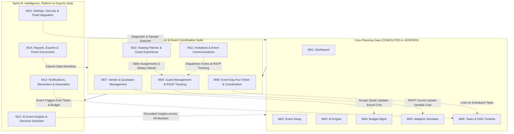

# Quveta — Master Implementation Plan (Modules 07–15)
## Full-Suite Phased Delivery & Complete Prompt Specifications

> [!IMPORTANT]
> **Authoritative Phase 2 Implementation Plan**: This document outlines the exhaustive architecture, technical blueprints, file-by-file implementation instructions, cross-module integration hooks, and test plans for the remaining 9 modules of Quveta (Modules 07 through 15).
> 
> As requested, **the complete verbatim prompt text for each module is attached directly within each module's section**, providing an exact and unambiguous reference for all functional requirements, trust rules, edge cases, and evaluation criteria.

---

## 1. Executive Strategy & Delivery Roadmap

The Quveta celebration planning platform has successfully completed and verified the **Core Planning Gate (Modules 01–06)** with 100% test coverage and zero build warnings. We now proceed to deliver the remaining nine modules organized into two coherent, tightly integrated delivery sprints:



### Phasing & Sprint Breakdown

1. **Sprint A: Guest & Event Coordination Suite (Modules 07–11)**
   - **Goal:** Empower event coordinators to manage suppliers, execute the event day schedule without friction, capture RSVPs, seat guests with zero dietary/accessibility conflicts, and dispatch branded invitations.
   - **Module 07:** Vendor & Quotation Management (Vendor directory, quote comparison, quote acceptance linked to budget line items).
   - **Module 08:** Event-Day Run Sheet & Coordination (Minute-by-minute cues, live status tracker, cascading delay engine, incident log).
   - **Module 09:** Guest Management & RSVP Tracking (Guest records, household groups, dietary/accessibility flags, CSV import/export, attendance analytics).
   - **Module 10:** Seating Planner & Guest Experience (Interactive floor plan, capacity constraints, dietary badge aggregation per table for catering).
   - **Module 11:** Invitations & Event Communications (Branded template engine, tokenized personalization `{{guest_name}}`, RSVP reminder campaign dispatcher).

2. **Sprint B: Intelligence, Platform & Exports Suite (Modules 12–15)**
   - **Goal:** Provide unified event intelligence, automated proactive alerting, production-grade PDF/CSV report exports, and system administration with zero-friction judge evaluation.
   - **Module 12:** AI Event Insights & Decision Assistant (Grounded Copilot answering natural-language queries against real database facts, 0–100% readiness radar score).
   - **Module 13:** Notifications, Reminders & Automation (In-app notification center, configurable triggers for overdue tasks, budget deficits, and RSVP deadlines).
   - **Module 14:** Reports, Exports & Event Documents (RFC-4180 CSV exports and print-optimized PDF documents for caterers, coordinators, and stakeholders).
   - **Module 15:** Settings, Security & Final Integration (Timezone/currency controls, live diagnostic runner, sample event switcher for 1-click evaluator testing, audit trail).

---

## 2. Relational Database Extensions & Domain Models

To preserve our strict **Deep Relational Coupling Invariant**, the database layer in `src/shared/db/schema.sql` and `src/shared/db/storage.ts` will be expanded with the following relational tables and typed collections:

```sql
-- Module 07: Vendors & Quotations
CREATE TABLE vendors (
  id UUID PRIMARY KEY DEFAULT gen_random_uuid(),
  event_id UUID NOT NULL REFERENCES events(id) ON DELETE CASCADE,
  name TEXT NOT NULL,
  category TEXT NOT NULL,
  contact_person TEXT,
  email TEXT,
  phone TEXT,
  website TEXT,
  address TEXT,
  status TEXT NOT NULL DEFAULT 'RESEARCHING',
  notes TEXT,
  created_at TIMESTAMPTZ NOT NULL DEFAULT now(),
  updated_at TIMESTAMPTZ NOT NULL DEFAULT now()
);

CREATE TABLE vendor_quotations (
  id UUID PRIMARY KEY DEFAULT gen_random_uuid(),
  vendor_id UUID NOT NULL REFERENCES vendors(id) ON DELETE CASCADE,
  event_id UUID NOT NULL REFERENCES events(id) ON DELETE CASCADE,
  quote_reference TEXT,
  amount_minor BIGINT NOT NULL,
  currency VARCHAR(3) NOT NULL DEFAULT 'INR',
  status TEXT NOT NULL DEFAULT 'RECEIVED',
  valid_until DATE,
  line_items JSONB NOT NULL DEFAULT '[]'::jsonb,
  inclusions JSONB NOT NULL DEFAULT '[]'::jsonb,
  exclusions JSONB NOT NULL DEFAULT '[]'::jsonb,
  payment_terms TEXT,
  deposit_required_minor BIGINT DEFAULT 0,
  linked_budget_line_item_id UUID REFERENCES budget_line_items(id) ON DELETE SET NULL,
  notes TEXT,
  created_at TIMESTAMPTZ NOT NULL DEFAULT now()
);

-- Module 08: Event-Day Run Sheet & Incidents
CREATE TABLE run_sheet_items (
  id UUID PRIMARY KEY DEFAULT gen_random_uuid(),
  event_id UUID NOT NULL REFERENCES events(id) ON DELETE CASCADE,
  title TEXT NOT NULL,
  scheduled_start_time TIME NOT NULL,
  scheduled_end_time TIME NOT NULL,
  actual_start_time TIME,
  actual_end_time TIME,
  category TEXT NOT NULL,
  location TEXT,
  responsible_person TEXT,
  vendor_id UUID REFERENCES vendors(id) ON DELETE SET NULL,
  linked_task_id UUID REFERENCES tasks(id) ON DELETE SET NULL,
  status TEXT NOT NULL DEFAULT 'SCHEDULED',
  notes TEXT,
  sequence_order INTEGER NOT NULL DEFAULT 0,
  created_at TIMESTAMPTZ NOT NULL DEFAULT now()
);

CREATE TABLE run_sheet_incidents (
  id UUID PRIMARY KEY DEFAULT gen_random_uuid(),
  event_id UUID NOT NULL REFERENCES events(id) ON DELETE CASCADE,
  run_sheet_item_id UUID REFERENCES run_sheet_items(id) ON DELETE SET NULL,
  severity TEXT NOT NULL DEFAULT 'MEDIUM',
  description TEXT NOT NULL,
  reported_time TIMESTAMPTZ NOT NULL DEFAULT now(),
  resolved_time TIMESTAMPTZ,
  resolution_notes TEXT,
  reported_by TEXT
);

-- Module 09: Guests & RSVP Tracking
CREATE TABLE household_groups (
  id UUID PRIMARY KEY DEFAULT gen_random_uuid(),
  event_id UUID NOT NULL REFERENCES events(id) ON DELETE CASCADE,
  name TEXT NOT NULL,
  max_guests INTEGER NOT NULL DEFAULT 1
);

CREATE TABLE guests (
  id UUID PRIMARY KEY DEFAULT gen_random_uuid(),
  event_id UUID NOT NULL REFERENCES events(id) ON DELETE CASCADE,
  household_group_id UUID REFERENCES household_groups(id) ON DELETE SET NULL,
  first_name TEXT NOT NULL,
  last_name TEXT NOT NULL,
  email TEXT,
  phone TEXT,
  invitation_status TEXT NOT NULL DEFAULT 'NOT_SENT',
  rsvp_status TEXT NOT NULL DEFAULT 'NO_RESPONSE',
  plus_one_allowed BOOLEAN NOT NULL DEFAULT false,
  plus_one_name TEXT,
  dietary_restrictions JSONB NOT NULL DEFAULT '[]'::jsonb,
  accessibility_needs JSONB NOT NULL DEFAULT '[]'::jsonb,
  notes TEXT,
  created_at TIMESTAMPTZ NOT NULL DEFAULT now()
);

-- Module 10: Seating Tables & Assignments
CREATE TABLE seating_tables (
  id UUID PRIMARY KEY DEFAULT gen_random_uuid(),
  event_id UUID NOT NULL REFERENCES events(id) ON DELETE CASCADE,
  name TEXT NOT NULL,
  shape TEXT NOT NULL DEFAULT 'ROUND',
  capacity INTEGER NOT NULL CHECK (capacity > 0),
  location_zone TEXT NOT NULL DEFAULT 'MAIN_FLOOR',
  accessibility_friendly BOOLEAN NOT NULL DEFAULT false,
  notes TEXT
);

CREATE TABLE seating_assignments (
  id UUID PRIMARY KEY DEFAULT gen_random_uuid(),
  table_id UUID NOT NULL REFERENCES seating_tables(id) ON DELETE CASCADE,
  guest_id UUID NOT NULL REFERENCES guests(id) ON DELETE CASCADE,
  seat_number INTEGER,
  assigned_at TIMESTAMPTZ NOT NULL DEFAULT now(),
  CONSTRAINT uq_guest_seating UNIQUE (guest_id)
);

-- Module 11: Invitations & Communications
CREATE TABLE invitation_designs (
  id UUID PRIMARY KEY DEFAULT gen_random_uuid(),
  event_id UUID NOT NULL REFERENCES events(id) ON DELETE CASCADE,
  title TEXT NOT NULL,
  template_id TEXT NOT NULL DEFAULT 'ELEGANT_WEDDING',
  headline TEXT NOT NULL,
  body_text TEXT NOT NULL,
  dress_code TEXT,
  venue_name TEXT NOT NULL,
  venue_address TEXT NOT NULL,
  date_time_display TEXT NOT NULL,
  rsvp_deadline DATE,
  primary_color TEXT DEFAULT '#5B21B6',
  accent_color TEXT DEFAULT '#E9D5FF',
  updated_at TIMESTAMPTZ NOT NULL DEFAULT now()
);

CREATE TABLE communication_logs (
  id UUID PRIMARY KEY DEFAULT gen_random_uuid(),
  event_id UUID NOT NULL REFERENCES events(id) ON DELETE CASCADE,
  guest_id UUID REFERENCES guests(id) ON DELETE SET NULL,
  channel TEXT NOT NULL DEFAULT 'EMAIL',
  message_type TEXT NOT NULL DEFAULT 'FORMAL_INVITE',
  status TEXT NOT NULL DEFAULT 'SENT',
  sent_at TIMESTAMPTZ NOT NULL DEFAULT now(),
  content_preview TEXT
);

-- Module 12: Event Insights & Readiness
CREATE TABLE event_insights (
  id UUID PRIMARY KEY DEFAULT gen_random_uuid(),
  event_id UUID NOT NULL REFERENCES events(id) ON DELETE CASCADE,
  category TEXT NOT NULL,
  severity TEXT NOT NULL DEFAULT 'INFO',
  title TEXT NOT NULL,
  description TEXT NOT NULL,
  evidence_data JSONB NOT NULL DEFAULT '{}'::jsonb,
  recommended_action TEXT,
  action_type TEXT,
  created_at TIMESTAMPTZ NOT NULL DEFAULT now()
);

-- Module 13: In-App Notifications & Reminders
CREATE TABLE notifications (
  id UUID PRIMARY KEY DEFAULT gen_random_uuid(),
  event_id UUID NOT NULL REFERENCES events(id) ON DELETE CASCADE,
  title TEXT NOT NULL,
  message TEXT NOT NULL,
  category TEXT NOT NULL DEFAULT 'SYSTEM',
  priority TEXT NOT NULL DEFAULT 'MEDIUM',
  read BOOLEAN NOT NULL DEFAULT false,
  action_url TEXT,
  created_at TIMESTAMPTZ NOT NULL DEFAULT now()
);

-- Module 15: Settings & Audit Logs
CREATE TABLE event_settings (
  event_id UUID PRIMARY KEY REFERENCES events(id) ON DELETE CASCADE,
  currency VARCHAR(3) NOT NULL DEFAULT 'INR',
  timezone TEXT NOT NULL DEFAULT 'Asia/Kolkata',
  default_catering_budget_per_guest BIGINT DEFAULT 150000,
  notifications_enabled BOOLEAN NOT NULL DEFAULT true,
  ai_features_enabled BOOLEAN NOT NULL DEFAULT true,
  privacy_mode BOOLEAN NOT NULL DEFAULT false,
  updated_at TIMESTAMPTZ NOT NULL DEFAULT now()
);

CREATE TABLE audit_logs (
  id UUID PRIMARY KEY DEFAULT gen_random_uuid(),
  event_id UUID NOT NULL REFERENCES events(id) ON DELETE CASCADE,
  action TEXT NOT NULL,
  entity_type TEXT NOT NULL,
  entity_id TEXT NOT NULL,
  actor TEXT NOT NULL DEFAULT 'Event Planner',
  details JSONB NOT NULL DEFAULT '{}'::jsonb,
  timestamp TIMESTAMPTZ NOT NULL DEFAULT now()
);
```


---

# SPRINT A: Guest & Event Coordination Suite

---

## 3. Module 07 — Vendor & Quotation Management

### 3.1. Detailed Technical Blueprint ("What Needs to Be Done")

1. **Domain Data Models & Schemas (`src/modules/vendors/domain/vendor.schema.ts`):**
   - `VendorSchema`: id, event_id, name, category (`VENUE`, `CATERING`, `PHOTOGRAPHY`, `MUSIC_ENTERTAINMENT`, `DECOR`, `TRANSPORT`, `ATTIRE`, `OTHER`), contact_person, email, phone, website, address, status (`RESEARCHING`, `CONTACTED`, `QUOTED`, `CONTRACT_PENDING`, `BOOKED`, `DECLINED`, `ARCHIVED`), notes, created_at, updated_at.
   - `QuotationSchema`: id, vendor_id, event_id, quote_reference, amount_minor (integer paise/cents), currency, status (`DRAFT`, `RECEIVED`, `UNDER_REVIEW`, `ACCEPTED`, `REJECTED`, `EXPIRED`), valid_until, line_items: `{ description, amount_minor, is_mandatory }[]`, inclusions: `string[]`, exclusions: `string[]`, payment_terms, deposit_required_minor, linked_budget_line_item_id, notes, created_at.
   - All monetary fields strictly use integer minor units and deterministic arithmetic from `@/shared/types/money`.

2. **Quotation Comparator Engine (`src/modules/vendors/domain/quote.comparator.ts`):**
   - Pure domain service that compares 2 or 3 quotations within the same service category.
   - Computes:
     - Price variance (delta between highest and lowest quote).
     - Per-guest cost comparison based on `event.guest_count`.
     - Deposit exposure (`deposit_required_minor` vs total).
     - Missing inclusion alerts (e.g. "Vendor A includes cleanup and lighting; Vendor B excludes both").

3. **Server Actions & Mutations (`src/modules/vendors/server/vendor.actions.ts`):**
   - `createVendorAction(eventId, data)`: Validates with Zod, inserts vendor, logs audit event, and revalidates path.
   - `updateVendorStatusAction(vendorId, status)`: Updates vendor lifecycle state.
   - `createQuotationAction(eventId, vendorId, data)`: Validates quotation line items and persists quotation.
   - `acceptQuotationAction(quotationId)`: **Signature Integration Action** —
     - Retrieves quotation and vendor.
     - Sets quotation status to `ACCEPTED` and vendor status to `BOOKED`.
     - Rejects competing quotations for the same category or prompts the user.
     - **Relational Coupling to Module 04:** Locates corresponding `budget_line_items` record (or creates one) and sets `actual_amount = quotation.amount_minor` and `status = 'COMMITTED'`.
     - Revalidates both `/events/[id]/vendors` and `/events/[id]/budget`.

4. **UI Workspace (`src/app/events/[id]/vendors/page.tsx`):**
   - Filterable vendor directory tabs by category (All, Venue, Catering, Photography, etc.).
   - Summary metric cards: Total Vendors Contacted, Booked Vendors, Total Quoted Amount, Committed Spend.
   - Interactive Quotation Comparison Modal displaying side-by-side specs, deposit requirements, and inclusion badges.
   - Direct "Accept & Commit to Budget" button with instant visual feedback and confirmation.

### 3.2. Step-by-Step Implementation Instructions ("How Can It Be Done")

1. Create `src/modules/vendors/domain/vendor.schema.ts` defining Zod schemas for vendors and quotations.
2. Create `src/modules/vendors/domain/quote.comparator.ts` with pure functions: `compareQuotations(quotes, guestCount)`.
3. Create `src/modules/vendors/server/vendor.actions.ts` implementing Server Actions with `storage` methods.
4. Update `src/shared/db/storage.ts` with `getVendors(eventId)`, `saveVendor(vendor)`, `getQuotations(eventId)`, `saveQuotation(quote)`, and link quotation acceptance to `budget_line_items`.
5. Seed realistic vendor and quotation records for `evt-wedding-001` (e.g. *Royal Palace Greens Venue*, *Gourmet Feast Caterers*, *Studio 9 Photography*) and `evt-hackathon-002` in `src/shared/db/seed-data.ts`.
6. Build `src/app/events/[id]/vendors/page.tsx` using Deep Purple & Lavender design system components (`Card`, `Badge`, `Button`, `Input`).
7. Write unit tests in `src/modules/vendors/__tests__/quote.comparator.test.ts` verifying deterministic comparison math and deposit calculations.

### 3.3. Acceptance & Verification Criteria
- [ ] Vendor records persist with category, contact details, and lifecycle states.
- [ ] Quotation line items and total amounts calculate deterministically in integer minor units without float errors.
- [ ] Accepting a quotation marks the vendor as `BOOKED` and immediately updates the corresponding Module 04 budget line item to `COMMITTED` with matching actual amount.
- [ ] Unverified vendor prices are never displayed as confirmed quotes.
- [ ] 100% test pass on comparison logic and build succeeds with zero type errors.

<details>
<summary><b>Authoritative Prompt Specification: Module 07 — Vendor & Quotation Management</b></summary>

```markdown
# Module 07 — Vendor & Quotation Management
## Quveta | Antigravity Implementation Prompt

### 1. Objective

Build a complete Vendor & Quotation Management module for Quveta, an AI-powered event-planning application.

The module helps users organize vendor information, collect and compare quotations, evaluate offers, track booking decisions, and connect vendor costs to the existing budget and event timeline.

**Core user story:**

“I need to find and compare suppliers, understand the true cost of each option, decide which offer suits my event, and keep track of what has and has not been confirmed.”

Examples include venues, caterers, decorators, photographers, entertainers, transport providers, rental companies, and other event services.

This must be a functioning, data-driven module—not a static vendor directory with invented businesses, prices, ratings, or availability.

**Critical trust rule:** Never represent an estimated price as a verified quotation, an inquiry as a booking, or an unconfirmed supplier as available.

### 2. Inspect the existing project first

Before implementing:

1. Inspect the existing repository, architecture, database schema, authentication, UI components, API patterns, and testing framework.
2. Reuse the established stack, design system, and existing services.
3. Integrate with Modules 01–06 instead of creating duplicate event, budget, or task systems.
4. Identify whether external vendor discovery, email, messaging, or booking integrations already exist.
5. Build only the integrations supported by the actual project and available credentials.
6. Keep the application runnable throughout implementation.

Do not replace working infrastructure or add unnecessary dependencies.

### 3. Define module ownership and integration boundaries

Maintain the following responsibilities:

- **Module 02 — Event Setup:** owns event requirements, date, location, guest count, currency, and preferences.
- **Module 03 — AI Planning Engine:** provides shared AI orchestration and structured recommendation generation.
- **Module 04 — Budget Management:** owns authoritative budget records, financial calculations, and financial status.
- **Module 05 — Adaptive Budget Simulator:** owns budget scenarios and approved budget adjustments.
- **Module 06 — Task & Timeline Management:** owns tasks, deadlines, dependencies, and scheduling.
- **Module 07 — Vendor & Quotation Management:** owns vendor records, contact details, quotation records, comparisons, inquiry tracking, and vendor booking-status records.
- **Module 01 — Dashboard:** presents relevant vendor and booking summaries from authoritative records.

A quotation may inform a budget line item, but the vendor module must not maintain a conflicting independent budget total.

### 4. Implement vendor records

Allow users to create, view, edit, archive, and search vendors associated with an event. Where the existing architecture supports reusable vendors across events, design the data model to support that without leaking information between users.

Each vendor record should support:

- Vendor ID.
- Event association or authorized reusable vendor association.
- Business or supplier name.
- Service category.
- Contact person's name, where available.
- Email and telephone, where provided.
- Website or public profile URL, where provided.
- Business address or service area, where relevant.
- Description of services.
- Services and packages offered.
- User-entered notes.
- Source of the vendor information.
- Verification status.
- Date last verified, where applicable.
- Created and updated timestamps.

Suggested service categories include venue, catering, decoration, photography, video, entertainment, transport, accommodation, attire, invitations, rentals, staffing, and other.

Allow custom categories where practical.

Do not require every field. Users must be able to record a vendor even when they have only a name and partial contact information.

Support these verification states:

- Unverified.
- User-confirmed.
- Source-verified, when a genuine verification process exists.
- Verification stale.
- Archived.

Clearly explain what each status means. A user confirming a phone number is not the same as Quveta independently verifying a business.

Do not imply that a vendor has been background-checked, vetted, licensed, or endorsed unless a real process establishes that fact.

### 5. Build a useful vendor directory

Create a searchable vendor interface with:

- Vendor name and service category.
- Verification status.
- Contact information when available.
- Linked quotations.
- Latest known quoted amount, when available.
- Booking status for the relevant event.
- Last contact or update date, where recorded.

Provide filters for category, verification status, quotation status, and booking status.

Allow sorting by vendor name, category, latest quotation date, or other supported fields.

Do not rank vendors by fabricated ratings or invented popularity metrics.

If the application has no vendor records, show a useful empty state with actions to add a vendor or discover vendors through a supported integration.

Vendor discovery must use actual search results or a real provider integration. If no discovery integration is configured, offer manual entry rather than displaying fake suppliers.

### 6. Implement quotation management

Users must be able to create, view, edit, compare, and archive quotations associated with a vendor and event.

Each quotation should support:

- Quotation ID.
- Vendor ID.
- Event ID.
- Quotation title or package name.
- Description of included services.
- Quoted amount and currency.
- Tax amount or tax treatment, when known.
- Additional fees.
- Discounts, when documented.
- Delivery, transport, setup, or service charges where applicable.
- Quantity or per-person pricing when supplied.
- Included and excluded services.
- Deposit requirement.
- Payment schedule.
- Valid-until date, if provided.
- Quotation received date.
- Source document or reference, if supported.
- Source and verification status.
- User notes.
- Quotation status.
- Created and updated timestamps.

Suggested quotation statuses:

- Draft.
- Requested.
- Received.
- Under review.
- Accepted.
- Rejected.
- Expired.
- Superseded.
- Cancelled.

Keep quotation status separate from vendor booking status. An accepted quotation does not automatically prove a booking has been confirmed.

Allow users to record quotations manually even if no document-upload feature exists.

If file upload already exists, support securely attaching quotation documents. Validate file types and sizes, enforce authorization, and avoid exposing private documents through public URLs.

### 7. Handle pricing and quotation totals reliably

Use the existing financial conventions from Module 04.

Do not duplicate monetary arithmetic across frontend components.

Where the necessary inputs are known, calculate the quotation total using explicit, documented rules for:

- Base price.
- Quantity.
- Tax.
- Additional charges.
- Discounts.
- Deposit.
- Remaining balance.

Clearly distinguish a deposit from the total cost. A deposit is usually part of the quoted total, not an additional expense on top of it.

Do not assume taxes are included or excluded without evidence. Record the tax treatment as known, unknown, included, or excluded where appropriate.

Support fixed-price, per-person, hourly, package-based, and other pricing models when the source provides that information.

Handle:
- Different currencies.
- Missing prices.
- Unknown taxes.
- Unspecified additional fees.
- Expired quotations.
- Partial quotations.
- Rounding and currency precision.
- Revised or superseded quotations.

Use integer minor units or an appropriate decimal-money representation.

Never compare different currencies as though they were equivalent. If no verified exchange-rate service is available, group quotations by currency and explain that direct comparison is unavailable.

When important charges are unknown, show that the total is incomplete rather than presenting a misleading final price.

### 8. Build a side-by-side quotation comparison

Create a comparison interface that lets users select two or more quotations for the same service category or requirement.

Compare relevant fields such as:

- Vendor and package name.
- Quoted price and currency.
- Known total cost.
- Pricing model.
- Services included.
- Services excluded.
- Tax treatment.
- Additional fees.
- Deposit requirement.
- Payment schedule.
- Quotation validity.
- Cancellation and refund terms, when documented.
- Availability confirmation status.
- Relevant user-defined preferences.
- Outstanding questions.

Show price differences only when the quotations are comparable. Explain any limitations, such as missing fees or differing service scope.

Do not automatically declare the cheapest quotation the best option. A lower price may exclude important services or require additional spending.

Where useful, highlight:
- Lowest known comparable price.
- Most complete quotation.
- Missing information that prevents a fair comparison.
- Potential additional costs.
- Best fit for user-defined priorities, when supported by evidence.

Use neutral, explainable labels rather than unsupported ratings or quality scores.

### 9. Integrate AI-assisted quotation analysis

Use Module 03’s existing AI orchestration service.

AI may help users:
- Summarize quotation documents or descriptions.
- Extract proposed line items from uploaded quotations, if secure file processing is available.
- Identify differences between supplier offers.
- Highlight missing terms.
- Generate follow-up questions.
- Explain trade-offs against the event’s requirements.
- Identify potential scope mismatches.
- Summarize documented cancellation and payment conditions.

AI must distinguish explicitly between:

1. Information directly present in the source.
2. Information calculated by application code.
3. AI-generated interpretation.
4. Missing information.
5. Information that requires confirmation from the vendor.

For extracted values, retain a source reference where possible, such as a document page or text excerpt, so users can verify the result.

Do not invent missing quotation terms, taxes, availability, discounts, or supplier policies.

If extraction confidence is insufficient, mark the field for user review. Never silently convert an uncertain interpretation into a confirmed financial record.

Require user confirmation before saving extracted information as an authoritative quotation.

### 10. Support vendor inquiries and follow-up tracking

Allow users to track vendor communication without pretending that messages have been sent externally.

Support records such as:

- Inquiry created.
- Inquiry date.
- Questions to ask.
- Requested service or package.
- Expected response date.
- Follow-up date.
- Last contact date.
- Response received.
- Inquiry notes.
- Next action.
- Contact status.

Suggested inquiry states include:

- Not contacted.
- Inquiry prepared.
- Contacted.
- Awaiting response.
- Response received.
- Follow-up needed.
- Closed.

If a genuine email or messaging integration is configured, use its established authorization and sending flow. Make the actual send action explicit and report success only when confirmed by the provider.

Without an integration, let users copy an inquiry message or open the vendor’s actual contact channel where available.

A prepared email is not a sent email. An inquiry is not a booking.

### 11. Implement booking and contract-status tracking

Allow users to track the relationship between a vendor and an event.

Suggested states:

- Considering.
- Inquiry sent.
- Quotation received.
- Negotiating.
- Awaiting confirmation.
- Booked.
- Contract signed, when explicitly recorded.
- Deposit paid, when explicitly recorded.
- Completed.
- Cancelled.

Adapt these statuses to the existing project’s domain model.

Track relevant dates, notes, and confirmation references where available.

Do not assume that:
- Accepting a quotation books the vendor.
- Recording a deposit proves a payment was processed.
- A contract is signed because a vendor is marked booked.
- Availability remains valid indefinitely.

Only record external confirmations when supported by user-entered evidence or a real integration.

Where contract or payment information is stored, protect it with the same authorization and privacy controls as other event records.

### 12. Connect quotations to the budget module

Integrate with Module 04’s existing budget services.

Provide a workflow to create or update a budget line item from a selected quotation.

Before applying a quotation:
- Show the source quotation.
- Show the amount and currency.
- Show the destination budget category.
- Identify any existing related budget item.
- Explain whether the action will create or update a record.
- Let the user confirm the change.

Preserve distinctions between:
- Early planning estimates.
- Supplier quotations.
- Accepted quotations.
- Committed expenses.
- Actual paid amounts.

Do not count the same expense twice when an estimate is replaced by a quotation or when a quotation is later accepted.

Use source identifiers or explicit relationships to trace budget items back to their originating quotation.

When a quotation is revised, do not silently overwrite a historical quotation or previously approved financial record. Preserve the revision history according to the existing persistence model.

Changes must flow through Module 04’s authoritative calculations and appear correctly in Module 01’s dashboard.

### 13. Connect vendor bookings to tasks and timelines

Integrate with Module 06 to help users act on vendor decisions.

Examples:
- An inquiry may create a follow-up task.
- An approaching quotation expiry may warrant a review task.
- A confirmed booking may satisfy an explicitly linked planning prerequisite.
- A required deposit may create a payment task if the user approves it.
- A missing venue confirmation may flag dependent tasks for review.

Only create tasks when the user approves the action or when an established workflow explicitly permits automatic creation.

Prevent duplicate tasks when the same event or quotation is processed repeatedly.

Do not mark a task complete merely because a vendor record changes status unless the task’s completion criteria are genuinely satisfied.

If a booking is cancelled or delayed, identify relevant linked tasks and propose updates for review rather than automatically changing the entire timeline.

### 14. Implement vendor discovery responsibly

If an existing vendor-search provider or approved external search integration is available, implement vendor discovery using that integration.

Display source information and retrieval time when supported. Distinguish search-result information from information independently verified by the user or provider.

Where supported, allow filtering by:
- Service category.
- Event location or service area.
- Budget range.
- Relevant event date.
- Service requirements.

Do not claim real-time availability unless the provider actually returns reliable availability information for the requested date and service.

Do not fabricate:
- Businesses.
- Phone numbers.
- Websites.
- Ratings.
- Reviews.
- Prices.
- Discounts.
- Availability.
- Licenses or certifications.

If no provider is configured, clearly state that live vendor discovery is unavailable and provide the manual vendor-management workflow. Do not simulate a live search with fictional results.

### 15. Backend, persistence, and API requirements

Follow existing application conventions and add only necessary schema changes.

Implement capabilities equivalent to:
- Create and retrieve authorized vendor records.
- Update and archive vendors.
- Create and update quotations.
- Retrieve quotation history.
- Compare selected quotations.
- Record inquiry and follow-up information.
- Update booking-status records.
- Link a quotation to a budget item.
- Create approved vendor-related tasks.
- Retrieve vendor and quotation summaries for a specific event.

Requirements:
- Typed request and response schemas.
- Server-side validation.
- Database migrations where needed.
- Authorization on every vendor, quotation, and event operation.
- Ownership validation for related record identifiers.
- Safe handling of concurrent updates.
- Idempotent operations where repeated requests could create duplicate records.
- Clear error handling.
- Bounded queries and pagination where appropriate.
- Secure handling of uploaded documents and contact details.
- No provider secrets exposed to the frontend.

Never trust client-supplied totals, authorization claims, or quotation verification statuses without server-side validation.

### 16. Security, privacy, and accessibility

Implement:
- Event-level access control.
- Protection against cross-event identifier manipulation.
- Safe file handling if uploads exist.
- Secure external-link handling.
- Server-side validation of URLs and other user-supplied data.
- Protection against prompt injection in vendor descriptions and quotation documents.
- AI output validation before persistence.
- Minimal logging of personal contact details and sensitive documents.
- Error messages that do not reveal secrets or stack traces.

Accessibility requirements:
- Semantic forms and labels.
- Keyboard-operable vendor and quotation tables.
- Clear status labels that do not depend on color alone.
- Accessible comparison layouts on mobile.
- Visible focus indicators.
- Screen-reader-friendly validation messages.
- Loading, empty, error, and retry states.
- Responsive layouts across mobile and desktop.

### 17. Testing requirements

Use the existing test framework.

**Unit tests**
- Quotation total calculations.
- Tax and fee handling.
- Deposit versus total cost.
- Currency-aware comparisons.
- Missing-price and incomplete-quotation handling.
- Expired quotation indicators.
- Vendor and booking status transitions.
- Duplicate expense prevention.
- Quotation-to-budget mapping.
- AI extraction validation.

**Integration tests**
- Vendor CRUD and authorization.
- Quotation creation, revision, and retrieval.
- Cross-event access prevention.
- Quotation comparison with missing information.
- Budget item creation or update from a quotation.
- Preservation of historical quotation data.
- Duplicate-prevention behavior.
- Vendor-related task creation.
- AI provider failure.
- Secure document access, if uploads exist.

**End-to-end tests**
1. Open an existing event.
2. Add two vendors in the same service category.
3. Record a quotation for each vendor.
4. Compare their prices, terms, and included services.
5. Verify incomplete or uncertain fields are clearly identified.
6. Select a quotation and preview the budget impact.
7. Confirm the budget update.
8. Verify Module 04 and Module 01 reflect the authoritative values.
9. Create a vendor follow-up task and verify it appears in Module 06.
10. Update a quotation without destroying its history.
11. Verify unauthorized users cannot access vendor or quotation data.
12. Verify the module remains usable when AI or vendor discovery is unavailable.

Report only tests that were actually executed and their real results.

### 18. Acceptance criteria

This module is complete when:

- Users can create and manage real vendor records.
- Users can record and revise quotations.
- Pricing and fees are handled with currency-aware calculations.
- Incomplete or unverified information is clearly labelled.
- Users can compare quotations without misleading price comparisons.
- AI analysis is grounded in actual source information and validated.
- Inquiry tracking does not falsely claim external messages were sent.
- Booking and contract statuses accurately represent recorded evidence.
- Selected quotations can be linked to budget records without double-counting.
- Relevant vendor actions can connect to tasks and timelines.
- Historical information is preserved appropriately.
- Authorization and privacy controls are implemented.
- The UI is accessible and responsive.
- Relevant automated tests pass.
- No fake vendors, quotations, ratings, or confirmed availability are displayed as real data.

### 19. Implementation workflow

Work in this order:

1. Inspect the current project and Modules 01–06.
2. Identify existing vendor, budget, task, and integration capabilities.
3. Define vendor, quotation, inquiry, and booking contracts.
4. Implement persistence, validation, and authorization.
5. Build vendor directory and vendor detail views.
6. Implement quotation entry and comparison.
7. Add AI-assisted quotation analysis through Module 03.
8. Integrate budget updates through Module 04.
9. Integrate approved follow-up tasks through Module 06.
10. Add vendor discovery only if a real provider is configured.
11. Implement tests and verify end-to-end workflows.
12. Run available linting, type checks, builds, and tests.
13. Fix regressions and provide an implementation report.

The final report must describe what was implemented, files and migrations changed, integrations completed, tests actually run, and any limitations.

**Product principle:** Quveta should help users make informed vendor decisions with clear evidence, honest pricing, and traceable commitments—not just collect supplier names in a list.
```

</details>


---

## 4. Module 08 — Event-Day Run Sheet & Coordination

### 4.1. Detailed Technical Blueprint ("What Needs to Be Done")

1. **Domain Data Models & Schemas (`src/modules/run-sheet/domain/run-sheet.schema.ts`):**
   - `RunSheetItemSchema`: id, event_id, title, scheduled_start_time (`HH:mm`), scheduled_end_time (`HH:mm`), actual_start_time, actual_end_time, category (`CEREMONY`, `RECEPTION`, `CATERING`, `LOGISTICS`, `ENTERTAINMENT`, `SPEECH`, `PHOTO`), location, responsible_person, vendor_id, linked_task_id, status (`SCHEDULED`, `IN_PROGRESS`, `COMPLETED`, `DELAYED`, `SKIPPED`), notes, sequence_order.
   - `IncidentLogSchema`: id, event_id, run_sheet_item_id, severity (`LOW`, `MEDIUM`, `HIGH`, `CRITICAL`), description, reported_time, resolved_time, resolution_notes, reported_by.

2. **Schedule Delay & Recovery Engine (`src/modules/run-sheet/domain/delay.engine.ts`):**
   - Pure engine that calculates schedule deviation:
     - Calculates `delayMinutes = actual_start_time - scheduled_start_time`.
     - Simulates cascading ripple effects on subsequent items in the timeline.
     - Generates non-destructive Schedule Recovery Recommendations:
       - Compressing scheduled buffer times.
       - Trimming flexible activities (e.g. open photo session, networking cocktail).
       - Preserving hard milestone anchors (e.g. venue curfew, auspicious ceremony time).

3. **Server Actions & Mutations (`src/modules/run-sheet/server/run-sheet.actions.ts`):**
   - `createRunSheetItemAction(eventId, data)`: Validates time sequence and inserts item.
   - `updateRunSheetStatusAction(itemId, status, actualTime)`: Updates live execution state; if status is `DELAYED`, calculates schedule impact.
   - `logIncidentAction(eventId, incidentData)`: Records incident, links to item, and triggers high-priority notification if critical.
   - `applyScheduleRecoveryAction(eventId, adjustments)`: Batch-updates revised start/end times based on user-approved recovery plan.

4. **UI Workspace (`src/app/events/[id]/run-sheet/page.tsx`):**
   - Operational Event-Day Command Console.
   - "Active Now" prominent card with live progress bar and "Mark Complete" / "Report Delay" quick buttons.
   - Chronological cue sheet table with time, cue, location, responsible coordinator, linked vendor contact button, and status badge.
   - Incident Drawer / Quick Modal to capture issues and log resolutions.
   - Print-friendly button for offline paper cue sheets.

### 4.2. Step-by-Step Implementation Instructions ("How Can It Be Done")

1. Create `src/modules/run-sheet/domain/run-sheet.schema.ts` with Zod validation.
2. Create `src/modules/run-sheet/domain/delay.engine.ts` with `calculateScheduleDeviation` and `suggestScheduleRecovery`.
3. Create `src/modules/run-sheet/server/run-sheet.actions.ts` with Server Actions connecting to `storage.ts`.
4. Update `src/shared/db/storage.ts` with run sheet CRUD and incident log methods.
5. Seed realistic run sheet cues for `evt-wedding-001` (Baraat arrival, Varmala, Pheras, Dinner, Bidaai) and `evt-hackathon-002` (Check-in, Opening Keynote, Hacking Kickoff, Mentor Office Hours, Pitch Demos).
6. Build `src/app/events/[id]/run-sheet/page.tsx` with clean responsive layout, live status toggles, and incident reporting.
7. Write unit tests in `src/modules/run-sheet/__tests__/delay.engine.test.ts` verifying delay cascade math and recovery proposal logic.

### 4.3. Acceptance & Verification Criteria
- [ ] Activities display in chronological order with start/end time validation.
- [ ] Toggling status to `IN_PROGRESS` or `COMPLETED` stamps actual timestamps.
- [ ] Introducing a delay correctly calculates downstream impact and suggests recovery options without altering historical data.
- [ ] Incidents can be logged and linked to specific items or vendors.
- [ ] Clean printable layout formatted for on-ground stage managers.

<details>
<summary><b>Authoritative Prompt Specification: Module 08 — Event-Day Run Sheet & Coordination</b></summary>

```markdown
# Module 08 — Event-Day Run Sheet & Coordination
## Quveta | Antigravity Implementation Prompt

### 1. Objective

Build a fully functional Event-Day Run Sheet & Coordination module for Quveta, an AI-powered event-planning application.

The module turns the approved event plan into a chronological, operational schedule that organizers can use before and during an event.

It should answer five questions quickly:

1. What is happening now?
2. What happens next?
3. Who is responsible?
4. What is delayed, blocked, or at risk?
5. What should we do when something changes?

**Core user story:**

“On the day of my event, I need one reliable place to see the schedule, coordinate people, track progress, and respond to unexpected changes without losing control of the plan.”

Example: A wedding ceremony is scheduled for 5:00 PM. The photographer is delayed, decoration setup is running late, and guests are arriving early. Quveta should show the affected schedule items, highlight potential conflicts, suggest recovery options, and let the organizer decide which changes to apply.

Do not assume the photographer’s delay automatically requires moving the ceremony. Show the consequences and let the user choose.

This must be a working, persisted feature integrated with the existing modules—not a static itinerary or an AI-generated schedule that cannot be edited.

### 2. Inspect the existing project

Before implementing:

1. Inspect the repository, architecture, database schema, authentication, UI system, and test framework.
2. Review Modules 01–07 and identify reusable event, task, vendor, budget, and AI services.
3. Reuse existing components, models, validation, and API conventions.
4. Preserve existing event plans, completed tasks, vendor records, and approved budget decisions.
5. Implement incrementally and keep the application runnable.

Do not introduce a second task management system or duplicate existing business logic.

### 3. Establish module boundaries

Respect these ownership rules:

- Module 02 — Event Setup owns event details, date, timezone, location, and preferences.
- Module 03 — AI Planning Engine owns shared AI orchestration and structured AI recommendations.
- Module 04 — Budget Management owns authoritative financial records and calculations.
- Module 05 — Adaptive Budget Simulator owns budget scenarios and approved budget adjustments.
- Module 06 — Task & Timeline Management owns tasks, dependencies, deadlines, and scheduling.
- Module 07 — Vendor & Quotation Management owns vendor records, quotations, and recorded booking statuses.
- Module 08 — Event-Day Coordination owns the operational run sheet, event-day coordination state, live progress tracking, incident records, and proposed event-day adjustments.
- Module 01 — Dashboard presents relevant event and operational summaries.

Reuse Module 06’s task and dependency engine. A run-sheet item may reference an existing task, but must not create duplicate tasks unnecessarily.

### 4. Build the operational run sheet

Create an event-specific run sheet using persisted event data.

Each run-sheet item should support:

- Unique item ID.
- Event ID.
- Title.
- Description or instructions.
- Scheduled start time.
- Scheduled end time or duration.
- Event timezone.
- Item category.
- Priority.
- Status.
- Responsible person or team, where supported.
- Related task ID, where applicable.
- Related vendor ID, where applicable.
- Dependencies.
- Location or venue area.
- Preparation notes.
- Completion criteria.
- Actual start time, where recorded.
- Actual completion time, where recorded.
- Delay or deviation notes.
- Source, such as user-created, approved plan, or imported task.
- Created and updated timestamps.

Suggested categories:

- Setup and preparation.
- Vendor arrival.
- Decoration and staging.
- Technical checks.
- Guest arrival.
- Ceremony.
- Food and beverage service.
- Speeches and presentations.
- Entertainment.
- Photography.
- Transitions.
- Cleanup and closing.
- Other.

Allow users to customize categories when appropriate.

Support run-sheet items created manually or generated from approved tasks and event plans.

When importing tasks, preserve the original task identity and status. Do not duplicate the same work simply because it appears in both the task list and run sheet.

### 5. Create the run-sheet interface

Build a clean, operational interface optimized for quick scanning.

**A. Chronological schedule**

Display:
- Time.
- Activity.
- Duration.
- Responsible person or team.
- Location.
- Status.
- Dependencies or warnings.
- Related vendor or task, where applicable.

Sort items chronologically using the event timezone.

Clearly distinguish completed, in-progress, upcoming, delayed, blocked, and cancelled items.

Do not invent a start time for an item that has no scheduled time.

**B. Event-day overview**

Display:
- Event name, date, and location.
- Current event status.
- Total run-sheet items.
- Completed and outstanding items.
- Delayed or blocked items.
- Next scheduled activity.
- Important upcoming milestones.

Use real persisted data and consistent calculations.

**C. Timeline view**

Show the schedule across the event day, including durations and overlapping activities.

Make conflicts visible, particularly when:
- A person is assigned to overlapping activities.
- A prerequisite is incomplete.
- A setup activity runs into the next scheduled activity.
- A task duration exceeds the available time.
- A critical milestone is at risk.

Do not flag legitimate parallel activities as conflicts unless the relevant resource or dependency is actually constrained.

**D. Now and Next view**

Provide a simplified operational view showing:
- The current or most relevant activity.
- The next scheduled activity.
- Outstanding actions.
- Active incidents.
- Critical alerts.

The current activity must be derived from the current time in the event timezone and the stored schedule. If the current time is outside the event schedule, show the nearest upcoming or most recently relevant activity rather than falsely claiming an event is in progress.

### 6. Implement run-sheet editing and progress tracking

Users must be able to:

- Add run-sheet items.
- Edit titles, instructions, times, durations, locations, and assignments.
- Reorder activities.
- Mark an item as in progress.
- Mark an item completed.
- Mark an item delayed or blocked.
- Cancel an item.
- Record actual start and completion times.
- Add operational notes.
- Restore or reopen an item when authorized and appropriate.

Persist all meaningful changes.

When changing an item’s time, recalculate relevant conflicts and dependent activities.

Do not silently move other activities to accommodate a change.

If a proposed change creates a scheduling conflict, explain the conflict and offer alternatives.

Preserve an auditable distinction between the original scheduled time and actual execution time where operationally useful.

Use explicit user actions for important status transitions. Do not mark activities completed simply because their scheduled end time has passed.

### 7. Support responsible people and team coordination

If the project already supports users, teams, or event collaborators, integrate with that authorization model.

Allow users to assign run-sheet items to authorized people or teams and display their responsibilities clearly.

Where supported, provide:
- Assigned activities.
- Contact details that the current user is authorized to see.
- Assignment status.
- Responsibility changes.
- Notes relevant to the assigned activity.

Do not expose personal information to unauthorized users.

If team collaboration infrastructure does not exist, implement a lightweight assignment model only if it fits the existing architecture. Do not create a separate authentication system for this module.

Do not imply that a person has received a notification unless an actual notification integration confirms delivery.

### 8. Implement live progress tracking

Provide a practical way for organizers to record what is happening during the event.

Support:
- Activity started.
- Activity completed.
- Activity delayed.
- Activity blocked.
- Activity cancelled.
- Unexpected issue reported.
- Schedule adjustment proposed.
- Schedule adjustment approved.

Capture the actor and timestamp when supported by the existing authentication system.

When a user records a delay, allow them to enter:
- Reason for delay.
- Estimated revised start time, if known.
- Expected duration, if known.
- Related vendor, task, or activity.
- Immediate operational concern.

Keep unknown values explicitly unknown.

Do not assume that a delay duration is exact merely because a user enters an estimate.

### 9. Build an incident and issue log

Create an event-day incident log for operational problems.

Examples:
- A vendor has not arrived.
- Decoration setup is incomplete.
- Audio equipment has failed.
- A scheduled speaker is unavailable.
- Weather conditions require an outdoor-to-indoor transition.
- Catering service is delayed.
- A guest accessibility requirement needs attention.

Each incident should support:

- Incident ID.
- Event ID.
- Title and description.
- Category.
- Severity.
- Status.
- Reported timestamp.
- Reporter, where supported.
- Related run-sheet items.
- Related tasks or vendors.
- Assigned responder, where supported.
- Proposed resolution.
- Resolution notes.
- Resolved timestamp, where applicable.

Suggested severity levels:
- Low.
- Moderate.
- High.
- Critical.

Suggested statuses:
- Open.
- Investigating.
- Action required.
- Resolved.
- Closed.

Provide filters and sorting so organizers can focus on unresolved and high-severity issues.

Do not label an issue as resolved merely because a suggested resolution exists. Resolution must be explicitly recorded.

For critical issues, make the interface emphasize immediate attention while avoiding unsupported claims about emergency services or external response.

### 10. Implement schedule-impact analysis

This is one of the module’s most important capabilities.

When a user reports a delay or changes an activity’s time, analyze the impact using Module 06’s task and dependency logic plus the run sheet’s own scheduling data.

The analysis should identify:

- Directly affected activities.
- Downstream activities that may be affected.
- Overlapping or resource conflicts.
- Tasks whose prerequisites are no longer satisfied.
- Important milestones at risk.
- Activities with insufficient time to complete.
- Possible recovery options.
- Unresolved assumptions.

For example, if a decoration setup finishes later than expected, the application might identify a scheduled photography session that depends on the completed setup.

It should not automatically move the photography session or shorten the ceremony. Instead, it should present feasible options for review.

Distinguish between:
- Confirmed dependency.
- Resource conflict supported by assignment data.
- Potential timing conflict.
- AI-suggested relationship requiring confirmation.

If insufficient information exists, ask a question or explain the uncertainty.

### 11. Generate recovery options without taking control away from users

Use deterministic scheduling logic for time arithmetic, dependency validation, overlap detection, and hard constraints.

Use Module 03’s AI service to explain consequences and propose operational alternatives.

Potential options include:
- Delay a flexible activity.
- Reorder activities where dependencies permit.
- Shorten an activity when the organizer confirms it is flexible.
- Reassign an activity to an available, authorized person.
- Move a nonessential activity to a later slot.
- Notify the organizer that the schedule cannot be reconciled without a decision.

Every option must include:
- Proposed change.
- Affected activities.
- Original and proposed times.
- Reason for the change.
- Relevant dependencies.
- Trade-offs or risks.
- Assumptions.
- Whether additional confirmation is needed.

Do not shorten ceremonies, meals, accessibility arrangements, or other important activities without explicit user approval.

Do not assume an individual or vendor is available for reassignment without evidence.

If no feasible recovery option exists, state that clearly instead of fabricating a workable schedule.

### 12. Add a controlled schedule-change workflow

Schedule changes must follow a review-and-approval process.

1. Record the reported issue or proposed change.
2. Calculate the current schedule state.
3. Generate potential adjustments.
4. Validate each option against dependencies and constraints.
5. Show the proposed changes and their consequences.
6. Allow the user to select, reject, or edit an option.
7. Recalculate the complete affected schedule.
8. Show any remaining conflicts.
9. Request confirmation before applying the changes.
10. Persist the approved changes atomically.

Preserve the original schedule where historical comparison is useful.

If the underlying schedule changes while a proposal is awaiting approval, mark the proposal stale and require recalculation or explicit resolution.

Never silently apply AI-generated changes.

### 13. Use AI responsibly

Use Module 03’s shared AI orchestration service.

AI may:
- Summarize the operational status.
- Explain schedule conflicts.
- Suggest recovery alternatives.
- Draft instructions for event staff.
- Suggest questions to ask a delayed vendor.
- Identify potential omissions based on the event context.
- Summarize active incidents and outstanding decisions.

Application code must:
- Perform time calculations.
- Validate dependencies.
- Detect scheduling conflicts.
- Enforce authorization.
- Validate assignments.
- Validate structured AI output.
- Determine what changes are approved.
- Persist approved changes.

Use schema-validated structured output, such as the existing project’s Zod schemas.

Treat event notes, vendor messages, and user-entered incident descriptions as untrusted input.

Do not fabricate real-time vendor locations, arrival times, responses, availability, or external confirmations.

If the AI provider is unavailable, core run-sheet operations, progress tracking, and incident logging must continue to function.

### 14. Build an event-day communication support workflow

Where useful, let users prepare operational messages related to schedule changes.

Examples:
- Inform the catering coordinator that guest service may begin later.
- Ask the photographer to confirm their revised arrival estimate.
- Share an updated setup time with authorized event staff.

Messages should include only information the user chooses to share.

If an actual messaging integration exists, follow its authentication, consent, and delivery-confirmation process.

Otherwise, allow the user to preview and copy the message or open a supported contact channel.

Clearly distinguish:
- Drafted.
- Ready to copy.
- Sent through a real integration.
- Delivery confirmed, only if the provider supports that confirmation.

Never claim that an external message was sent or received when the app only generated text.

### 15. Add an operational history

Maintain a useful history of significant schedule and incident changes.

Record relevant information such as:
- Original schedule values.
- Approved revised values.
- Status transitions.
- Delay reports.
- Incident creation and resolution.
- Who made a change, where supported.
- Timestamps.
- The reason for a change.
- Related approved proposal IDs.

Use the existing project’s history or audit mechanism if available.

Do not create unnecessary duplicate audit systems.

Keep a clear distinction between an original planned time, a revised approved time, and the actual time an activity started or finished.

Historical records must not be silently overwritten by routine edits.

### 16. Integrate with existing modules

**Module 01 — Dashboard**
- Reflect event-day progress, unresolved incidents, and relevant upcoming activities where appropriate.
- Use authoritative stored records.

**Module 02 — Event Setup**
- Use the event date, timezone, location, and event preferences.
- Re-evaluate the schedule when event details change.

**Module 03 — AI Planning Engine**
- Use the shared AI orchestration and structured output validation.

**Module 04 — Budget Management**
- Reference relevant budget information when it affects an operational decision.
- Do not independently change financial records.

**Module 05 — Adaptive Budget Simulator**
- Reflect approved plan changes when they require event-day schedule review.
- Do not treat a draft budget scenario as an approved operational change.

**Module 06 — Task & Timeline Management**
- Reuse task records and dependency logic.
- Keep task completion and run-sheet execution status consistent where the two represent the same activity.
- Avoid duplicate tasks and conflicting status sources.

**Module 07 — Vendor & Quotation Management**
- Reference actual vendor records and recorded booking statuses.
- Surface relevant confirmed information and outstanding confirmations.
- Do not imply that a booking is confirmed merely because a vendor appears in the run sheet.

### 17. Backend and persistence requirements

Follow the existing API conventions and implement only the necessary new entities and endpoints.

Support capabilities equivalent to:
- Retrieve an event run sheet.
- Create, edit, reorder, and cancel run-sheet items.
- Record activity progress.
- Create and update incidents.
- Retrieve unresolved incidents.
- Generate schedule-impact analyses.
- Create and review recovery proposals.
- Apply approved schedule changes.
- Retrieve operational history.

Requirements:
- Typed request and response schemas.
- Server-side validation.
- Database migrations where required.
- Authorization on every event and run-sheet operation.
- Validation of task, vendor, and activity references.
- Atomic updates when multiple activities change together.
- Safe concurrent-update handling.
- Idempotency for repeated actions where necessary.
- Clear error responses.
- Bounded queries for larger events.

Never trust client-calculated schedule status or AI-provided identifiers as authoritative.

### 18. Security, accessibility, and reliability

Implement:
- Event-level access control.
- Protection against cross-event record manipulation.
- Safe handling of user-entered instructions and vendor messages.
- Server-side validation of AI-generated proposals.
- Secure storage of operational notes and contact information.
- Clear error handling without exposing secrets or stack traces.

Accessibility requirements:
- Semantic headings and form labels.
- Keyboard-operable schedule and incident controls.
- Visible focus indicators.
- Status indicators that do not rely on color alone.
- Accessible alternatives to drag-and-drop reordering.
- Screen-reader-friendly timeline and alert summaries.
- Responsive layouts for phones, tablets, and desktops.
- Clear loading, empty, stale-proposal, and error states.

Optimize the primary event-day interface for quick scanning and minimal interaction overhead.

### 19. Testing requirements

Use the project's existing test framework.

**Unit tests**
- Timezone-aware schedule calculations.
- Activity duration calculations.
- Overlap detection.
- Dependency validation.
- Delay-impact analysis.
- Critical and high-priority warning rules.
- Status transitions.
- Schedule proposal validation.
- Stale proposal detection.
- Preservation of original and actual times.

**Integration tests**
- Run-sheet CRUD operations.
- Authorization and cross-event access prevention.
- Incident creation and resolution.
- Atomic multi-activity updates.
- Schedule proposal generation and approval.
- Concurrency conflicts.
- AI provider failure.
- Task/run-sheet synchronization.
- Operational history preservation.

**End-to-end tests**
1. Open an existing event with scheduled tasks.
2. Generate or create a run sheet from approved event data.
3. Mark an activity in progress and then complete it.
4. Report a delay affecting a dependent activity.
5. Review the impact analysis.
6. Compare recovery options.
7. Approve a proposed schedule change.
8. Verify the updated run sheet and preserved history.
9. Create and resolve an incident.
10. Confirm unauthorized users cannot access operational records.
11. Verify core functionality remains usable when the AI provider is unavailable.
12. Test the operational interface on mobile and with keyboard navigation.

Run the relevant checks and report actual results. Do not claim tests pass unless they have been executed.

### 20. Acceptance criteria

The module is complete when:

- Users can create and manage a persisted event-day run sheet.
- Activities display in the correct event timezone.
- Progress and incident states update reliably.
- Existing tasks can be referenced without unnecessary duplication.
- Delays trigger a useful schedule-impact analysis.
- Recovery options are validated and reviewable.
- AI-generated changes require explicit user approval.
- Conflicting or infeasible schedules are clearly identified.
- Original, revised, and actual activity times are distinguishable.
- Vendor and task references reflect real application data.
- Operational history is preserved.
- Dashboard integration works correctly.
- Authorization, error handling, and accessibility are implemented.
- Automated tests cover the critical workflows.
- No external action is falsely represented as completed.

### 21. Implementation workflow

Proceed in this order:

1. Inspect the project and Modules 01–07.
2. Identify existing task, timeline, vendor, and event models.
3. Define run-sheet, incident, and schedule-proposal contracts.
4. Implement persistence and authorization.
5. Build the chronological run sheet and Now & Next views.
6. Implement progress tracking and incident management.
7. Add deterministic schedule-impact analysis.
8. Integrate AI-assisted recovery suggestions through Module 03.
9. Implement review, approval, and schedule history.
10. Integrate with the dashboard and existing task records.
11. Add automated tests.
12. Run linting, type checks, builds, and relevant tests.
13. Fix regressions and verify the complete workflow.

Provide a final implementation report containing:
- Features implemented.
- Files and migrations changed.
- Integration with Modules 01–07.
- Scheduling and incident-handling behavior.
- Tests executed and actual results.
- Remaining limitations or unfinished work.

**Final product principle:** On event day, Quveta should be a calm, trustworthy coordination assistant—not another source of confusion. It should make the next action clear, explain the impact of unexpected changes, and help the organizer stay in control.
```

</details>


---

## 5. Module 09 — Guest Management & RSVP Tracking

### 5.1. Detailed Technical Blueprint ("What Needs to Be Done")

1. **Domain Data Models & Schemas (`src/modules/guests/domain/guest.schema.ts`):**
   - `GuestSchema`: id, event_id, household_group_id, first_name, last_name, email, phone, invitation_status (`NOT_SENT`, `SENT`, `DELIVERED`, `BOUNCED`), rsvp_status (`ATTENDING`, `DECLINED`, `TENTATIVE`, `NO_RESPONSE`), plus_one_allowed (boolean), plus_one_name, dietary_restrictions: `string[]` (`VEG`, `VEGAN`, `JAIN`, `GLUTEN_FREE`, `NUT_ALLERGY`, `HALAL`, `NONE`), accessibility_needs: `string[]` (`WHEELCHAIR`, `GROUND_FLOOR`, `ASSISTIVE_LISTENING`, `NONE`), notes, created_at.
   - `HouseholdGroupSchema`: id, event_id, name, max_guests.

2. **Deterministic Attendance & Diet Engine (`src/modules/guests/domain/guest.stats.ts`):**
   - Pure service computing authoritative guest metrics:
     - `totalInvited`: count of individual guests + confirmed plus ones.
     - `attendingCount`: count of guests with `rsvp_status === 'ATTENDING'` + their attending plus-ones.
     - `declinedCount`: count of guests with `rsvp_status === 'DECLINED'`.
     - `pendingCount`: count of guests with `rsvp_status === 'NO_RESPONSE' || 'TENTATIVE'`.
     - `dietarySummary`: aggregated key-value map (e.g. Vegetarian: 85, Jain: 14, Vegan: 8, Nut Allergy: 2).
     - `accessibilitySummary`: aggregated count of guests needing wheelchair or step-free access.

3. **CSV Import & Parser (`src/modules/guests/domain/csv.parser.ts`):**
   - Pure RFC-4180 CSV parser and validator:
     - Validates mandatory fields: `first_name`, `last_name`.
     - Sanitizes email and phone numbers.
     - Parses comma-delimited dietary restrictions into normalized enum arrays.
     - Flags duplicate email addresses or names before committing.

4. **Server Actions & Mutations (`src/modules/guests/server/guest.actions.ts`):**
   - `createGuestAction(eventId, guestData)`: Adds guest with default `NO_RESPONSE` state.
   - `updateGuestRsvpAction(guestId, rsvpStatus, dietary, plusOneName)`: Updates RSVP; triggers check against `event.guest_count`.
   - `importGuestsFromCsvAction(eventId, csvString)`: Validates and batch-inserts parsed guests.
   - `deleteGuestAction(guestId)`: Removes guest and cascades removal from seating assignments (Module 10).

5. **UI Workspace (`src/app/events/[id]/guests/page.tsx`):**
   - KPI metric banner: Total Invited, Attending, Declined, Pending Response, Dietary Requirements.
   - Filter bar: Search by name/email, filter by RSVP status, filter by dietary tag.
   - Guest Table with inline RSVP toggle and dietary badges.
   - "Import CSV" modal with sample template download and row preview.
   - Variable Cost Warning Banner: If confirmed attendees exceed `event.guest_count`, displays an alert linking to Module 05 (Adaptive Budget Simulator).

### 5.2. Step-by-Step Implementation Instructions ("How Can It Be Done")

1. Create `src/modules/guests/domain/guest.schema.ts` defining strict Zod schemas and dietary/accessibility enums.
2. Create `src/modules/guests/domain/guest.stats.ts` with pure calculation functions.
3. Create `src/modules/guests/domain/csv.parser.ts` for safe CSV parsing without external bloated dependencies.
4. Create `src/modules/guests/server/guest.actions.ts` implementing CRUD, RSVP updates, and CSV batch import.
5. Update `src/shared/db/storage.ts` to store guests and household groups in JSON store and handle cascading seating cleanup.
6. Seed realistic guests for `evt-wedding-001` (30+ guests with diverse dietary needs: Jain, Veg, Gluten-Free, Wheelchair) and `evt-hackathon-002` (hackers with Halal, Vegan, Non-Veg).
7. Build `src/app/events/[id]/guests/page.tsx` with intuitive sorting, badges, modal forms, and CSV import.
8. Write unit tests in `src/modules/guests/__tests__/guest.stats.test.ts` verifying deterministic counts and dietary aggregation.

### 5.3. Acceptance & Verification Criteria
- [ ] Guest records persist with household groups, dietary flags, and contact details.
- [ ] Attendance counts calculate deterministically: attending, declined, and pending never drift.
- [ ] CSV import validates data integrity and rejects malformed rows with clear line-number errors.
- [ ] Deleting a guest cleans up any existing seating assignment in Module 10.
- [ ] Attendance delta surfaces a recommendation to re-simulate catering in Module 05.

<details>
<summary><b>Authoritative Prompt Specification: Module 09 — Guest Management & RSVP Tracking</b></summary>

```markdown
# Module 09 — Guest Management & RSVP Tracking
## Quveta | Antigravity Implementation Prompt

### 1. Objective

Build a complete, functional Guest Management & RSVP Tracking module for Quveta, an AI-powered event-planning application.

The module helps event organizers maintain an accurate guest list, manage invitations and responses, record relevant guest requirements, track attendance, and understand how guest-count changes affect catering, seating, transport, and the event budget.

**Core user story:**

“I need to know who is invited, who is attending, how many people to plan for, what guests need, and what changes when someone responds or updates their RSVP.”

Example: An organizer plans an event for 200 guests. Several invitees decline, a family confirms additional attendees, and a guest reports an accessibility requirement. Quveta should update the relevant RSVP records, calculate the revised attendance count, identify affected planning assumptions, and help the organizer review any resulting changes.

Guest responses must be based on recorded information—not AI guesses.

This module must use persisted records and real application logic. Do not build a static guest table, simulated invitation delivery, or fabricated RSVP responses.

### 2. Inspect the existing project first

Before implementation:

1. Inspect the repository, architecture, database schema, authentication, UI components, API conventions, and test framework.
2. Review Modules 01–08 and identify reusable event, budget, task, vendor, and coordination services.
3. Reuse the existing design system, data models, validation, and authorization patterns.
4. Preserve existing event plans, budget records, task history, and approved changes.
5. Implement incrementally while keeping the application runnable.

Do not replace working infrastructure or introduce duplicate systems for event management, scheduling, or AI orchestration.

### 3. Define module ownership

Maintain clear module boundaries:

- **Module 02 — Event Setup:** owns event details, event date, guest-count planning assumptions, currency, location, and preferences.
- **Module 03 — AI Planning Engine:** provides shared AI orchestration and structured recommendations.
- **Module 04 — Budget Management:** owns authoritative budget records and financial calculations.
- **Module 05 — Adaptive Budget Simulator:** owns budget scenarios and approved budget changes.
- **Module 06 — Task & Timeline Management:** owns tasks, deadlines, dependencies, and schedule calculations.
- **Module 07 — Vendor & Quotation Management:** owns vendors, quotations, and recorded booking information.
- **Module 08 — Event-Day Coordination:** owns the run sheet, operational progress, and incident tracking.
- **Module 09 — Guest Management & RSVP Tracking:** owns guest records, invitation records, RSVP responses, guest-group relationships, and attendance calculations.
- **Module 01 — Dashboard:** displays relevant guest counts and planning summaries.

Guest Management must calculate actual attendance from guest and RSVP records. Module 02's guest count remains the event's planning target unless the existing application explicitly establishes a different ownership model.

Clearly distinguish the **planned guest count** from **invited guests**, **confirmed attendees**, **declined invitations**, and **unknown responses**.

### 4. Implement guest records

Allow authorized users to create, view, edit, search, archive, and restore guest records associated with an event.

Each guest record should support fields equivalent to:

- Guest ID.
- Event ID.
- First name.
- Last name, when available.
- Preferred display name.
- Email address, when provided.
- Phone number, when provided.
- Guest group or household association.
- Invitation status.
- RSVP status.
- Number of attendees represented by the record.
- Relationship or guest category, when useful.
- Meal preference.
- Dietary requirements.
- Accessibility requirements.
- Other organizer-defined requirements.
- Private organizer notes.
- Record source, such as manual entry or imported file.
- Created and updated timestamps.
- Archived status.

Allow incomplete contact details. A guest must not need an email address or phone number merely to be added to the guest list.

Support individual guests and household or group invitations. Model relationships explicitly rather than storing multiple unrelated people in a single name field.

Where one invitation covers several people, provide a clear way to track the primary invitee, associated guests, and attendance response for each person when the data is available.

Do not assume that a household invitation means every household member will attend.

### 5. Build the guest list interface

Create a responsive guest-management interface with:

**Guest list**
- Guest display name.
- Guest group, where applicable.
- Invitation status.
- RSVP status.
- Party size.
- Meal preference, where relevant.
- Outstanding requirements indicator.
- Relevant response or update date.

**Search and filters**
- Search by guest name.
- Filter by RSVP status.
- Filter by invitation status.
- Filter by household or group.
- Filter by meal preference where useful.
- Filter by guests with outstanding requirements.
- Sort by name, response date, or status.

**Guest details**
- Contact details when available.
- Invitation history.
- RSVP history.
- Associated household members.
- Dietary and accessibility information.
- Relevant notes.
- Edit and archive actions.

Provide clear empty states, loading states, validation errors, and retry behavior.

Use pagination or bounded retrieval when needed for larger events.

### 6. Implement invitation and RSVP states

Maintain separate invitation and response states.

Suggested invitation statuses:
- Not invited.
- Invitation prepared.
- Invitation sent.
- Delivery confirmed, only when supported by an actual provider.
- Invitation failed.
- Invitation cancelled.

Suggested RSVP statuses:
- Awaiting response.
- Attending.
- Declined.
- Maybe or tentative.
- Response withdrawn, if supported by the chosen data model.

Do not collapse invitation status and RSVP status into one field. A guest may have received an invitation but not responded.

Allow authorized organizers to record or correct a guest's response manually, preserving the appropriate audit history.

If an invitation has not been sent, the application must not imply that it has.

If an invitation delivery provider is unavailable, manual invitation tracking must still work.

### 7. Build RSVP response capture

Support a reliable workflow for recording guest responses.

At minimum, authorized organizers must be able to:
- Mark a guest as attending.
- Mark a guest as declining.
- Record a tentative response.
- Return a guest to awaiting response when appropriate.
- Record the response date and source.
- Update party size.
- Correct an erroneous response.

If the application supports guest-facing RSVP links, implement secure, event-specific response access.

For guest-facing responses:
- Use unguessable, revocable tokens or an appropriate secure authentication mechanism.
- Avoid exposing the full guest list.
- Allow only the intended invitee or authorized household contact to update their response.
- Validate party-size limits.
- Prevent unauthorized event or guest modification.
- Provide clear confirmation after a response is successfully saved.
- Handle expired, revoked, or already-used links according to the chosen token design.

Do not expose sensitive dietary, accessibility, or contact information through public RSVP links.

If secure guest-facing links cannot be implemented in the current scope, provide organizer-managed RSVP entry and clearly identify guest self-service as unimplemented.

### 8. Calculate attendance accurately

Create a deterministic attendance calculation service.

Show separate counts for:
- Total guest records.
- Total people invited.
- Confirmed attendees.
- Declined attendees.
- Tentative attendees.
- Awaiting response.
- Total confirmed party size.
- Attendance target from Module 02.
- Remaining responses needed.

Define and document the counting rules.

For example, a confirmed household invitation representing four people should count as four confirmed attendees only if all four are explicitly included in the confirmed party size.

Do not count a household as a single attendee merely because it has one invitation record.

Do not count declined or tentative guests as confirmed attendees.

Avoid double-counting guests associated with multiple invitation records.

Distinguish between:
- Number of invitation records.
- Number of individual people.
- Number of confirmed attendees.

When guest data is incomplete or party size is unknown, display the uncertainty instead of inventing a number.

Keep attendance calculations on the backend or in the existing authoritative business-logic layer. Do not trust client-computed totals.

### 9. Implement guest groups and household management

Allow guests to be organized into groups such as:
- Family.
- Friends.
- Colleagues.
- Wedding party.
- Community members.
- Other custom groups.

Where supported, allow users to create household or party relationships and manage the primary contact.

Support moving guests between groups without creating duplicate records.

When a group invitation changes, make the impact on individual guest responses explicit.

Do not automatically overwrite individual responses when a household or group record changes.

If a guest is invited to multiple events, keep event-specific invitation and RSVP records separate while respecting the existing guest ownership model.

### 10. Add dietary and accessibility requirements

Allow organizers to record relevant guest needs, including:
- Vegetarian or other meal preferences.
- Allergies and dietary restrictions.
- Accessibility requirements.
- Mobility-related arrangements.
- Other event-specific requests.

Allow users to mark a requirement as confirmed, unconfirmed, or needing follow-up where appropriate.

Treat this information as potentially sensitive personal data.

Requirements:
- Collect only information needed to plan the event.
- Restrict access to authorized event participants.
- Do not expose sensitive details in public guest lists or general dashboards.
- Avoid including private information in AI prompts unless necessary and explicitly permitted by the application's privacy design.
- Provide a way to correct inaccurate information.
- Avoid making medical assumptions from a dietary or accessibility note.

Where appropriate, provide aggregate planning summaries, such as the number of vegetarian meals required, without exposing individual identities to users who do not need that information.

Do not treat an unconfirmed requirement as a verified instruction to a vendor.

### 11. Implement CSV import and export

If consistent with the existing project stack, support guest-list import and export.

**Import workflow**
1. Upload or select a supported CSV file.
2. Preview the file and detected columns.
3. Allow column mapping.
4. Validate rows before committing.
5. Display valid rows, warnings, and errors.
6. Identify likely duplicates.
7. Let the organizer resolve conflicts.
8. Confirm the import.
9. Report the actual number of created, updated, skipped, and rejected records.

Requirements:
- Validate file type and size.
- Prevent spreadsheet formula injection in exported or re-imported content.
- Handle commas, quotes, Unicode, and international names correctly.
- Preserve the original file during preview.
- Never silently discard invalid rows.
- Never merge guests solely because they share a name.
- Do not create duplicate guests when an import is repeated.

**Export workflow**

Allow authorized users to export appropriate guest-list fields.

Provide clear warnings and sensible field selection for sensitive contact, dietary, and accessibility information.

Exports must be generated from authorized records only. Do not expose guest information through public or guessable download URLs.

If file import/export cannot be implemented safely within the existing architecture, prioritize correct manual guest management and document the limitation.

### 12. Integrate with the budget and adaptive simulator

Guest-count changes can affect catering, seating, transport, accommodation, and other variable costs.

Integrate with Module 04 and Module 05 without duplicating their financial logic.

When confirmed attendance changes materially:
- Compare confirmed attendance with the planning target.
- Show the difference.
- Identify budget items that may depend on guest count.
- Show existing unit-cost assumptions when they are available.
- Estimate potential cost changes only when there is a documented calculation basis.
- Label estimates clearly.
- Allow the organizer to review a budget scenario when an adjustment may be needed.

Do not automatically change the budget target or reduce line items because an RSVP changes.

For example, if the confirmed guest count rises, Quveta may flag that catering quantities need review. It must not invent a new per-person catering price or claim that a vendor has confirmed additional capacity.

Route proposed financial changes through Module 05 and approved changes through Module 04.

### 13. Integrate with vendor management

Use Module 07 to identify relevant vendor records and quotations.

Potential workflows include:
- Reviewing catering quantities after RSVP changes.
- Checking whether a quotation specifies a guest-count limit.
- Identifying an unresolved vendor question.
- Preparing a follow-up task when a confirmed guest count requires a revised quotation.

Do not assume a vendor's existing quotation automatically covers a new guest count.

Do not claim a vendor has accepted a revised quantity or confirmed availability unless the record or an actual integration establishes that fact.

### 14. Integrate with tasks and event-day coordination

Use Module 06 to manage approved follow-up tasks related to guest responses.

Examples:
- Follow up with guests who have not responded.
- Confirm dietary requirements.
- Finalize catering quantities.
- Prepare seating assignments.
- Confirm transport requirements.

Use Module 08 where guest information is needed for event-day coordination.

Examples:
- Display authorized aggregate meal counts.
- Identify unresolved accessibility arrangements.
- Provide an authorized guest attendance summary.
- Highlight outstanding guest-related preparation tasks.

Only create new tasks when the organizer approves the action or an existing workflow explicitly permits it.

Prevent duplicate tasks when the same guest or RSVP change is processed repeatedly.

Do not automatically mark a task complete merely because a related guest field changes.

### 15. Use AI for assistance, not guest-data invention

Use Module 03's shared AI orchestration service when AI genuinely improves the workflow.

AI may:
- Suggest follow-up messages for unanswered invitations.
- Summarize RSVP progress.
- Identify planning questions raised by changing attendance.
- Suggest appropriate guest-list cleanup actions.
- Summarize aggregate meal or accessibility planning needs.
- Recommend when the organizer should review related vendor or budget assumptions.

AI must not:
- Invent guest names or contact information.
- Guess an RSVP response.
- Infer attendance from message tone without a recorded response.
- Invent dietary requirements.
- Fabricate vendor capacity or prices.
- Automatically send invitations or messages without an authorized real integration and explicit action.
- Overwrite authoritative guest records without confirmation.

Use structured, schema-validated AI output where applicable.

Treat imported files, guest notes, and external messages as untrusted input.

If AI is unavailable, guest CRUD, RSVP tracking, attendance calculations, and import validation should continue to work.

### 16. Implement privacy, security, and authorization

Guest information can include personal contact details and sensitive dietary or accessibility notes. Apply appropriate privacy controls.

Requirements:
- Enforce event-level authorization on every guest and RSVP operation.
- Prevent cross-event record access.
- Validate invitation tokens server-side.
- Make tokens revocable and avoid logging them unnecessarily.
- Restrict exports and uploads to authorized users.
- Protect personal data in logs and error reports.
- Validate all imported fields.
- Protect against malicious file content and spreadsheet formula injection.
- Do not expose private data through public URLs.
- Define appropriate retention and deletion behavior consistent with the existing product model.
- Keep secrets and provider credentials on the server.

Do not assume that possessing a guest ID or invitation URL alone grants unrestricted access to an event.

### 17. Backend, persistence, and API requirements

Follow existing backend and database conventions. Introduce only the entities and migrations needed for this module.

Support capabilities equivalent to:
- Create and update guests.
- Retrieve an authorized event guest list.
- Archive and restore guest records.
- Manage guest groups and household relationships.
- Create and update invitation records.
- Record RSVP responses.
- Calculate attendance summaries.
- Import and export guest data.
- Retrieve guest requirement summaries.
- Generate approved follow-up task requests.
- Create and revoke secure RSVP links, if supported.

Use typed request and response schemas, server-side validation, authorization checks, safe concurrent updates, and consistent error handling.

Use transactions for operations that affect multiple related guest or invitation records.

Prevent duplicate RSVP submissions from creating duplicate responses or corrupting attendance totals.

Keep guest identities, event-specific invitations, and RSVP history conceptually separate where needed to avoid data duplication.

### 18. Accessibility and usability

Build a responsive, accessible interface.

Include:
- Semantic headings and form labels.
- Keyboard-operable guest lists and actions.
- Visible focus indicators.
- Accessible validation and error messages.
- Status labels that do not rely on color alone.
- Accessible alternatives to complex tables.
- Clear confirmation for destructive actions.
- Mobile-friendly editing and RSVP entry.
- Loading, empty, error, and retry states.

Ensure guest names and international characters display correctly.

Make it easy to complete common actions with minimal unnecessary navigation.

### 19. Testing requirements

Use the existing testing framework.

**Unit tests**
- Attendance totals and party-size counting.
- RSVP status transitions.
- Household and individual guest calculations.
- Duplicate detection.
- Missing party-size handling.
- Dietary summary aggregation.
- Import-row validation.
- Currency-independent guest counts.
- Invitation-token validation.
- Prevention of double-counting.

**Integration tests**
- Guest CRUD and authorization.
- RSVP creation and correction.
- Household guest updates.
- Cross-event access prevention.
- Import preview and commit.
- Duplicate import behavior.
- Export authorization.
- Guest requirement privacy.
- Task creation without duplication.
- Budget review triggers.
- AI failure handling.
- Secure invitation-link creation and revocation, if supported.

**End-to-end tests**
1. Open an existing event.
2. Add individual guests and a household invitation.
3. Record attending, declining, tentative, and unanswered responses.
4. Verify confirmed attendance and response counts.
5. Update a household party size and verify no double-counting occurs.
6. Record a dietary or accessibility requirement.
7. Verify authorized aggregate summaries update.
8. Import a CSV and review validation errors before committing.
9. Change an RSVP and verify the relevant planning warning appears.
10. Review a potential budget adjustment without automatically modifying the approved budget.
11. Verify unauthorized users cannot access guest information.
12. Verify core guest management works when the AI provider is unavailable.

Report actual test results. Do not claim that unexecuted tests pass.

### 20. Acceptance criteria

The module is complete when:

- Users can manage persisted guest records.
- Invitation and RSVP statuses remain separate.
- Individual guests and household invitations are counted correctly.
- Attendance summaries are deterministic and accurate.
- Dietary and accessibility information is appropriately protected.
- Guest imports are validated before committing.
- Exports respect authorization and privacy.
- Guest-count changes surface relevant planning consequences.
- Budget adjustments are proposed rather than silently applied.
- Vendor and task integrations use existing records.
- AI never fabricates guest responses or personal information.
- Security, accessibility, and error handling are implemented.
- Relevant automated tests pass.
- No invitations or external messages are falsely represented as sent.

### 21. Implementation workflow

Proceed in this order:

1. Inspect the project and Modules 01–08.
2. Identify existing guest-count, event, budget, task, and vendor integration points.
3. Define guest, household, invitation, and RSVP data contracts.
4. Implement persistence, validation, and authorization.
5. Build the guest list, details, and RSVP management interfaces.
6. Implement deterministic attendance calculations.
7. Add household and guest-group workflows.
8. Add secure import/export where feasible.
9. Integrate guest-count changes with Modules 04–08.
10. Add AI-assisted summaries and follow-up suggestions through Module 03.
11. Add automated tests.
12. Run linting, type checks, builds, and relevant tests.
13. Fix regressions and verify the end-to-end workflow.

In your final report, summarize the features implemented, files and migrations changed, module integrations, tests actually run, and any remaining limitations.

**Product principle:** Every guest response should make Quveta's plan more accurate. The app should turn real attendance information into useful next steps while protecting guest privacy and leaving important decisions to the organizer.
```

</details>


---

## 6. Module 10 — Seating Planner & Guest Experience

### 6.1. Detailed Technical Blueprint ("What Needs to Be Done")

1. **Domain Data Models & Schemas (`src/modules/seating/domain/seating.schema.ts`):**
   - `SeatingTableSchema`: id, event_id, name, shape (`ROUND`, `RECTANGULAR`, `HEAD_TABLE`), capacity (positive integer), location_zone (`STAGE_FRONT`, `MAIN_FLOOR`, `BALCONY`, `OUTDOOR`), accessibility_friendly (boolean), notes.
   - `SeatingAssignmentSchema`: id, table_id, guest_id, seat_number, assigned_at.
   - Unique constraint: A guest can be assigned to at most one seat across the event.

2. **Seating Validation & Conflict Engine (`src/modules/seating/domain/seating.engine.ts`):**
   - Pure domain validation engine:
     - **Capacity Enforcement:** `assignedCount <= table.capacity`. Blocks over-assignment.
     - **Accessibility Conflict Detection:** Flags guests with `WHEELCHAIR` accessibility needs assigned to tables where `accessibility_friendly === false`.
     - **RSVP Guard:** Warns if a guest with `rsvp_status === 'DECLINED'` is seated, or suggests seating for unassigned `ATTENDING` guests.
     - **Catering Manifest Aggregator:** For any table, computes the exact dietary breakdown (e.g. Table 4: 6 Regular, 2 Jain, 1 Gluten-Free) to supply directly to waitstaff and Module 14 reports.

3. **Server Actions & Mutations (`src/modules/seating/server/seating.actions.ts`):**
   - `createTableAction(eventId, tableData)`: Adds a table with specified capacity and zone.
   - `assignGuestToTableAction(tableId, guestId, seatNumber)`: Validates capacity and uniqueness, assigns guest, and revalidates path.
   - `unassignGuestAction(assignmentId)`: Removes guest assignment.
   - `autoAssignAttendingGuestsAction(eventId)`: Deterministic rule-based auto-assignment placing household members together and honoring accessibility requirements.

4. **UI Workspace (`src/app/events/[id]/seating/page.tsx`):**
   - Visual floor plan layout showing tables as interactive cards with visual seating donuts/pills.
   - Table cards display: Table Name, Zone, Assigned / Capacity count (e.g. `8 / 10`), Accessibility badge, and Dietary badges.
   - "Unseated Guests" sidebar/drawer listing confirmed attending guests who have not yet been assigned a seat.
   - One-click seat assignment or drag/select interaction with instant capacity validation and error toasts for over-capacity attempts.
   - Conflict Warning Alert bar highlighting any accessibility mismatches or unseated attendees.

### 6.2. Step-by-Step Implementation Instructions ("How Can It Be Done")

1. Create `src/modules/seating/domain/seating.schema.ts` defining tables, shapes, and assignment contracts.
2. Create `src/modules/seating/domain/seating.engine.ts` implementing pure validation, capacity checks, and dietary aggregation.
3. Create `src/modules/seating/server/seating.actions.ts` with Server Actions connecting to `storage.ts`.
4. Update `src/shared/db/storage.ts` with seating table CRUD and unique assignment constraints.
5. Seed realistic tables and assignments for `evt-wedding-001` (VIP Table, Family Table, Friends Table with balanced seating) and `evt-hackathon-002` (Team Tables 1-5).
6. Build `src/app/events/[id]/seating/page.tsx` featuring an interactive visual layout, unseated guest panel, and dietary summary per table.
7. Write unit tests in `src/modules/seating/__tests__/seating.engine.test.ts` verifying capacity limit enforcement and wheelchair accessibility conflict detection.

### 6.3. Acceptance & Verification Criteria
- [ ] Table capacity is strictly enforced; assigning beyond capacity throws a user-friendly validation error.
- [ ] No guest can be assigned to multiple tables simultaneously (unique seat constraint).
- [ ] Dietary restrictions are aggregated per table for catering coordinators.
- [ ] Accessibility warnings flag any wheelchair-dependent guests placed at non-accessible tables.
- [ ] UI provides effortless 1-click assignment and unassignment with zero page reloads.

<details>
<summary><b>Authoritative Prompt Specification: Module 10 — Seating Planner & Guest Experience</b></summary>

```markdown
# Module 10 — Seating Planner & Guest Experience
## Quveta | Antigravity Implementation Prompt

### 1. Objective

Build a functional Seating Planner & Guest Experience module for Quveta, an AI-powered event-planning application.

The module helps event organizers design seating layouts, assign guests to tables or seating areas, manage capacity, respect guest preferences and accessibility requirements, and identify conflicts before the event.

**Core user story:**

“I know who's attending, but I need to decide where everyone should sit, accommodate their needs, and make sure the venue layout actually works.”

Example: A wedding has 120 confirmed attendees, 12 tables, and a maximum of 10 seats per table. Some guests want to sit with family, one guest needs wheelchair-accessible seating, and another group should be seated near the stage. Quveta should help create a feasible arrangement, explain any conflicts, and let the organizer approve or adjust the result.

All numbers are illustrative. The application must use the actual event and venue configuration.

This must be a persisted, interactive feature—not a static floor-plan image or an AI-generated seating list that cannot be edited.

### 2. Inspect the existing project

Before implementing:

1. Inspect the repository, architecture, database schema, authentication, UI components, and test framework.
2. Review Modules 01–09 and identify reusable event, guest, RSVP, task, vendor, and AI services.
3. Reuse existing design patterns, validation libraries, and data models.
4. Preserve existing guest records, RSVP responses, approved event plans, and budget records.
5. Implement incrementally and keep the application runnable.

Do not duplicate guest management or create a second source of truth for attendance.

### 3. Establish module ownership

Maintain these boundaries:

- **Module 02 — Event Setup:** owns event details, location, event date, and planning preferences.
- **Module 03 — AI Planning Engine:** owns shared AI orchestration and structured recommendations.
- **Module 04 — Budget Management:** owns authoritative financial records.
- **Module 05 — Adaptive Budget Simulator:** owns budget scenarios and approved budget changes.
- **Module 06 — Task & Timeline Management:** owns tasks, deadlines, and dependencies.
- **Module 07 — Vendor & Quotation Management:** owns vendor records, quotations, and recorded booking status.
- **Module 08 — Event-Day Coordination:** owns the run sheet, operational progress, and incident tracking.
- **Module 09 — Guest Management & RSVP Tracking:** owns guest records, invitation states, RSVP responses, and authoritative attendance calculations.
- **Module 10 — Seating Planner:** owns venue seating configurations, table definitions, seating assignments, seating preferences used for planning, and layout validation.
- **Module 01 — Dashboard:** displays relevant seating and guest-readiness summaries.

Use Module 09’s authoritative guest and attendance data. Do not independently redefine who is attending.

### 4. Build venue and seating configuration

Allow authorized users to create and manage seating configurations for an event.

Support venue layouts containing:
- Seating areas or zones.
- Tables or seating groups.
- Table names or numbers.
- Table shapes, where relevant.
- Seating capacity.
- Location within the venue.
- Accessibility characteristics.
- Proximity or placement notes.
- Restrictions or reserved seating.
- Active or inactive status.

Examples of seating areas include the main hall, outdoor area, VIP section, family area, and accessible seating zone.

Each table should support:
- Unique table ID.
- Event ID.
- Table name or number.
- Seating area.
- Maximum capacity.
- Optional shape.
- Optional position and dimensions for a visual layout.
- Optional seat numbering.
- Optional accessibility attributes.
- Optional notes.
- Creation and update timestamps.

Allow organizers to create, edit, duplicate, and remove tables where safe.

Do not allow a table to be removed if it has active assignments without warning and an explicit reassignment or removal decision.

If the venue's actual capacity is unknown, label the configuration as user-defined or unverified. Do not imply that Quveta has independently inspected the venue.

### 5. Build the seating assignment interface

Create an interface that lets users assign confirmed guests to tables.

Include:

**Guest panel**
- Guest name or display name.
- RSVP status.
- Household or group.
- Current table assignment.
- Relevant seating preferences.
- Outstanding seating requirements.

**Table panel**
- Table name.
- Seating area.
- Maximum capacity.
- Current assigned count.
- Remaining capacity.
- Assigned guests.
- Capacity warnings.

**Assignment actions**
- Assign a guest to a table.
- Move a guest between tables.
- Remove an assignment.
- Assign selected guests together.
- Search and filter guests.
- Search and filter tables.
- Review unassigned guests.
- Undo a recent change where supported.

Support keyboard-accessible assignment controls. If drag-and-drop is implemented, provide equivalent non-drag alternatives.

Persist changes and immediately recalculate table occupancy.

### 6. Enforce capacity and assignment rules

Implement deterministic validation in application code.

Core rules:
- A guest must belong to the correct event.
- An active guest assignment must reference a valid table belonging to the same event.
- A guest must not be assigned to multiple active seats for the same seating plan unless a supported model explicitly represents multiple event sessions.
- A table must not exceed its configured capacity.
- Removing or deactivating a table must not silently discard active assignments.
- Repeated assignment requests must not create duplicate assignments.
- Capacity changes must trigger revalidation.
- Only authorized users may modify seating records.

Use the correct attendance unit. If a guest record represents multiple confirmed attendees, the seating model must represent each individual attendee or explicitly track a group assignment with a validated seat count.

Do not treat a household as one seat merely because it has one RSVP record.

If a party's confirmed size changes, identify the affected assignments and request resolution when the existing seating configuration is no longer valid.

### 7. Support guest groups and seating preferences

Integrate with Module 09 to access existing guest groups and household relationships.

Allow authorized organizers to record seating preferences such as:
- Keep a household together.
- Seat a group of friends together.
- Place a guest near a specified group.
- Seat guests near the stage or speaker area.
- Keep a guest away from another guest, where the organizer explicitly requests it.
- Reserve seating for designated participants.
- Prioritize proximity to accessible entrances or facilities.
- Keep children with their responsible adult when explicitly specified.

Treat preferences as explicit constraints or soft preferences according to the organizer's settings.

Provide a way to distinguish:
- Required constraints.
- Preferred arrangements.
- Optional suggestions.

Do not infer relationship conflicts, family dynamics, disabilities, or social preferences from names or demographic characteristics.

Do not automatically infer sensitive attributes about guests.

When a required constraint conflicts with another requirement, explain the conflict and ask the organizer to resolve it.

### 8. Implement accessible seating support

Allow organizers to record the seating accommodations needed for an event using the information they are authorized to access from Module 09.

Examples may include:
- Wheelchair-accessible seating.
- Step-free access requirements.
- Companion seating.
- Seating near an accessible route.
- Proximity to an accessible restroom or entrance where venue information is available.
- Other organizer-defined requirements.

Requirements:
- Use only the minimum relevant information needed for seating.
- Restrict access to sensitive guest details.
- Avoid exposing private accessibility notes in general seating exports.
- Do not assume a table is accessible because its name contains “accessible.”
- Let organizers define and verify the characteristics of seating areas.
- Flag unresolved requirements instead of silently assigning unsuitable seating.

The system must distinguish between a guest requirement recorded in the application and an independently verified venue accommodation.

### 9. Create an interactive visual floor plan

Where feasible with the existing frontend stack, implement a simple interactive floor-plan editor.

Allow users to:
- Add tables to a seating area.
- Move tables within the layout.
- Rename tables.
- Change table shapes where supported.
- Configure table capacity.
- View assigned guests or occupancy.
- Zoom or pan when necessary.
- Save and reopen the layout.

Use a sensible two-dimensional representation with accessible labels and controls.

Do not require a complex architectural CAD editor. Focus on a clear, useful layout for event organizers.

Persist positions and layout metadata. Avoid storing the entire layout solely in frontend state.

If a visual editor is too large for the existing scope, deliver a complete table-based seating planner first and document the visual editor as a remaining limitation. Do not present a static illustration as an interactive editor.

### 10. Build seating validation and conflict detection

Create a deterministic validation service that checks the current seating plan.

Detect:
- Unassigned confirmed attendees.
- Tables exceeding capacity.
- Duplicate assignments.
- Invalid guest or table references.
- Required groups split across tables.
- Required separation constraints violated.
- Accessibility requirements not yet accommodated.
- Missing or inactive seating areas.
- Table capacity changes that invalidate assignments.
- RSVP changes that affect seating.
- Unresolved seating requirements.

Distinguish between hard errors and review warnings.

Examples:
- **Error:** A table has 12 assigned seats but a configured capacity of 10.
- **Warning:** A preferred family group is split across two tables.
- **Needs review:** A guest's RSVP changed, and the previous seating assignment may no longer be valid.

Do not treat every preference as a hard constraint. Users should be able to configure the importance of soft preferences.

Show a useful conflict summary with affected guests or tables, the reason for the conflict, and possible corrective actions.

### 11. Add AI-assisted seating recommendations

Use Module 03's existing AI orchestration service when recommendations would help.

AI may suggest:
- Groupings based on explicitly supplied preferences.
- Alternative arrangements that satisfy capacity constraints.
- Seating options that keep selected groups together.
- Placement near designated areas.
- Ways to resolve conflicting preferences.
- Explanations of the trade-offs between candidate layouts.

The AI must not independently determine whether a layout is valid.

**Application code must perform:**
- Capacity validation.
- Assignment uniqueness checks.
- Event and table ownership validation.
- Constraint evaluation.
- Guest-count reconciliation.
- Accessibility-rule checks based on recorded configuration.
- Final feasibility validation.

Use schema-validated structured output.

AI recommendations must reference existing guest and table IDs. Reject fabricated or unauthorized IDs.

Do not allow the AI to invent attendees, infer sensitive characteristics, or silently assign guests based on stereotypes.

If preferences are insufficient, ask the organizer a focused clarification question or generate a proposal using clearly stated assumptions.

### 12. Implement a review-and-apply workflow

AI-generated seating arrangements must initially be proposals, not saved final assignments.

Provide a workflow to:
1. Select the guests and seating plan to optimize.
2. Configure required constraints and soft preferences.
3. Generate a candidate arrangement.
4. Validate the arrangement deterministically.
5. Display proposed assignments and any unresolved conflicts.
6. Compare the proposal with the current seating plan.
7. Allow the organizer to accept, reject, or manually edit assignments.
8. Revalidate the edited result.
9. Confirm and save the approved assignments.

Do not overwrite the existing plan when generating a proposal.

If the current seating plan changes while a proposal is open, mark the proposal stale and require recalculation or explicit resolution before applying it.

When applying a proposal, use an atomic persistence strategy so the database cannot be left with partially applied assignments.

### 13. Support seating-plan versions

Allow users to maintain a useful history of seating-plan changes.

Track relevant information such as:
- Seating plan identifier.
- Event identifier.
- Plan version.
- Table configuration.
- Guest assignments.
- Layout positions.
- Validation results.
- Source of the changes.
- Creation and update timestamps.
- Approval status.

Preserve previously approved arrangements when a new layout is proposed.

Where the existing architecture supports audit history, reuse it.

Provide a way to restore a previous version when appropriate, but revalidate restored assignments against the current guest list, RSVP records, and table capacities before applying them.

Do not silently overwrite historical versions.

### 14. Handle RSVP changes and attendance updates

Integrate with Module 09.

When a guest:
- Confirms attendance.
- Declines.
- Changes party size.
- Withdraws a response.
- Is archived or removed.

Identify the affected seating assignments.

Examples:
- A newly confirmed guest may need a seat.
- A guest who declines may leave an unused seat.
- A household's confirmed party size may increase.
- A table may become over capacity after an RSVP correction.

Do not silently invent a new assignment or remove an existing guest from a table.

Show the organizer what changed and provide a clear review action.

Preserve existing valid assignments whenever possible.

### 15. Connect seating to budget, vendor, and event-day modules

**Module 04 — Budget Management**
- Surface configured seating-related expenses where relevant.
- Do not modify financial records automatically.

**Module 05 — Adaptive Budget Simulator**
- Allow the seating configuration to inform scenario assumptions when table or rental costs are recorded.
- Do not invent a cost per table or chair.

**Module 06 — Task & Timeline Management**
- Support approved follow-up tasks for unresolved seating requirements.
- Prevent duplicate tasks.

**Module 07 — Vendor & Quotation Management**
- Reference actual venue, furniture rental, and catering vendor records when available.
- Highlight relevant capacity or layout details only when documented.

**Module 08 — Event-Day Coordination**
- Make the approved seating plan available to authorized coordinators.
- Surface unresolved assignments and seating requirements.
- Preserve the distinction between an approved plan and a draft proposal.

**Module 09 — Guest Management**
- Use authoritative RSVP and party-size information.
- Keep sensitive guest details appropriately restricted.

### 16. Backend, persistence, and API requirements

Follow the existing backend and database conventions.

Implement capabilities equivalent to:
- Create and retrieve seating plans.
- Create, update, and deactivate tables.
- Configure seating areas.
- Create and update guest assignments.
- Retrieve table occupancy.
- Validate the current seating plan.
- Generate seating proposals.
- Review and apply approved proposals.
- Retrieve seating-plan history.
- Revalidate assignments after relevant RSVP changes.

Requirements:
- Typed request and response schemas.
- Server-side validation.
- Authorization on every event, guest, table, and assignment operation.
- Database migrations where required.
- Event-scoped relationship validation.
- Transactional updates for bulk assignments.
- Safe concurrent-update handling.
- Idempotency where repeated requests could create duplicate assignments.
- Clear error responses.
- Bounded queries for large guest lists.
- No client-side calculation treated as authoritative.

Reuse Module 09's guest identifiers and Module 03's AI integration.

### 17. Security, privacy, and accessibility

Implement:
- Event-level authorization.
- Protection against cross-event identifier manipulation.
- Access controls for sensitive guest information.
- Validation of AI-generated assignments.
- Safe handling of user-entered seating preferences.
- Clear errors without stack traces or secrets.
- Secure storage of seating-plan and guest records.

Accessibility requirements:
- Keyboard-operable guest and table assignment.
- Accessible alternatives to drag-and-drop.
- Semantic labels for tables and seating areas.
- Screen-reader-friendly capacity and conflict messages.
- Visible focus indicators.
- Status information that does not rely on color alone.
- Responsive layouts.
- Clear loading, empty, validation, and error states.

The seating planner must itself be accessible, even when it is used to organize accessible seating for an event.

### 18. Testing requirements

Use the existing test framework.

**Unit tests**
- Table capacity validation.
- Guest assignment uniqueness.
- Household party-size handling.
- Required group constraints.
- Separation constraints.
- Seating preference evaluation.
- Accessibility requirement validation.
- RSVP-change impact analysis.
- Duplicate assignment prevention.
- Seating proposal schema validation.
- Stale proposal detection.

**Integration tests**
- Seating-plan CRUD.
- Table and seating-area CRUD.
- Assignment persistence.
- Cross-event authorization.
- Atomic bulk assignment updates.
- Capacity changes with existing assignments.
- RSVP updates affecting seating.
- Proposal approval and version history.
- Invalid AI-generated guest or table IDs.
- AI provider failure.

**End-to-end tests**
1. Open an event with confirmed guests.
2. Create tables with different capacities.
3. Assign guests and verify occupancy counts.
4. Attempt to exceed table capacity and verify that the action is rejected or clearly blocked.
5. Record a seating preference and generate a proposal.
6. Review and edit the proposed assignments.
7. Apply the approved arrangement.
8. Change an RSVP and verify the affected seating is flagged.
9. Verify accessibility-related requirements are surfaced.
10. Confirm the previous approved seating plan remains recoverable.
11. Verify unauthorized users cannot access or modify seating data.
12. Test assignment controls using a keyboard and a mobile layout.

Run the relevant checks and report actual results. Do not claim tests pass unless they have been executed.

### 19. Acceptance criteria

The module is complete when:

- Users can configure seating areas, tables, and capacities.
- Users can assign guests to tables and persist the assignments.
- Guest and household attendance is represented correctly.
- Table capacity and assignment uniqueness are enforced.
- Seating preferences and required constraints are validated.
- Accessibility requirements are handled without unsupported assumptions.
- RSVP changes trigger relevant seating reviews.
- AI proposals are structured, validated, and reviewable.
- No proposed seating plan overwrites approved assignments without confirmation.
- Seating history is preserved.
- The approved layout is available to authorized event coordinators.
- Security, privacy, and accessibility requirements are implemented.
- Relevant automated tests pass.
- No fictional guests, venue capacities, or unsupported accessibility claims are presented as facts.

### 20. Implementation workflow

Proceed in this order:

1. Inspect the project and Modules 01–09.
2. Identify existing guest, RSVP, event, and persistence models.
3. Define seating-plan, table, assignment, and preference contracts.
4. Implement storage, authorization, and deterministic validation.
5. Build the guest assignment and table-management interfaces.
6. Implement capacity and conflict detection.
7. Add a visual floor-plan editor if feasible.
8. Integrate AI-assisted seating proposals through Module 03.
9. Implement review, approval, and version history.
10. Integrate RSVP updates and event-day coordination.
11. Add automated tests.
12. Run linting, type checks, builds, and relevant tests.
13. Fix regressions and verify the end-to-end workflow.

In your final implementation report, summarize:
- Features implemented.
- Files and migrations changed.
- Integration with Modules 01–09.
- Seating constraints and validation rules.
- Tests executed and actual results.
- Remaining limitations or unfinished work.

**Product principle:** Quveta should make seating decisions easier without pretending every social preference has a perfect mathematical solution. It should surface constraints, respect guest needs, explain trade-offs, and leave the final arrangement in the organizer's hands.
```

</details>


---

## 7. Module 11 — Invitations & Event Communications

### 7.1. Detailed Technical Blueprint ("What Needs to Be Done")

1. **Domain Data Models & Schemas (`src/modules/invitations/domain/invitation.schema.ts`):**
   - `InvitationDesignSchema`: id, event_id, title, template_id (`ELEGANT_WEDDING`, `MODERN_TECH`, `FESTIVE_GALA`, `MINIMALIST`), headline, body_text, dress_code, venue_name, venue_address, date_time_display, rsvp_deadline, primary_color, accent_color, updated_at.
   - `CommunicationLogSchema`: id, event_id, guest_id, channel (`EMAIL`, `SMS`, `WHATSAPP_SIMULATED`), message_type (`SAVE_THE_DATE`, `FORMAL_INVITE`, `RSVP_REMINDER`, `EVENT_UPDATE`), status (`DRAFT`, `QUEUED`, `SENT`, `DELIVERED`, `FAILED`), sent_at, content_preview.

2. **Tokenized Interpolation Engine (`src/modules/invitations/domain/template.interpolator.ts`):**
   - Pure string interpolation service:
     - Replaces tokens: `{{guest_name}}`, `{{event_title}}`, `{{date}}`, `{{venue}}`, `{{rsvp_link}}`, `{{dress_code}}`.
     - Validates that template tokens are provided without undefined text or raw brackets.
     - Sanitizes preview text to prevent script injection.

3. **Server Actions & Mutations (`src/modules/invitations/server/invitation.actions.ts`):**
   - `saveInvitationDesignAction(eventId, data)`: Saves the invitation theme, colors, and wording.
   - `sendRsvpRemindersAction(eventId, guestIds)`:
     - Selects guests who have not responded (`rsvp_status === 'NO_RESPONSE'`).
     - Generates personalized reminder messages.
     - Records entries in `communication_logs` with timestamp and `SENT` status.
     - Updates guest `invitation_status` to `SENT`.
   - `generateAiInvitationDraftAction(eventId, tone)`: Calls Gemini (with deterministic fallback) to generate polished, culturally appropriate invitation copy based on event type, venue, and dress code.

4. **UI Workspace (`src/app/events/[id]/invitations/page.tsx`):**
   - Split-screen workspace:
     - **Left Pane:** Visual design controls (Template selector, Headline/Body text editors, Color pickers, Dress code, RSVP deadline).
     - **Right Pane:** Live responsive card preview with simulated guest token rendering.
   - "RSVP Reminder Campaign" drawer: Shows recipient count of pending guests, message preview, and simulated "Dispatch Reminders" trigger.
   - Communication History Log: Table of dispatched messages, recipients, timestamps, and delivery statuses.

### 7.2. Step-by-Step Implementation Instructions ("How Can It Be Done")

1. Create `src/modules/invitations/domain/invitation.schema.ts` defining invitation templates and communication logs.
2. Create `src/modules/invitations/domain/template.interpolator.ts` with pure token replacement functions.
3. Create `src/modules/invitations/server/invitation.actions.ts` handling design persistence, reminder dispatch, and AI copy drafting.
4. Update `src/shared/db/storage.ts` to store invitation designs and communication logs.
5. Seed elegant invitations for `evt-wedding-001` (traditional wedding wording with lavender and deep purple theme) and `evt-hackathon-002` (high-energy developer hackathon invite).
6. Build `src/app/events/[id]/invitations/page.tsx` featuring the live WYSIWYG preview card, template presets, and campaign dispatcher.
7. Write unit tests in `src/modules/invitations/__tests__/template.interpolator.test.ts` verifying safe token replacement and placeholder handling.

### 7.3. Acceptance & Verification Criteria
- [ ] Invitation design settings persist and render in real-time within the interactive preview card.
- [ ] Token replacement `{{guest_name}}` correctly personalizes messages without data leaks or missing brackets.
- [ ] RSVP reminder campaign specifically filters guests with `NO_RESPONSE` and logs communication history.
- [ ] AI copy generation produces tasteful wording and falls back gracefully if API key is absent.
- [ ] Delivery status reflects simulated dispatch with immutable timestamp logging.

<details>
<summary><b>Authoritative Prompt Specification: Module 11 — Invitations & Event Communications</b></summary>

```markdown
# Module 11 — Invitations & Event Communications
## Quveta | Antigravity Implementation Prompt

### 1. Objective

Build a complete, functional Invitations & Event Communications module for Quveta, an AI-powered event-planning application.

The module helps event organizers create invitations, personalize messages, manage communication campaigns, track delivery where integrations support it, send RSVP reminders, and communicate event changes to the appropriate guests.

**Core user story:**

“I have an event to organize. I want to create beautiful, accurate invitations, reach the right guests, track their responses, and communicate updates without manually managing everything across disconnected tools.”

Example: An organizer creates a wedding invitation, prepares a guest list, previews personalized messages, and sends invitations through a configured email provider. Quveta tracks the provider's delivery results, connects guest responses to Module 09, and helps prepare reminders for guests who have not responded.

If no sending integration is configured, the app must still support drafting, previewing, copying, and exporting messages. It must not pretend messages were sent.

This must be a working, persisted feature integrated with the existing Quveta modules—not a static invitation-design page or a mock email campaign.

### 2. Inspect the existing project first

Before implementing:

1. Inspect the repository, current architecture, database schema, authentication, UI components, and test framework.
2. Review Modules 01–10 and identify reusable event, guest, RSVP, seating, vendor, and task services.
3. Reuse existing design patterns, validation schemas, and AI orchestration.
4. Determine whether a real email, SMS, messaging, or invitation-delivery integration is configured.
5. Preserve existing guest records, invitation history, RSVP responses, and approved event plans.
6. Implement incrementally and keep the application runnable.

Do not replace working infrastructure or build a duplicate guest-management system.

### 3. Define module ownership

Maintain these boundaries:

- **Module 02 — Event Setup:** owns event details, dates, location, timezone, and preferences.
- **Module 03 — AI Planning Engine:** owns shared AI orchestration and structured output validation.
- **Module 06 — Task & Timeline Management:** owns tasks, deadlines, and follow-up scheduling.
- **Module 07 — Vendor & Quotation Management:** owns vendor communication records and vendor booking information.
- **Module 08 — Event-Day Coordination:** owns operational updates and run-sheet information.
- **Module 09 — Guest Management & RSVP Tracking:** owns guest records, authoritative invitation records where established, and RSVP responses.
- **Module 10 — Seating Planner:** owns seating plans and seating assignments.
- **Module 11 — Invitations & Event Communications:** owns communication drafts, templates, campaigns, recipient selection, delivery attempts, provider results, and communication history.
- **Module 01 — Dashboard:** displays relevant communication summaries.

If Module 09 already contains invitation status fields, extend and integrate that model instead of creating conflicting invitation records. Module 11 may own delivery attempts and campaign state while Module 09 remains the source of truth for guest RSVP responses.

### 4. Build invitation creation and editing

Allow users to create, save, edit, duplicate, preview, archive, and reuse invitation drafts.

Support fields such as:
- Invitation title.
- Event ID.
- Communication purpose.
- Subject line, where applicable.
- Main message.
- Greeting and sign-off.
- Event name.
- Event date and time.
- Event timezone.
- Venue and address.
- RSVP deadline.
- RSVP instructions or link.
- Optional dress code.
- Optional agenda or event details.
- Visual theme or template.
- Language.
- Intended recipients.
- Created and updated timestamps.

Use event data from Module 02 rather than requiring organizers to enter the same details repeatedly.

Provide editable templates appropriate for different events, such as:
- Weddings and engagements.
- Birthdays.
- Community gatherings.
- College events.
- Corporate functions.
- Other user-defined events.

Templates should be starting points, not rigid forms. Let organizers customize tone, wording, visual presentation, and optional sections.

Validate required information before allowing the user to send a communication.

If event details change after an invitation draft is created, flag potentially outdated content and let the organizer review it. Do not silently rewrite or resend previously approved messages.

### 5. Build an invitation design and preview experience

Create a polished invitation editor with a live preview.

Support:
- Clear typography and readable layouts.
- Event-specific visual themes.
- Optional cover image or decorative artwork where supported.
- Editable invitation text.
- Date, time, venue, and RSVP details.
- Mobile-friendly previews.
- Email-friendly formatting when email delivery is supported.
- A plain-text alternative.
- Accessible color contrast and meaningful text alternatives for informative images.

If image uploads exist, validate file type, size, and access permissions. If image generation is available through an existing integration, use it only through that real integration.

Do not display broken image placeholders or rely on decorative images to communicate essential event details.

Allow users to preview the invitation before saving or sending.

### 6. Implement reusable communication templates

Provide a template library for common event communications:

**Invitation messages**
- Initial invitation.
- Formal invitation.
- Casual invitation.
- Family or group invitation.
- Corporate or community invitation.

**Follow-up messages**
- RSVP reminder.
- RSVP deadline reminder.
- Confirmation of attendance.
- Event details reminder.
- Venue or timing update.
- Schedule change.
- Cancellation or postponement notice.
- Post-event thank-you message.

Templates must be editable and should use the existing event and guest data.

Clearly distinguish a reusable template from a personalized message prepared for a specific recipient.

Do not include unsupported claims, invented details, or unverified venue information.

### 7. Add AI-assisted message drafting

Use Module 03's existing AI orchestration service.

Allow the organizer to request drafts based on:
- Event type.
- Event name and verified event details.
- Desired tone, such as formal, warm, celebratory, concise, or professional.
- Communication purpose.
- Preferred language.
- Selected template.
- User-provided instructions.
- Relevant RSVP or schedule context, when authorized and necessary.

AI may:
- Draft invitation wording.
- Suggest alternative subject lines.
- Rewrite messages for a different tone.
- Create concise reminders.
- Translate or adapt messages when supported.
- Summarize event changes for recipients.
- Personalize greetings using verified guest fields.

AI must not invent dates, locations, RSVP deadlines, contact details, prices, or event commitments.

Treat guest names, event notes, and user instructions as untrusted input. Do not let embedded instructions override system behavior, privacy restrictions, or authorization.

Use structured output validation where appropriate.

**Human approval is required:** AI-generated content must remain an editable draft until an authorized user approves it. Never send a generated message automatically just because the model returned a result.

### 8. Implement safe message personalization

Support approved placeholders such as:
- Guest display name.
- Event name.
- Event date.
- Event time.
- Venue name.
- Venue address.
- RSVP deadline.
- RSVP link, where securely generated.
- Organizer display name, where available.

Validate placeholders before previewing or sending.

Provide:
- A preview for an individual guest.
- A preview for a household invitation, where supported.
- A preview of fallback text for missing values.
- A warning for unresolved placeholders.
- A recipient count before sending.

Do not expose one guest's private details to another guest.

For group or household invitations, use the recipient relationship and consent model from Module 09. Do not assume that one recipient is authorized to receive every household member's private information.

Escape user-controlled content appropriately to prevent HTML injection or unsafe message rendering.

### 9. Implement recipient selection and campaign management

Allow users to prepare communication campaigns for authorized recipients associated with a particular event.

Support recipient filters such as:
- All eligible guests.
- Guests awaiting an RSVP.
- Guests who have confirmed attendance.
- Guests who have declined, where appropriate for the message.
- Guests in a selected group.
- Guests with a specific invitation status.
- Selected individual recipients.

Show the exact recipient count and selection criteria before sending.

Exclude archived guests and invalid contact records from sendable recipients unless a specific supported workflow permits otherwise.

Provide a recipient review screen showing the destination and relevant personalization preview without exposing unnecessary sensitive information.

Allow organizers to:
- Save a campaign as a draft.
- Edit campaign content.
- Preview the message.
- Review recipient selection.
- Schedule a send if the configured provider supports scheduling.
- Send immediately after confirmation if a real provider is configured.
- Cancel an unsent campaign.
- Review delivery results.

Do not create duplicate campaigns or accidentally resend a message when a user refreshes the page or retries a failed request.

### 10. Integrate real delivery providers responsibly

Inspect the project for an existing authorized email, SMS, or messaging integration.

If a provider is available:
- Use the server-side integration.
- Keep API keys and secrets out of the frontend.
- Validate recipient addresses or phone numbers.
- Respect provider rate limits.
- Support bounded retries for transient failures.
- Use idempotency or equivalent safeguards to prevent accidental duplicate sends.
- Record provider message identifiers and delivery events where available.
- Verify webhook signatures if webhooks are used.
- Handle provider outages and partial campaign failures.
- Provide an explicit final confirmation before sending.

If no provider is configured:
- Allow users to create and edit drafts.
- Support preview and copy actions.
- Allow export in an appropriate format where implemented.
- Provide a clear setup message explaining that live delivery is not configured.
- Never simulate a successful send.

Keep these states distinct:
- Draft.
- Ready for review.
- Approved.
- Queued.
- Sending.
- Sent to provider.
- Delivery confirmed.
- Delivery failed.
- Bounced.
- Cancelled.

Use only statuses that the actual provider and application workflow can support. “Sent to provider” does not necessarily mean “delivered to the recipient.”

### 11. Integrate RSVP tracking securely

Integrate with Module 09 to create or use secure guest-facing RSVP links where supported.

Requirements:
- Use unguessable, revocable tokens or the application's established secure authentication model.
- Scope each link to the intended event and permitted guest or household.
- Do not expose the complete guest list.
- Do not include sensitive personal information in URLs.
- Avoid logging raw RSVP tokens.
- Support expiry and revocation where appropriate.
- Validate the permitted party size.
- Prevent unauthorized RSVP modification.
- Avoid duplicate response processing.
- Handle invalid, expired, or revoked links gracefully.

When a guest submits an RSVP, Module 09 remains authoritative for the response.

Update the associated communication history with the response event when appropriate, without duplicating the RSVP record.

Do not claim that a guest opened or read a message unless the provider genuinely supports that signal. Even when available, explain that tracking signals may be incomplete.

### 12. Build an RSVP reminder workflow

Provide a reminder workflow for guests who have not responded.

Allow the organizer to:
1. Review the guests awaiting a response.
2. Select eligible recipients.
3. Choose or generate a reminder template.
4. Preview personalized messages.
5. Confirm the RSVP deadline and event details.
6. Review the final recipient list.
7. Send through an available provider or prepare messages for manual delivery.
8. Review the actual outcome.

Prevent accidental repeated reminders by showing prior communication history and warning about recent messages.

If automated scheduling is supported, allow the organizer to configure the schedule and opt-out rules.

Do not automatically send repeated reminders without explicit configuration and an appropriate consent policy.

A reminder being drafted is not a reminder being sent.

### 13. Implement event updates and cancellation notices

When event details change, help the organizer identify whether previously prepared or sent communications may be outdated.

Relevant changes may include:
- Event date or time.
- Venue or address.
- Schedule.
- RSVP deadline.
- Event cancellation or postponement.
- Other organizer-defined details.

Provide a review workflow:
1. Detect the changed event fields.
2. Identify affected drafts and relevant recipient groups.
3. Prepare a proposed update message.
4. Show exactly what changed.
5. Let the organizer edit and approve the message.
6. Confirm recipients.
7. Send through a real configured provider or prepare it for manual delivery.
8. Record actual delivery outcomes.

Do not automatically resend invitations when an event changes.

Do not claim that recipients have been notified until the sending workflow confirms the appropriate status.

### 14. Add communication history and campaign analytics

Create a communication history for each event.

Where supported, record:
- Campaign ID.
- Event ID.
- Template or draft reference.
- Message version.
- Intended recipient.
- Delivery channel.
- Creation and approval timestamps.
- Send attempt timestamp.
- Provider message identifier.
- Delivery status.
- Failure reason, safely redacted.
- Relevant RSVP response association.
- Retry history.

Provide useful summaries such as:
- Drafts awaiting review.
- Campaigns queued or in progress.
- Messages accepted by the provider.
- Confirmed deliveries, when available.
- Failed or bounced messages.
- Guests still awaiting an RSVP.

Do not fabricate open rates, read receipts, delivery rates, or engagement metrics. Display a metric only when the underlying data exists and its meaning is clear.

Preserve message versions so edits do not silently rewrite the history of a message already sent.

### 15. Integrate with other Quveta modules

**Module 01 — Dashboard**
- Show relevant communication summaries, such as drafts needing review and RSVP follow-ups.
- Use actual persisted records.

**Module 02 — Event Setup**
- Read authoritative event details.
- Flag potentially outdated drafts when those details change.

**Module 03 — AI Planning Engine**
- Use shared AI orchestration and output validation.

**Module 06 — Task & Timeline Management**
- Support approved follow-up tasks for RSVP deadlines and communication actions.
- Avoid duplicate tasks.

**Module 07 — Vendor & Quotation Management**
- Keep vendor communications separate from guest campaigns while reusing shared delivery infrastructure where appropriate.

**Module 08 — Event-Day Coordination**
- Help prepare operational updates when schedule changes are approved.
- Never imply that a message has been delivered unless the communication workflow confirms it.

**Module 09 — Guest Management & RSVP Tracking**
- Use authoritative guest contact information, invitation records, and RSVP states.
- Keep communication delivery status separate from RSVP status.

**Module 10 — Seating Planner**
- Use guest information only when necessary and authorized.
- Help prepare relevant seating updates if guest responses affect arrangements, without automatically disclosing seating details.

### 16. Backend, persistence, and API requirements

Follow the existing backend conventions and add only the necessary models, migrations, and endpoints.

Support capabilities equivalent to:
- Create and edit invitation drafts.
- Retrieve and manage templates.
- Preview personalized messages.
- Create and update communication campaigns.
- Select eligible recipients.
- Validate recipient and message data.
- Queue or send through a configured provider.
- Record provider delivery events.
- Cancel unsent campaigns.
- Retrieve campaign and recipient history.
- Generate RSVP reminder drafts.
- Prepare event-update messages.
- Manage secure RSVP links through the appropriate existing service.

Requirements:
- Typed request and response schemas.
- Server-side validation.
- Event-level authorization.
- Secure secret management.
- Rate limiting where appropriate.
- Safe handling of retries and concurrent requests.
- Idempotency for send operations.
- Provider webhook verification where applicable.
- Clear error handling.
- Protection against unauthorized bulk messaging.
- Safe storage of contact information and communication history.

Never trust client-side claims that a message was sent or delivered.

### 17. Privacy, consent, and accessibility

Implement:
- Authorization for guest contact details and campaign records.
- Appropriate consent and opt-out handling for supported communication channels.
- A clear review step before bulk sending.
- Prevention of accidental disclosure between recipients.
- Safe HTML rendering and output encoding.
- Protection against prompt injection in user-supplied content.
- Minimal logging of sensitive message content and contact information.
- Appropriate retention and deletion behavior.
- Clear errors without secrets or stack traces.

Accessibility requirements:
- Semantic forms and headings.
- Keyboard-operable editor and recipient selection.
- Visible focus indicators.
- Accessible message previews.
- Clear recipient counts and send confirmations.
- Status labels that do not rely on color alone.
- Responsive layouts.
- Loading, empty, failure, and retry states.

### 18. Testing requirements

Use the existing testing framework.

**Unit tests**
- Placeholder rendering and fallback behavior.
- Missing event details.
- Message content validation.
- Recipient eligibility.
- RSVP reminder selection.
- Campaign status transitions.
- Idempotent send behavior.
- Opt-out handling.
- HTML escaping.
- AI output validation.
- Outdated draft detection.

**Integration tests**
- Draft creation and editing.
- Campaign creation and recipient selection.
- Event-level authorization.
- Secure RSVP-link creation and validation.
- Provider failure and retry handling.
- Duplicate-send prevention.
- Webhook signature verification, if used.
- RSVP synchronization with Module 09.
- Communication history preservation.
- Partial campaign failure.
- AI provider failure.

**End-to-end tests**
1. Open an existing event.
2. Create and save an invitation draft.
3. Preview personalized messages for selected guests.
4. Verify unresolved placeholders are detected.
5. Prepare a campaign for eligible guests.
6. Confirm the recipient count and review the message.
7. Verify that no message is sent before explicit approval.
8. Test delivery using a provider sandbox or test adapter where available.
9. Verify that provider results are recorded accurately.
10. Prepare an RSVP reminder for guests who have not responded.
11. Record an RSVP and verify the guest status updates through Module 09.
12. Change an event detail and verify affected drafts are flagged.
13. Verify provider failure does not produce a false success state.
14. Verify unauthorized users cannot access campaign or guest information.

Report actual test results. Do not claim tests pass unless they have been executed.

### 19. Acceptance criteria

The module is complete when:

- Users can create, edit, preview, and save invitations.
- Reusable templates are available and editable.
- AI drafts are accurate, structured, and subject to user approval.
- Personalized placeholders use validated data.
- Recipient selection uses real guest records.
- RSVP links are secure when supported.
- Delivery status reflects actual provider results.
- Drafting and sending are clearly distinguished.
- RSVP reminders can be prepared and reviewed.
- Event changes flag potentially outdated messages.
- Communication history is persisted.
- Duplicate sends and unauthorized bulk messages are prevented.
- Integration with Module 09 preserves authoritative RSVP records.
- Security, privacy, and accessibility requirements are implemented.
- Relevant automated tests pass.
- No message is falsely represented as sent or delivered.

### 20. Implementation workflow

Proceed in this order:

1. Inspect the project and Modules 01–10.
2. Identify existing guest, invitation, RSVP, AI, and provider integration capabilities.
3. Define invitation, template, campaign, recipient, and delivery-state contracts.
4. Implement draft persistence and validation.
5. Build the invitation editor and live preview.
6. Add personalization and recipient selection.
7. Integrate AI-assisted drafting through Module 03.
8. Integrate secure RSVP handling through Module 09.
9. Add provider-backed sending only if a real integration is configured.
10. Implement reminders, event updates, and communication history.
11. Add automated tests.
12. Run linting, type checks, builds, and relevant tests.
13. Fix regressions and verify the end-to-end workflow.

In your final implementation report, summarize:
- Features implemented.
- Files and migrations changed.
- Integrations with Modules 01–10.
- Whether real delivery is configured.
- Tests actually run and their results.
- Remaining limitations or unfinished work.

**Product principle:** Quveta should make every invitation and update feel thoughtful, accurate, and easy to manage. It must always be clear what has been drafted, what has been approved, and what has genuinely reached a recipient.
```

</details>


---

# SPRINT B: Intelligence, Platform & Exports Suite

---

## 8. Module 12 — AI Event Insights & Decision Assistant

### 8.1. Detailed Technical Blueprint ("What Needs to Be Done")

1. **Domain Data Models & Schemas (`src/modules/insights/domain/insights.schema.ts`):**
   - `EventInsightSchema`: id, event_id, category (`BUDGET_RISK`, `TIMELINE_BOTTLENECK`, `VENDOR_GAP`, `RSVP_ALERT`, `READINESS_SCORE`), severity (`INFO`, `WARNING`, `CRITICAL`), title, description, evidence_data (JSON with exact numbers and IDs), recommended_action, action_type (`NAVIGATE`, `OPEN_MODAL`, `RUN_SIMULATOR`), created_at.
   - `ReadinessScoreSchema`: overall_score (0–100), budget_health (0–100), task_health (0–100), vendor_health (0–100), rsvp_health (0–100), seating_health (0–100), breakdown_notes: `string[]`.
   - `ChatMessageSchema`: role (`user` | `assistant`), content, citations: `{ module: string, entity_id?: string, label: string, value: string }[]`, suggested_actions: `{ label: string, action_type: string, payload: any }[]`.

2. **Deterministic Readiness Score Engine (`src/modules/insights/domain/readiness.calculator.ts`):**
   - Pure domain calculator computing an objective 0–100% readiness rating:
     - **Budget Health (25%):** Penalized if committed spend exceeds target budget or unallocated funds exist.
     - **Task Health (25%):** Penalized for overdue tasks or blocked critical path items in Module 06 DAG.
     - **Vendor Health (20%):** Evaluates whether all essential categories (Venue, Catering) have `BOOKED` vendors.
     - **RSVP Health (15%):** Ratio of confirmed/declined responses vs total invited guests.
     - **Seating Health (15%):** Ratio of assigned seats vs attending guests + accessibility conflict penalties.
   - Output includes clear diagnostic notes explaining exact deductions.

3. **Grounded Retrieval & Assistant Action Engine (`src/modules/insights/server/insights.actions.ts`):**
   - `getEventReadinessScoreAction(eventId)`: Gathers real records across all modules and computes deterministic readiness.
   - `queryAiAssistantAction(eventId, query, chatHistory)`:
     - Compiles authoritative snapshot: Total Budget, Committed Spend, Remaining, Overdue Tasks Count, Vendor Statuses, RSVP Attendance, Unseated Count.
     - Generates grounded response using Gemini 2.5 Flash (or deterministic rule fallback if offline).
     - Annotates response with structured citations and 1-click action triggers (e.g. "Simulate ₹50,000 budget cut", "View Overdue Tasks", "Assign Unseated Guests").
   - `executeAssistantRecommendationAction(eventId, actionType, payload)`: Executes the chosen action with user confirmation.

4. **UI Workspace (`src/app/events/[id]/insights/page.tsx`):**
   - Event Intelligence Command Center.
   - Readiness Radar Score card (circular progress gauge + 5-pillar breakdown with green/amber/red indicators).
   - Prioritized Proactive Insight Feed: Cards highlighting immediate risks (e.g., "Catering quote expires in 2 days", "3 wheelchair guests unseated").
   - Interactive Event Copilot Chat interface: Conversational interface with suggested prompt pills ("What is our current financial risk?", "Which tasks are blocking our timeline?", "Summarize dietary requirements for catering").

### 8.2. Step-by-Step Implementation Instructions ("How Can It Be Done")

1. Create `src/modules/insights/domain/insights.schema.ts` defining insights, readiness metrics, and chat structures.
2. Create `src/modules/insights/domain/readiness.calculator.ts` with deterministic math and weighted scoring.
3. Create `src/modules/insights/server/insights.actions.ts` implementing grounded context extraction and assistant query orchestration.
4. Update `src/shared/db/storage.ts` to support event insight querying.
5. Build `src/app/events/[id]/insights/page.tsx` with readiness gauge, insight cards, and responsive Copilot chat.
6. Write unit tests in `src/modules/insights/__tests__/readiness.calculator.test.ts` verifying that readiness drops deterministically when tasks are overdue or budget is exceeded.

### 8.3. Acceptance & Verification Criteria
- [ ] Readiness score is 100% deterministic, explainable, and derived purely from real database entities.
- [ ] Natural-language answers cite authoritative numbers (exact rupees/dollars, real guest counts, actual task names).
- [ ] Consequential actions (adjusting budgets or assigning tables) require explicit user approval.
- [ ] Works autonomously with deterministic rule fallback if Gemini API is unset or unreachable.

<details>
<summary><b>Authoritative Prompt Specification: Module 12 — AI Event Insights & Decision Assistant</b></summary>

```markdown
# Module 12 — AI Event Insights & Decision Assistant
## Quveta | Antigravity Implementation Prompt

### 1. Objective

Build Quveta's cross-module AI Event Insights & Decision Assistant.

This module gives event organizers one place to ask questions about their event, understand its current state, identify risks, explore options, and receive actionable recommendations based on their actual saved data.

The assistant must understand the context of an event across Modules 01–11, including:
- Event details and preferences.
- AI-generated and approved plans.
- Budget records and financial scenarios.
- Tasks, deadlines, and dependencies.
- Vendors, quotations, and booking statuses.
- Event-day run sheets and incidents.
- Guest records and RSVP counts.
- Seating arrangements.
- Invitations and communication history.

**Core user story:**

“I want to ask Quveta a question about my event and receive an accurate, useful answer grounded in my current plan—with clear explanations, relevant evidence, and next steps I can choose to take.”

Example questions:
- “What are the three most urgent things I need to do this week?”
- “Are we currently over budget, and why?”
- “Which tasks could be delayed if the venue confirmation slips?”
- “How many guests have confirmed, and how many still need to respond?”
- “Which quotations are incomplete or need follow-up?”
- “What should I review if the guest count increases by 30?”
- “Are there any unresolved seating requirements?”
- “What could go wrong with the current schedule?”
- “Summarize the decisions I still need to make.”

The assistant must answer from the application's authoritative records, identify missing information, and distinguish facts from estimates and recommendations.

This must be a working AI feature—not a generic chatbot that responds without consulting the event data.

### 2. Inspect the existing project first

Before implementation:

1. Inspect the repository, current architecture, database schema, authentication, AI integration, and testing framework.
2. Review Modules 01–11 and identify their existing service interfaces and authoritative data sources.
3. Reuse Module 03's AI orchestration service instead of creating a separate AI provider integration.
4. Reuse existing authentication, validation, persistence, and UI conventions.
5. Identify which cross-module summaries and operations already exist.
6. Implement incrementally without replacing working functionality.

Do not build duplicate budget calculations, task engines, RSVP logic, vendor records, or scheduling services.

### 3. Define the assistant's responsibilities

The assistant owns:
- Natural-language question handling.
- Retrieval and organization of relevant event context.
- Cross-module analysis.
- Evidence-grounded explanations.
- Risk and inconsistency summaries.
- Structured recommendations.
- Suggested next actions.
- Conversation history where appropriate.
- User-reviewed action proposals.

The assistant does **not** own authoritative event, budget, task, guest, vendor, or seating records.

Use the existing modules as sources of truth:

- Module 02 owns event details.
- Module 03 owns shared AI orchestration.
- Module 04 owns financial records and calculations.
- Module 05 owns budget scenarios and approved budget changes.
- Module 06 owns task scheduling and dependency logic.
- Module 07 owns vendor and quotation records.
- Module 08 owns operational run sheets and incident records.
- Module 09 owns guest and RSVP data.
- Module 10 owns seating plans and assignments.
- Module 11 owns communication drafts and delivery history.
- Module 01 provides dashboard-level summaries.

Where a module already exposes a reliable calculation or query service, call that service instead of independently reconstructing its logic.

### 4. Build the AI assistant interface

Create a dedicated assistant interface accessible from an event detail page and, where appropriate, the main application navigation.

Include:
- A clear conversation area.
- A message input.
- A send action.
- Loading and processing states.
- Error and retry states.
- Suggested questions.
- Context indicating which event the assistant is discussing.
- Evidence references for relevant claims.
- Action cards for useful next steps.
- A clear way to start a new conversation or switch events.

Provide useful suggested questions based on available event data rather than showing irrelevant generic prompts.

For example:
- If tasks are overdue, suggest reviewing urgent tasks.
- If quotations are awaiting responses, suggest vendor follow-up.
- If many guests have not responded, suggest an RSVP review.
- If the budget exceeds its target, suggest reviewing spending options.

Suggestions must reflect actual records and must not expose information the user is not authorized to access.

Support mobile and desktop layouts, keyboard navigation, accessible message announcements, and clear error recovery.

### 5. Implement event-context retrieval

Before generating an answer, retrieve only the relevant authorized information from the selected event.

Create a context-assembly service that can obtain information such as:
- Event name, date, location, timezone, and preferences.
- Budget target, planned expenditure, paid amounts, and remaining budget.
- Active budget scenarios and their approval status.
- Overdue tasks, upcoming deadlines, blockers, and dependencies.
- Vendor records, quotation status, and recorded booking information.
- Run-sheet items, schedule conflicts, and unresolved incidents.
- Confirmed attendance, unanswered RSVPs, and guest requirements.
- Seating assignments and validation warnings.
- Communication campaigns and actual delivery statuses.

Use existing services and query functions wherever possible.

Do not load the entire database into the model for every question. Retrieve the smallest useful context needed to answer accurately.

Apply authorization before data enters the AI context. Never rely on the model itself to enforce access control.

If a relevant module is unavailable or a query fails, explain the limitation rather than silently substituting invented information.

### 6. Ground answers in evidence

Every substantive answer about an event must be based on retrieved application data, explicitly identified user-provided information, or a clearly labelled inference.

Where practical, provide evidence references such as:
- Budget summary.
- Specific budget item.
- Task title and due date.
- Vendor quotation record.
- RSVP summary.
- Seating validation result.
- Run-sheet activity.
- Incident record.
- Communication delivery record.

References should link to the relevant record or module when the existing routing and authorization model supports it.

Each answer should distinguish between:

**Verified application facts**
Information directly retrieved from authoritative saved records.

**Calculated results**
Values produced by deterministic application services, such as outstanding task counts or budget totals.

**Estimates**
Values based on incomplete information or explicit assumptions.

**Recommendations**
Actions the assistant suggests but that have not yet been approved or completed.

**Unknown information**
Facts that are missing, unavailable, stale, or not independently confirmed.

Do not claim that a vendor has confirmed availability merely because a quotation exists. Do not claim that an invitation was delivered merely because a draft exists.

When a question cannot be answered reliably, say what is missing and ask a focused clarification question.

### 7. Build cross-module insights and risk detection

Create a structured insights service that identifies actionable issues across modules.

Examples include:

**Budget risks**
- Planned spending exceeds the target.
- Important quotations are incomplete.
- Significant costs remain estimates.
- A proposed budget scenario has not been approved.
- A budget item may be counted twice or lacks a clear source relationship.

**Timeline risks**
- Critical tasks are overdue.
- A prerequisite is incomplete.
- A deadline conflicts with a dependency.
- An event date change may make a task infeasible.
- A run-sheet activity has insufficient preparation time.

**Vendor risks**
- A required vendor confirmation is missing.
- A quotation has expired.
- Important fees or service inclusions are unknown.
- A booking status is still awaiting confirmation.

**Guest risks**
- Many invitations remain unanswered.
- Confirmed attendance differs materially from the planned guest count.
- Important dietary or accessibility requirements remain unresolved.
- Seating capacity is insufficient for confirmed attendees.

**Communication risks**
- A required message remains a draft.
- A campaign has delivery failures.
- Event details changed after an invitation was prepared.
- An RSVP deadline is approaching.

Do not present every warning as equally important.

Prioritize insights using transparent rules that consider urgency, impact, deadlines, dependencies, and confidence in the underlying evidence.

Do not invent a numerical risk score without a documented calculation and clear interpretation.

Where information is incomplete, label the insight as a potential risk rather than a confirmed problem.

### 8. Create an explainable recommendation engine

Recommendations should identify:
- What needs attention.
- Why it matters.
- Which saved records support the recommendation.
- The likely consequence of inaction.
- The suggested next step.
- Any assumptions or uncertainties.
- Whether the action is reversible.
- Which module should handle the action.

Example:

**Recommendation:** Follow up on the venue quotation.

**Reason:** The event is approaching, but the venue record still shows that confirmation is pending.

**Potential impact:** Several venue-dependent tasks may remain unresolved.

**Next step:** Review the quotation and prepare a follow-up message.

**Evidence:** The actual vendor record and dependent tasks.

This is a recommendation, not proof that the venue will be unavailable.

Avoid generic recommendations such as “plan ahead” when a specific, evidence-backed action is possible.

Do not overwhelm the user with dozens of low-value suggestions. Prioritize a small set of meaningful actions and let the user request more detail.

### 9. Implement natural-language question answering

Allow users to ask free-form questions about their event.

The assistant should:
1. Identify the selected event and the user's question.
2. Determine which records or services are relevant.
3. Retrieve authorized context.
4. Calculate any required metrics using application code.
5. Ask the AI to synthesize the retrieved evidence.
6. Validate any structured references or action proposals.
7. Return a clear answer with relevant evidence and next steps.

Support follow-up questions that refer to the existing conversation, while refreshing relevant application data before answering questions about current state.

For example:

User: “Are we over budget?”

Assistant: Provides the current authoritative budget summary.

User: “What if we add 30 guests?”

Assistant: Explains which costs may change based on documented variable-cost assumptions and offers to open a budget scenario.

The assistant must not treat a previous response as permanently current when the underlying event records may have changed.

### 10. Keep arithmetic and business rules deterministic

Never delegate authoritative calculations to the language model.

Use existing application services for:
- Budget totals and remaining amounts.
- Cost per guest.
- Confirmed attendance.
- Outstanding RSVP counts.
- Task progress.
- Overdue task counts.
- Dependency analysis.
- Date and timezone calculations.
- Table capacity.
- Quotation totals.
- Communication delivery summaries.
- Schedule conflicts.

The AI may explain these results in natural language but must not invent or silently recalculate them.

For financial comparisons, respect currency and monetary precision. Do not combine currencies without a verified conversion policy.

For date-sensitive questions, use the correct event timezone and current time supplied by a trusted application service.

If a calculation cannot be performed because required information is missing, return the limitation clearly.

### 11. Support user-controlled actions

The assistant should help users move from insight to action without becoming an uncontrolled automation agent.

Support action proposals such as:
- Open a budget scenario.
- Review overdue tasks.
- Prepare a vendor follow-up.
- Draft an RSVP reminder.
- Review unresolved seating conflicts.
- Prepare an event-update message.
- Create a proposed schedule adjustment.
- Open the relevant quotation or guest record.

Where supported, provide a direct link to the appropriate module or an explicit action card.

For actions that modify data:
1. Build a structured proposal.
2. Validate the proposal server-side.
3. Show the intended changes.
4. Let the user edit or reject the proposal.
5. Require explicit confirmation.
6. Execute the action through the owning module's service.
7. Report the actual result.

Never let the model directly execute arbitrary database writes or bypass module authorization.

Do not send messages, apply budget changes, reassign guests, modify schedules, or change bookings merely because the user asked a broad informational question.

### 12. Implement a structured action contract

Use the existing schema-validation approach, such as Zod if already installed.

Define a typed action proposal contract with fields equivalent to:
- Action ID.
- Event ID.
- Action type.
- Short title.
- Explanation.
- Referenced records.
- Proposed changes.
- Relevant assumptions.
- Validation results.
- Required confirmation.
- Owning module.
- Proposal status.

Supported action types must be explicitly allowlisted.

Validate all referenced IDs against the current event and the current user's authorization.

Reject:
- Unknown action types.
- Invalid record references.
- Unauthorized records.
- Unsupported state transitions.
- Invalid amounts or dates.
- Changes that violate hard business constraints.
- Requests that bypass confirmation.

The model must not be allowed to choose arbitrary internal function names or supply unrestricted execution instructions.

### 13. Preserve conversation context responsibly

Where useful, support conversation history scoped to an event.

Store:
- Conversation ID.
- Authorized user or workspace ID.
- Event ID, when applicable.
- Messages or appropriate conversation summaries.
- Timestamps.
- Relevant references to retrieved records.
- AI model and prompt version where the existing system supports this.

Avoid storing unnecessary sensitive guest details in conversation history.

Do not treat old assistant messages as authoritative facts. Re-query the source records when answering questions about current budget, task status, RSVPs, vendor confirmations, or schedule state.

When a user switches events, prevent information from the previous event from leaking into the new conversation context.

Provide appropriate history deletion or retention behavior consistent with the application's existing privacy model.

### 14. Add freshness and uncertainty handling

The assistant must recognize when data may be stale or incomplete.

For relevant results, track or display:
- When the source record was last updated, where useful.
- Whether the source is an authoritative application record.
- Whether an external provider confirmed the information.
- Whether the value is estimated.
- Whether the underlying data could not be retrieved.

If a query fails, do not quietly reuse an old value as though it were current.

If two records disagree, identify the inconsistency and direct the user to the authoritative owner module.

Examples:
- A quotation amount differs from its linked budget item.
- The event guest target differs from confirmed RSVP attendance.
- A run-sheet time conflicts with an approved task deadline.
- A draft invitation contains an outdated event date.

Prefer surfacing the discrepancy over silently deciding which record is correct.

### 15. Protect against hallucinations and prompt injection

Treat all user-entered content and retrieved text as untrusted input, including:
- Event notes.
- Guest notes.
- Vendor descriptions.
- Quotation documents.
- Task descriptions.
- Imported content.
- Communication messages.

Requirements:
- Keep system instructions separate from retrieved content.
- Do not interpret retrieved content as authorization to execute actions.
- Restrict the model to explicitly supported capabilities.
- Validate all outputs and referenced records.
- Apply authorization before retrieval and again before any write operation.
- Never expose secrets, internal credentials, or unauthorized event data.
- Avoid including sensitive personal information unless necessary and authorized.

If the model produces unsupported claims or invalid action proposals, reject them or request a safer response.

### 16. Backend architecture and performance

Integrate with Module 03's existing AI orchestration layer.

Implement:
- A context-assembly service.
- A cross-module insight service.
- A question-answering workflow.
- A structured recommendation contract.
- A validated action-proposal workflow.
- Conversation persistence where appropriate.
- Bounded retrieval and pagination.
- Timeouts and bounded retries.
- Rate limiting.
- Provider error handling.
- Logging and monitoring that minimize sensitive data.

Use the existing architecture and dependency-injection conventions.

Avoid a single oversized function that directly queries every table, calls the AI model, calculates totals, and performs writes.

Keep data retrieval, deterministic calculations, AI reasoning, validation, and approved execution in separate layers.

Cache only where safe. Revalidate freshness and authorization before using cached data for sensitive or consequential actions.

If the AI provider is unavailable, relevant existing module pages and deterministic summaries must continue to work.

### 17. Integrate across Modules 01–11

The assistant should connect the modules through their established services.

**Module 01 — Dashboard**
Use authoritative summary data to answer questions about event progress.

**Module 02 — Event Setup**
Use saved event facts and preferences.

**Module 03 — AI Planning Engine**
Reuse the shared AI orchestration, prompt configuration, and validation patterns.

**Module 04 — Budget Management**
Use authoritative financial summaries and line items.

**Module 05 — Adaptive Budget Simulator**
Offer a path to create a scenario when users explore budget trade-offs.

**Module 06 — Task & Timeline Management**
Use real task states, deadlines, and dependencies.

**Module 07 — Vendor & Quotation Management**
Use actual quotation records and booking states.

**Module 08 — Event-Day Coordination**
Use current run-sheet information and unresolved incidents.

**Module 09 — Guest Management & RSVP Tracking**
Use authoritative attendance calculations and response states.

**Module 10 — Seating Planner**
Use seating validation results and unresolved assignment conflicts.

**Module 11 — Invitations & Event Communications**
Use real campaign and delivery states, distinguishing drafts from sent messages.

Do not duplicate module calculations or create a second source of truth for any of these domains.

### 18. Testing requirements

Use the project's existing testing framework.

**Unit tests**
- Context assembly and data-source selection.
- Authorization filtering.
- Deterministic summary calculations.
- Risk prioritization rules.
- Evidence reference validation.
- Structured AI output validation.
- Unsupported action rejection.
- Stale-data handling.
- Currency and timezone handling.
- Prompt-injection resistance.

**Integration tests**
- Event-specific question answering.
- Cross-module retrieval.
- Unauthorized event access prevention.
- Missing source data handling.
- Conflicting record detection.
- AI provider failure and retry.
- Action proposal validation.
- Explicit confirmation before writes.
- Re-querying changed source records.
- Conversation isolation between events.
- Conversation history authorization.
- Sensitive data minimization.

**End-to-end tests**
1. Open an event with existing budget, tasks, vendors, and guest records.
2. Ask whether the event is over budget.
3. Verify the answer matches the authoritative budget service.
4. Ask which tasks are most urgent and verify the listed deadlines.
5. Ask about an unconfirmed vendor and verify the actual booking state is reported.
6. Ask how an increased guest count might affect the plan.
7. Verify the assistant offers a scenario rather than silently changing the budget.
8. Ask it to prepare a vendor follow-up and verify a draft is created without being sent.
9. Change a source record and ask a related follow-up question.
10. Verify the assistant retrieves fresh information.
11. Attempt to reference a record from another event and verify access is denied.
12. Simulate an AI provider failure and verify existing module functionality remains available.

Run tests and report actual results. Do not claim unexecuted tests pass.

### 19. Acceptance criteria

The module is complete when:

- Users can ask natural-language questions about their saved events.
- Answers use relevant, authorized, current application data.
- Financial and scheduling calculations come from deterministic services.
- Important claims include useful evidence references where supported.
- Facts, estimates, assumptions, and recommendations are distinguishable.
- Cross-module inconsistencies and actionable risks can be identified.
- Suggested actions are specific and explainable.
- Consequential changes require explicit approval.
- The assistant cannot bypass existing module authorization.
- Conversations remain isolated to the correct event and user.
- Sensitive data is handled appropriately.
- Provider failures do not disable ordinary event management.
- Relevant automated tests pass.
- No unsupported external actions or fabricated facts are presented as confirmed.

### 20. Implementation workflow

Proceed in this order:

1. Inspect the project and Modules 01–11.
2. Identify authoritative data services and available AI orchestration.
3. Define context, evidence, insight, conversation, and action-proposal contracts.
4. Implement authorized context retrieval.
5. Integrate deterministic summary and risk-analysis services.
6. Build the assistant interface and conversation workflow.
7. Implement evidence-grounded answer generation.
8. Add validated action proposals and user confirmation.
9. Implement conversation isolation and history controls.
10. Integrate the assistant with existing modules.
11. Add automated tests.
12. Run linting, type checks, builds, and relevant tests.
13. Fix regressions and verify the end-to-end workflow.

In the final implementation report, summarize:
- Features implemented.
- Files and migrations changed.
- Cross-module integrations completed.
- How data grounding and authorization work.
- Tests actually run and their results.
- Remaining limitations or unfinished work.

**Product principle:** Quveta's intelligence must come from understanding the user's actual event, not merely sounding intelligent. Every important recommendation should be grounded in evidence, every uncertainty should be visible, and every consequential action should remain under the user's control.
```

</details>


---

## 9. Module 13 — Notifications, Reminders & Automation

### 9.1. Detailed Technical Blueprint ("What Needs to Be Done")

1. **Domain Data Models & Schemas (`src/modules/notifications/domain/notification.schema.ts`):**
   - `NotificationItemSchema`: id, event_id, title, message, category (`BUDGET`, `TASK`, `VENDOR`, `GUEST`, `RUN_SHEET`, `SYSTEM`), priority (`LOW`, `MEDIUM`, `HIGH`, `URGENT`), read (boolean), action_url, created_at.
   - `AutomationRuleSchema`: id, event_id, name, trigger_event (`TASK_OVERDUE`, `BUDGET_DEFICIT`, `RSVP_DEADLINE_APPROACHING`, `RUN_SHEET_DELAY`), condition_json, action_type (`CREATE_NOTIFICATION`, `FLAG_COORDINATOR`), enabled (boolean).

2. **Event-Driven Rules Evaluator (`src/modules/notifications/domain/notification.rules.ts`):**
   - Pure rules evaluator that inspects the live event state:
     - Detects tasks where `due_date < today` and `status !== 'COMPLETED'`.
     - Detects categories where total committed actual spend exceeds allocated budget.
     - Detects guests with `rsvp_status === 'NO_RESPONSE'` when event date is within 14 days.
     - Detects run sheet items marked `DELAYED`.
   - Generates deduplicated notifications with deep links to respective module pages.

3. **Server Actions & Mutations (`src/modules/notifications/server/notification.actions.ts`):**
   - `getEventNotificationsAction(eventId)`: Evaluates rules, retrieves persisted notifications, and returns unread count.
   - `markNotificationReadAction(notificationId)`: Marks item as read.
   - `dismissAllNotificationsAction(eventId)`: Marks all notifications as read.
   - `evaluateAutomationRulesAction(eventId)`: Runs rules engine and commits newly triggered alerts.

4. **UI Workspace (`src/app/events/[id]/notifications/page.tsx`):**
   - Notification Center with category tabs (All, Budget, Tasks, Vendors, Guests).
   - Unread indicator badge in header and sidebar.
   - Notification list items with priority color badges (Red for Urgent, Amber for High, Purple for System).
   - "Mark as Read", "Dismiss All", and "Take Action" direct navigation buttons.

### 9.2. Step-by-Step Implementation Instructions ("How Can It Be Done")

1. Create `src/modules/notifications/domain/notification.schema.ts` defining notification types and trigger enums.
2. Create `src/modules/notifications/domain/notification.rules.ts` with rule evaluation logic.
3. Create `src/modules/notifications/server/notification.actions.ts` with Server Actions for reading, dismissing, and evaluating alerts.
4. Update `src/shared/db/storage.ts` with notification persistence and unread querying.
5. Seed realistic operational alerts for `evt-wedding-001` (e.g. "Catering budget threshold exceeded", "Finalize Varmala cue sheet timing") and `evt-hackathon-002`.
6. Build `src/app/events/[id]/notifications/page.tsx` with clean list, filter tabs, and action links.
7. Write unit tests in `src/modules/notifications/__tests__/notification.rules.test.ts` verifying rule trigger criteria and deduplication.

### 9.3. Acceptance & Verification Criteria
- [ ] Notifications reflect real application anomalies without fabricated warnings.
- [ ] Unread counts update dynamically when items are marked read or dismissed.
- [ ] Deep links navigate directly to the offending line item, task, or guest record.
- [ ] Deduplication prevents recurring notifications from spamming the user.

<details>
<summary><b>Authoritative Prompt Specification: Module 13 — Notifications, Reminders & Automation</b></summary>

```markdown
# Module 13 — Notifications, Reminders & Automation
## Quveta | Antigravity Implementation Prompt

### 1. Objective

Build a reliable Notifications, Reminders & Automation module for Quveta, an AI-powered event-planning application.

The module helps event organizers stay ahead of deadlines, unanswered invitations, quotation expirations, unresolved issues, and important event changes.

It should turn meaningful changes in the existing application into timely, actionable notifications without overwhelming users or silently making decisions on their behalf.

**Core user story:**

“I don't want to constantly check every module to find out what needs attention. Notify me when something important happens, explain why it matters, and help me take the next step.”

Example: A vendor quotation is approaching its expiry date, several guests have not responded to their invitations, and a critical task is overdue. Quveta should notify the appropriate organizer, explain each issue, and provide a link to the relevant record.

Notifications must be based on real application data. Never generate fake events, deadlines, delivery confirmations, or vendor availability.

### 2. Inspect the existing project first

Before implementation:

1. Inspect the repository, architecture, database schema, authentication, existing background jobs, and notification integrations.
2. Review Modules 01–12 and identify available event, task, quotation, RSVP, communication, and AI services.
3. Reuse the established architecture and design system.
4. Check whether the project already has email, push, SMS, or in-app notification infrastructure.
5. Integrate with existing services rather than creating duplicate business logic.
6. Keep the application runnable throughout implementation.

Do not add an external notification provider unless it is needed and can be configured securely.

### 3. Define module ownership

Respect the existing module boundaries:

- Module 02 owns event details and preferences.
- Module 03 owns shared AI orchestration.
- Module 04 owns authoritative budget records.
- Module 05 owns budget scenarios and approved budget changes.
- Module 06 owns tasks, deadlines, and dependencies.
- Module 07 owns vendors, quotations, and booking records.
- Module 08 owns run sheets, incidents, and operational progress.
- Module 09 owns guest records and RSVP responses.
- Module 10 owns seating plans and assignments.
- Module 11 owns communication drafts, campaigns, and delivery history.
- Module 12 owns cross-module insights and AI recommendations.
- Module 13 owns notification records, reminder scheduling, user notification preferences, and automation execution history.

Module 13 should consume authoritative events and service results from the other modules. It must not duplicate their business rules or become a second source of truth.

### 4. Implement an in-app notification center

Build a persistent notification center accessible from the main application navigation.

Include:
- Unread notification count.
- Notification list.
- Read and unread states.
- Mark as read.
- Mark all as read.
- Dismiss or archive a notification.
- Filters by category and read status.
- Sorting by newest and urgency.
- Links to the relevant event or record.
- Empty, loading, and error states.

Each notification should support:
- Notification ID.
- User or authorized recipient ID.
- Event ID, where relevant.
- Category.
- Title.
- Short message.
- Severity or priority.
- Related entity type and ID.
- Creation timestamp.
- Read timestamp.
- Dismissal or archive status.
- Optional expiry timestamp.
- Optional deduplication key.

Validate referenced records before displaying links. A notification must never allow a user to access an event or record they are not authorized to view.

Use clear labels and accessible status indicators. Do not rely on color alone to communicate urgency.

### 5. Create event-driven notification rules

Generate notifications from actual application events or validated scheduled checks.

Support relevant triggers such as:

**Tasks and timeline — Module 06**
- A task is approaching its deadline.
- A task becomes overdue.
- A critical dependency becomes blocked.
- A schedule change creates a new risk.
- A task remains blocked beyond a configured threshold.

**Vendors and quotations — Module 07**
- A quotation is approaching its recorded expiry date.
- A requested quotation has not received a response by its follow-up date.
- A vendor booking status changes.
- Important quotation information remains incomplete.

**Run sheet and incidents — Module 08**
- A high-priority incident is reported.
- A critical run-sheet activity is delayed.
- An unresolved incident needs attention.
- An approved schedule change affects important activities.

**Guests and RSVPs — Module 09**
- An RSVP deadline is approaching.
- Guests remain unanswered after a configured point.
- Confirmed attendance changes materially.
- A guest requirement needs follow-up.

**Seating — Module 10**
- Confirmed attendance exceeds available seating capacity.
- A required seating arrangement is unresolved.
- A guest response invalidates an existing assignment.

**Communications — Module 11**
- An approved campaign fails to send.
- A delivery failure requires attention.
- A communication draft contains outdated event details.
- A scheduled campaign requires review.

**Budget and planning — Modules 04, 05, and 12**
- The authoritative budget exceeds its target.
- A budget scenario requires user review.
- An important planning risk is detected.
- A proposal remains unapproved near a relevant deadline.

Do not create notifications for every minor edit. Trigger them only when the event is meaningful and the rule's conditions are satisfied.

### 6. Build configurable reminders

Allow authorized users to configure reminders for an event.

Examples:
- Remind me one week before a task deadline.
- Remind me one day before a quotation expires.
- Notify me about unanswered RSVPs before the response deadline.
- Remind me to review unresolved incidents.
- Send me a morning summary of upcoming tasks.
- Notify me when a critical dependency becomes blocked.

Provide configurable timing where useful, such as minutes, hours, or days before a deadline.

Requirements:
- Respect the event timezone or the user's explicitly selected timezone as appropriate.
- Handle date-only deadlines consistently.
- Prevent duplicate reminder delivery.
- Cancel or reschedule reminders when the underlying record changes.
- Avoid sending reminders for completed, cancelled, or otherwise ineligible records.
- Respect quiet hours and channel preferences.
- Recalculate scheduled reminders when relevant dates change.

Do not assume that every event needs every reminder type enabled.

Provide sensible defaults that users can customize.

### 7. Implement a reliable background scheduling system

Use the project's existing background-job or scheduler infrastructure if available.

If no scheduler exists, implement a minimal, reliable scheduled-processing mechanism that fits the current deployment environment.

Requirements:
- Store scheduled reminders persistently.
- Process due reminders in bounded batches.
- Handle retries for transient failures.
- Prevent concurrent workers from sending the same reminder multiple times.
- Use idempotency keys or an equivalent deduplication mechanism.
- Record processing status and failure reason.
- Apply retry limits and backoff.
- Avoid endless retry loops.
- Recover safely after a restart.
- Handle timezone and daylight-saving transitions where relevant.
- Ensure scheduled jobs do not rely on an in-memory timer that disappears when a serverless request ends.

Possible reminder states include:
- Scheduled.
- Processing.
- Delivered.
- Failed.
- Cancelled.
- Skipped because the condition no longer applies.

Use only the states appropriate to the chosen delivery architecture.

If deployment infrastructure cannot support background processing reliably, document that limitation and implement a safe supported alternative rather than claiming that scheduled reminders work when they do not.

### 8. Support notification channels responsibly

Support in-app notifications first.

Where a real provider is available, extend the system to support channels such as:
- Email.
- Web push.
- SMS.
- Other explicitly configured messaging channels.

Use a channel abstraction so the notification rules are separate from the provider-specific delivery implementation.

For each channel:
- Require appropriate configuration and authorization.
- Store credentials securely on the server.
- Handle rate limits.
- Apply bounded retries.
- Record provider message IDs where available.
- Distinguish queued, accepted, delivered, and failed states according to the provider's actual capabilities.
- Respect consent and opt-out requirements.
- Prevent duplicate sends.

Do not simulate external delivery.

If no provider is configured, keep in-app notifications functional and show that external channels are unavailable or not configured.

An in-app notification being created does not mean an email or SMS was sent.

### 9. Create an automation rules interface

Allow users to configure supported automation rules through a simple interface.

Each rule should include:
- Rule ID.
- Name.
- Event or workspace scope.
- Trigger.
- Conditions.
- Action.
- Enabled or disabled status.
- Applicable recipients.
- Delivery channel.
- Timing or scheduling configuration.
- Created and updated timestamps.
- Last execution status, where available.

Example rule:

**Trigger:** A task becomes overdue.

**Condition:** The task belongs to an active event and has not been completed or cancelled.

**Action:** Create an in-app notification for the authorized event organizer.

Another example:

**Trigger:** A quotation approaches its recorded expiry date.

**Condition:** The quotation is still relevant, and its status is not rejected, cancelled, or superseded.

**Action:** Notify the organizer and link to the quotation.

Start with a finite list of supported triggers and actions. Do not build an unrestricted workflow engine unless the existing architecture already supports one.

Validate every rule before saving it.

Prevent unsupported actions, invalid conditions, and rules that would create infinite loops.

### 10. Separate notifications from automatic actions

Notifications and automation must not bypass user approval.

Safe actions may include:
- Creating an in-app notification.
- Preparing a reminder draft.
- Linking to a task.
- Generating a summary.
- Marking a scheduled reminder as no longer applicable.

Potentially consequential actions must require explicit authorization and appropriate confirmation, including:
- Sending bulk messages.
- Changing an approved budget.
- Reassigning guests.
- Applying a schedule revision.
- Cancelling a booking.
- Altering a vendor commitment.

If an automation rule can perform an external action, show exactly what it does, the triggering conditions, and the configured recipients before enabling it.

Use an allowlist of supported actions. Never execute arbitrary code or unrestricted model-generated instructions.

### 11. Integrate with the AI Event Insights Assistant

Use Module 12 to explain and summarize notifications when helpful.

Examples:
- Explain why a task is considered urgent.
- Summarize the effect of a blocked dependency.
- Recommend what to review after a quotation expires.
- Summarize several related guest-response issues.
- Group related warnings into a useful event overview.

AI may help prioritize and explain evidence-backed issues.

Deterministic application code must determine:
- Whether a task is overdue.
- Whether a quotation has expired.
- Whether an RSVP deadline has passed.
- Whether a budget exceeds its target.
- Whether a seating configuration is invalid.
- Whether a notification should be deduplicated.
- Whether a reminder is still eligible to run.

Do not ask the AI model to invent deadlines or independently determine authoritative statuses.

When the AI provider fails, basic notification creation, scheduling, delivery tracking, and read-state management must continue working.

### 12. Prevent notification fatigue

Quveta should be helpful, not noisy.

Implement:
- Deduplication of equivalent notifications.
- Configurable reminder frequency.
- Per-category notification preferences.
- Quiet hours where appropriate.
- A way to mute noncritical categories.
- Grouping of related low-priority notifications.
- Suppression of reminders after the underlying issue is resolved.
- Limits on repeated reminders.
- Clear separation between critical alerts and routine reminders.

Do not suppress critical issues solely because the user has muted routine notifications, unless the user's configuration explicitly permits that behavior and it remains safe.

Define transparent severity rules.

For example:
- Critical: requires urgent attention.
- High: important issue with meaningful consequences.
- Normal: routine planning reminder.
- Informational: useful update without immediate action.

Use severity levels only when the underlying rule supports them.

### 13. Add a notification preference center

Allow users to configure:
- Enabled notification categories.
- Preferred channels.
- Quiet hours.
- Reminder lead times.
- Daily summary preferences.
- Event-specific overrides.
- Routine notification frequency.
- Optional email or push preferences where supported.

Use the existing user and workspace settings model.

Distinguish global defaults from event-specific preferences.

Validate timezone settings and configuration values.

Do not allow a user to change notification preferences for another user without the appropriate permissions.

If the application does not yet support multi-user collaboration, implement preferences for the current authenticated user and avoid inventing a separate account model.

### 14. Build notification summaries

Provide an optional daily or periodic summary that groups important updates.

A summary might contain:
- Upcoming deadlines.
- Overdue tasks.
- Vendor quotations requiring attention.
- Guests awaiting responses.
- Unresolved seating issues.
- Active incidents.
- Important changes since the previous summary.

Generate the summary from authoritative records and include links to the relevant modules.

Allow the user to configure whether summaries are in-app only or delivered through an available provider.

Avoid sending empty or repetitive summaries.

Do not describe an issue as unresolved if the underlying record has already been updated to resolve it.

### 15. Integrate across Modules 01–12

Use the existing services and records.

**Module 01 — Dashboard**
- Show unread notifications and important reminders.

**Module 02 — Event Setup**
- Use the authoritative event date and timezone.
- Reschedule relevant reminders when event details change.

**Module 03 — AI Planning Engine**
- Reuse existing AI orchestration only where needed.

**Module 04 — Budget Management**
- Use authoritative budget warning conditions.

**Module 05 — Adaptive Budget Simulator**
- Notify users when a scenario awaits review or becomes stale.

**Module 06 — Task & Timeline Management**
- Trigger reminders from real task states and deadlines.

**Module 07 — Vendor & Quotation Management**
- Track quotation expiry and follow-up dates.

**Module 08 — Event-Day Coordination**
- Surface important incidents and schedule deviations.

**Module 09 — Guest Management & RSVP Tracking**
- Trigger appropriate RSVP reminders using actual response data.

**Module 10 — Seating Planner**
- Notify users about unresolved seating conflicts.

**Module 11 — Invitations & Event Communications**
- Reflect actual campaign and delivery outcomes.

**Module 12 — AI Event Insights**
- Explain and group evidence-backed notifications.

Avoid duplicated rules and conflicting status calculations across modules.

### 16. Backend, persistence, and API requirements

Follow existing project conventions and introduce only the necessary database structures and endpoints.

Support capabilities equivalent to:
- Retrieve authorized notifications.
- Mark notifications as read.
- Archive notifications.
- Update notification preferences.
- Create and manage reminder rules.
- Schedule and cancel reminders.
- Process due reminders.
- Record delivery attempts.
- Retry eligible failures.
- Retrieve automation execution history.
- Generate event summaries.

Requirements:
- Typed request and response schemas.
- Server-side validation.
- User and event authorization.
- Persistent scheduled-job state.
- Atomic claim or locking behavior for workers.
- Idempotent delivery processing.
- Bounded retries and backoff.
- Rate limiting.
- Secure provider configuration.
- Consistent error handling.
- Appropriate indexes for due-job queries.
- Retention rules for old notification and execution records.

Do not trust client-supplied delivery status or execute actions solely because the AI recommends them.

### 17. Security, privacy, and accessibility

Implement:
- Authorization checks on notification and preference records.
- Protection against cross-event access.
- Secure provider credentials.
- Safe handling of user-generated notification content.
- Webhook signature verification where applicable.
- Minimal logging of personal information.
- Protection against malicious automation configuration.
- Clear error messages without secrets or stack traces.

Accessibility requirements:
- Keyboard-operable notification controls.
- Accessible unread and severity indicators.
- Screen-reader-friendly notification announcements.
- Visible focus indicators.
- Clear labels for preference controls.
- Responsive notification center.
- Accessible confirmation dialogs.
- Loading, empty, and error states.

Avoid repeatedly announcing every low-priority background update to screen readers.

### 18. Testing requirements

Use the existing testing framework.

**Unit tests**
- Notification eligibility.
- Deduplication.
- Reminder timing.
- Timezone and date handling.
- Quiet-hour rules.
- Retry and backoff logic.
- Preference resolution.
- Rule validation.
- Suppression after an issue is resolved.
- Severity classification.
- Idempotency behavior.

**Integration tests**
- Notification creation and retrieval.
- Read and archive actions.
- Authorization.
- Persistent job scheduling.
- Concurrent job processing.
- Provider failure and retry handling.
- Preference overrides.
- Reminder cancellation after task completion.
- RSVP reminder eligibility.
- Quotation expiry notifications.
- AI provider failure.
- Webhook validation where applicable.

**End-to-end tests**
1. Create a task with an upcoming deadline.
2. Verify the appropriate reminder is scheduled.
3. Complete the task and verify the reminder is cancelled or suppressed.
4. Create a quotation with an expiry date.
5. Verify the configured reminder is generated at the correct time.
6. Trigger an overdue-task notification and mark it as read.
7. Change notification preferences and verify the change takes effect.
8. Simulate a provider failure and verify retries do not create duplicate messages.
9. Verify resolved issues no longer trigger routine reminders.
10. Verify unauthorized users cannot access another user's notifications.
11. Confirm core in-app notification behavior works without an external provider.
12. Verify automation rules cannot execute unapproved consequential actions.

Run the relevant tests and report actual results. Do not claim unexecuted tests pass.

### 19. Acceptance criteria

The module is complete when:

- Notifications are created from real application records.
- The in-app notification center persists read and unread states.
- Users can configure relevant reminder preferences.
- Scheduled reminders survive server restarts when supported by the chosen architecture.
- Duplicate reminders and duplicate sends are prevented.
- Completed or cancelled records suppress ineligible reminders.
- External delivery statuses reflect actual provider results.
- Automation rules use a validated, supported action set.
- Consequential actions require appropriate confirmation.
- AI explanations are grounded in authoritative data.
- Module integrations use existing source-of-truth services.
- Privacy, security, accessibility, and error handling are implemented.
- Relevant automated tests pass.
- No fake message delivery or unexecuted automation is presented as successful.

### 20. Implementation workflow

Proceed in this order:

1. Inspect the project and Modules 01–12.
2. Identify existing notification, background-job, and provider capabilities.
3. Define notification, reminder, preference, and automation-rule contracts.
4. Implement persistence and authorization.
5. Build the in-app notification center.
6. Implement deterministic triggers and deduplication.
7. Implement persistent scheduling and retry behavior.
8. Add configurable rules and preferences.
9. Integrate available external channels where genuinely supported.
10. Add AI-assisted summaries through Module 12.
11. Integrate notification triggers with existing modules.
12. Add automated tests.
13. Run linting, type checks, builds, and relevant tests.
14. Fix regressions and verify the end-to-end workflow.

In the final implementation report, summarize:
- Features implemented.
- Files and migrations changed.
- Notification channels actually configured.
- Scheduling and retry architecture.
- Integrations completed.
- Tests executed and their actual results.
- Remaining limitations or unfinished work.

**Product principle:** Quveta should notify users when it genuinely helps them make a better decision or take timely action—not simply because another database field changed.
```

</details>


---

## 10. Module 14 — Reports, Exports & Event Documents

### 10.1. Detailed Technical Blueprint ("What Needs to Be Done")

1. **Domain Data Models & Schemas (`src/modules/reports/domain/report.schema.ts`):**
   - `ReportType`: `EXECUTIVE_SUMMARY`, `BUDGET_AUDIT`, `GUEST_DIETARY_ROSTER`, `SEATING_MANIFEST`, `RUN_SHEET_CUES`, `VENDOR_DIRECTORY`.
   - `ExportFormat`: `PRINT_VIEW`, `CSV`, `JSON`.
   - `ReportSnapshotSchema`: report_type, event_id, title, generated_at, metadata, sections: `{ heading: string, rows: any[], summary?: string }`.

2. **RFC-4180 Pure CSV Serializer (`src/modules/reports/domain/csv.serializer.ts`):**
   - Pure TypeScript RFC-4180 compliant CSV generator:
     - Handles proper escaping of quotes, commas, and multiline text.
     - **Budget Export:** Category, Line Item, Priority, Allocated (`₹`), Actual (`₹`), Variance (`₹`), Vendor Name.
     - **Guest Dietary Roster:** Guest Name, Household, RSVP Status, Dietary Restrictions, Plus One, Assigned Table.
     - **Run Sheet Schedule:** Time Cue, Activity Title, Category, Location, Lead Person, Linked Vendor, Status.

3. **Printable Document Stylesheet & View (`src/app/events/[id]/reports/page.tsx`):**
   - Dedicated print-optimized layouts utilizing CSS `@media print`:
     - Clean typography, high-contrast monochrome printing, page-break management (`page-break-inside: avoid`).
     - Header with event title, date, venue, and generated timestamp.
     - No screen chrome, sidebars, or interactive buttons printed.

4. **Server Actions (`src/modules/reports/server/report.actions.ts`):**
   - `generateReportSnapshotAction(eventId, reportType)`: Aggregates cross-module records and returns structured preview.
   - `exportReportCsvAction(eventId, reportType)`: Generates downloadable CSV string.

### 10.2. Step-by-Step Implementation Instructions ("How Can It Be Done")

1. Create `src/modules/reports/domain/report.schema.ts` defining report types and snapshot formats.
2. Create `src/modules/reports/domain/csv.serializer.ts` with robust CSV formatting and character escaping.
3. Create `src/modules/reports/server/report.actions.ts` retrieving data from Modules 02, 04, 07, 08, 09, 10.
4. Build `src/app/events/[id]/reports/page.tsx` featuring:
   - Report Type selector tab (Executive Summary, Budget Audit, Dietary Roster, Run Sheet).
   - Live on-screen preview document card.
   - "Download CSV" button initiating genuine browser file download.
   - "Print / Save PDF" button triggering `window.print()` with specialized print stylesheet.
5. Write unit tests in `src/modules/reports/__tests__/csv.serializer.test.ts` verifying CSV quote escaping and column fidelity.

### 10.3. Acceptance & Verification Criteria
- [ ] All exported numbers strictly match authoritative Module 04 budgets and Module 09 guest counts.
- [ ] CSV files download with valid RFC-4180 encoding and open cleanly in Excel/Google Sheets.
- [ ] Print view produces clean, paginated, professional physical documents without UI artifacts.
- [ ] No placeholder or fake report generation.

<details>
<summary><b>Authoritative Prompt Specification: Module 14 — Reports, Exports & Event Documents</b></summary>

```markdown
# Module 14 — Reports, Exports & Event Documents
## Quveta | Antigravity Implementation Prompt

### 1. Objective

Implement a complete Reports, Exports & Event Documents module for Quveta, an AI-powered event-planning application.

The goal is to let event organizers transform their existing, saved event information into accurate, well-formatted, downloadable, and printable documents.

Users should be able to generate documents such as:
- Event overview reports.
- Budget summaries and expense breakdowns.
- Task lists and planning timelines.
- Vendor and quotation comparison reports.
- Guest lists and RSVP summaries.
- Seating plans and table assignments.
- Event-day run sheets.
- Invitation and communication summaries.
- Planning progress and outstanding-issues reports.

**Core user story:**

“I have planned my event in Quveta. Now I need reliable documents that I can download, print, or share with the people helping me organize it.”

A generated document must reflect actual saved application data at a clearly identifiable point in time. Never fabricate financial figures, guest responses, vendor quotations, bookings, task statuses, or completed actions.

### 2. Inspect the existing project first

Before coding:

1. Inspect the repository, framework, architecture, existing UI, and database schema.
2. Review Modules 01–13 and identify the authoritative services and data models available.
3. Check for existing export libraries, document-generation utilities, charting tools, and storage services.
4. Reuse existing components, authentication, authorization, design tokens, and API conventions.
5. Preserve the project's existing stack and avoid introducing unnecessary dependencies.
6. Identify which report formats can be generated reliably within the current deployment environment.
7. Keep the existing application functional throughout implementation.

Do not recreate data models or calculation logic that already belong to another module.

### 3. Establish source-of-truth rules

Reports must consume authoritative data from the existing modules.

- **Module 01:** Dashboard summaries and event-level overview.
- **Module 02:** Event details, preferences, dates, location, and planning targets.
- **Module 03:** AI-generated plan content, subject to validation and approval status.
- **Module 04:** Budget targets, line items, amounts, and financial statuses.
- **Module 05:** Approved budget changes and explicitly selected scenario comparisons.
- **Module 06:** Tasks, priorities, deadlines, dependencies, and completion states.
- **Module 07:** Vendor details, quotations, and booking records.
- **Module 08:** Event-day run sheet, incidents, and operational status.
- **Module 09:** Guest records, invitations or RSVP data where authoritative, and attendance counts.
- **Module 10:** Seating arrangements, table capacities, and assignments.
- **Module 11:** Communication drafts, campaign records, and actual delivery statuses.
- **Module 12:** Evidence-backed insights and recommendations, clearly identified as AI-generated where applicable.
- **Module 13:** Relevant notification history and unresolved reminders.

The reporting module formats and exports data. It must not silently recalculate financial totals differently from Module 04 or redefine task and booking statuses.

Where a value is unavailable, show “Not provided,” “Not recorded,” or an equivalent clear label. Do not replace missing information with invented values.

### 4. Build a reports and exports workspace

Create a dedicated Reports & Documents page accessible from the main navigation and individual event pages.

Include:
- Event selector when multiple events exist.
- Report category selector.
- Available document formats.
- Relevant filters and date ranges.
- Preview before downloading.
- Generate and download actions.
- Print-friendly layouts.
- Previously generated documents, where persistence is supported.
- Generation status and useful error messages.

Organize report types into categories such as:

**Planning**
- Event overview.
- Master checklist.
- Task timeline.
- Planning progress.

**Financial**
- Budget summary.
- Category-wise budget breakdown.
- Expense and payment status.
- Budget variance.
- Approved budget scenario comparison.

**People and vendors**
- Guest list.
- RSVP and attendance summary.
- Seating chart or assignment list.
- Vendor directory.
- Quotation comparison.

**Event execution**
- Event-day run sheet.
- Outstanding tasks.
- Open incidents.
- Communication and delivery summary.

Only show report types supported by the available modules and saved data.

Do not display functional-looking download buttons for formats or reports that have not been implemented.

### 5. Implement an event overview report

Generate a concise report containing:
- Event name and type.
- Date, time, and timezone where available.
- Location.
- Expected guest count.
- Planning budget and currency.
- Current planned costs, using Module 04 calculations.
- Outstanding budget amount or overrun.
- Task completion summary.
- Upcoming deadlines.
- Important vendor or quotation statuses.
- Key unresolved planning issues.
- Report generation timestamp.

Show the event's actual planning status rather than assuming the event is ready.

Include an explicit distinction between planned figures, estimates, quotations, committed costs, and amounts paid whenever the selected data supports those distinctions.

If multiple currencies exist, keep them separate unless a verified conversion mechanism is already available.

### 6. Implement financial reports

Create reliable financial documents based on Module 04 and approved changes from Module 05.

Include:
- Budget target.
- Planned expenditure.
- Actual paid amounts, where recorded.
- Remaining budget or overrun.
- Category-wise allocations.
- Individual line items.
- Financial status of each item.
- Recorded vendor quotations and commitments.
- Cost per guest when the guest count is greater than zero.
- Contingency allocation when present.
- Differences between a selected original and revised budget.

Use the authoritative budget service for every financial summary.

Financial rules:
- Never sum amounts across currencies without verified conversion rates.
- Distinguish estimates from confirmed quotations and actual payments.
- Prevent double-counting between quotation, commitment, and payment records.
- Use the existing money representation and currency precision.
- Display negative remaining balances correctly when the budget is exceeded.
- Never imply that a quoted amount has been paid.
- Identify whether the report uses current data or a historical snapshot.

For budget scenario comparisons, include only valid saved scenarios and clearly identify whether they are drafts or approved revisions.

### 7. Implement task and timeline reports

Generate a practical planning checklist and timeline from Module 06.

Include:
- Task name and description.
- Owner or assignee, where supported.
- Priority.
- Status.
- Due date and timezone where relevant.
- Dependencies.
- Overdue status.
- Blocked tasks.
- Completion information, where recorded.

Provide useful filters:
- All tasks.
- Outstanding tasks.
- Overdue tasks.
- Critical and high-priority tasks.
- Completed tasks.
- Tasks due within a selected date range.

Preserve dependency relationships when exporting tasks.

For printable checklists, provide readable spacing and room for manual notes where appropriate.

For timeline reports, distinguish the planned date from any actual completion date that is recorded.

Do not claim that a task has been completed merely because a recommendation or reminder was generated.

### 8. Implement vendor and quotation reports

Generate vendor directories and quotation comparison documents using Module 07.

A vendor report may include:
- Vendor name and service category.
- Contact details, subject to authorization.
- Inquiry or booking status.
- Relevant notes.
- Recorded quotation details.

A quotation comparison may include:
- Vendor and quotation identifiers.
- Quoted amount and currency.
- Taxes, fees, and additional charges when recorded.
- Deposit and payment terms when recorded.
- Expiry date.
- Included and excluded services.
- Recorded cancellation terms.
- Current quotation or booking status.
- Important differences and missing information.

Never invent missing prices, terms, contact details, or vendor availability.

Clearly label incomplete quotation data. Do not present a vendor inquiry or accepted quotation as a confirmed booking unless the source record confirms that status.

If AI-generated comparison commentary is included, keep it separate from the recorded facts and label it as AI-generated analysis.

### 9. Implement guest and seating exports

Generate guest and seating documents using Modules 09 and 10.

Support:
- Guest list.
- RSVP status summary.
- Attendance summary.
- Dietary and accessibility requirements, when authorized.
- Table assignments.
- Unassigned guests.
- Table capacities and occupancy.
- Seating conflict summary.

Guest-count rules:
- Use the authoritative RSVP and attendance rules from Module 09.
- Do not equate invitation delivery with an RSVP.
- Do not equate a household invitation with a single attendee if multiple guests are represented.
- Distinguish expected attendance from confirmed attendance.
- Exclude or identify cancelled responses according to existing business rules.

Privacy rules:
- Export only fields needed for the selected report.
- Warn users when an export contains personal or sensitive guest information.
- Require appropriate authorization.
- Do not expose dietary or accessibility details in a general event summary unnecessarily.
- Do not create public download links for private guest data.
- Ensure exported files are not accessible across unauthorized events or accounts.

Provide a compact print layout for authorized event staff where appropriate.

### 10. Implement the event-day run sheet

Generate an operational document using Module 08 and its authoritative task and timeline data from Module 06.

Include:
- Event name, date, timezone, and venue.
- Chronological schedule.
- Activity and task descriptions.
- Start and end times where recorded.
- Assigned person or vendor where supported.
- Dependencies or prerequisites.
- Critical activities.
- Current status.
- Relevant contact details, subject to authorization.
- Important operational notes.
- Open incidents and their current statuses.

Make the document practical for printing and quick reference on a phone.

Do not invent activity times or assume missing contacts are available.

Clearly distinguish the approved run sheet from proposed schedule revisions.

If a schedule change has been suggested but not approved, do not silently incorporate it into the official run sheet.

### 11. Implement communication and planning-status reports

Where useful, provide reports covering:
- Invitation campaign status.
- Actual send attempts and delivery outcomes.
- Failed communications requiring attention.
- Unresolved planning reminders.
- Open incidents.
- Outstanding decisions.
- AI-generated recommendations awaiting review.

Use the real records from Modules 11, 12, and 13.

Distinguish:
- Drafted.
- Approved.
- Queued.
- Accepted by a provider.
- Delivered, when confirmed by the provider.
- Failed.

Use only statuses supported by the underlying integration.

Do not include full message contents or personal contact information unless needed and authorized.

### 12. Support useful export formats

Implement formats that suit the selected report and existing project capabilities.

**PDF**
- Preferred for printable reports, run sheets, seating plans, and shareable summaries.
- Include clear headings, pagination, and appropriate page breaks.
- Avoid splitting important table rows where practical.
- Add event identity and report-generation time.
- Include page numbers where supported.

**CSV**
- Suitable for tabular data such as guest lists, tasks, budget items, and vendor records.
- Use stable column names.
- Escape delimiters, quotes, and line breaks correctly.
- Use consistent date and numeric formats.
- Protect against spreadsheet formula injection by safely handling untrusted values beginning with formula-triggering characters.
- Clearly document the encoding and export scope where necessary.

**Excel-compatible spreadsheet**
- Implement XLSX only if a suitable library is available or can be safely added.
- Use appropriate data types, column headers, readable widths, and sensible number formats.
- Keep currency values and dates interpretable.
- Do not create misleading formulas or untrusted spreadsheet expressions.

**Print**
- Provide a dedicated print stylesheet or print-friendly view.
- Hide navigation, buttons, dialogs, and unrelated interface elements when printing.
- Preserve headings, table readability, and page breaks.

Do not implement fake file formats. If XLSX is not supported, provide a working CSV alternative and document the limitation.

### 13. Create a report preview and generation workflow

Use the following flow:

1. User selects an event.
2. User selects a report type.
3. User configures supported filters and date ranges.
4. The backend checks access and retrieves authoritative data.
5. The system validates the report data.
6. The user sees a preview or report summary.
7. The user generates or downloads the selected format.
8. The application records generation metadata when supported.

The preview and downloaded document must use the same validated dataset or snapshot.

Avoid a race condition where the preview shows one version of the data and the generated file silently contains another.

For reports requiring multiple modules, define a clear data snapshot boundary or record the generation time and source revision identifiers where available.

Do not require an AI call to produce ordinary reports, calculations, CSV files, or print layouts.

### 14. Add optional AI-assisted summaries

Reuse Module 03 for orchestration and Module 12 for evidence-backed insight generation.

AI may help:
- Summarize planning progress.
- Explain significant budget differences.
- Highlight unresolved risks.
- Summarize quotation differences.
- Turn recorded issues into a concise executive summary.
- Explain outstanding decisions in plain language.

AI must not:
- Invent missing report data.
- Recalculate authoritative financial totals.
- fabricate vendor information or quotations.
- Claim an action has occurred when it has not.
- Hide important risks because they make the report look better.
- silently change approved plans.

Separate factual data tables from AI-generated commentary.

Where possible, retain links or references to the underlying records that support each important recommendation.

If the AI provider is unavailable, ordinary report generation and downloads must still work.

### 15. Report history and document management

If the existing architecture supports document storage, maintain a report history containing:
- Document ID.
- Event ID.
- Report type.
- File format.
- Creation timestamp.
- Creator.
- Relevant filters.
- Source snapshot or revision metadata.
- Generation status.
- File reference, where stored.

Provide actions to regenerate or download a report, subject to authorization and file availability.

Do not store sensitive exports indefinitely without a clear need and retention policy.

If files are stored externally:
- Use private storage by default.
- Validate access permissions.
- Use short-lived signed download URLs when appropriate.
- Apply retention and deletion rules.
- Prevent unauthorized cross-event access.

If persistent file storage is unavailable, support secure on-demand generation rather than pretending that files have been saved permanently.

### 16. Backend and architecture requirements

Follow the established architecture and existing module boundaries.

Implement only the necessary:
- Report-generation service.
- Typed report data contracts.
- Format-specific renderers.
- Export endpoints.
- Authorization checks.
- Validation schemas.
- Optional report-history persistence.
- Optional private file-storage integration.

Keep data retrieval separate from rendering.

Use reusable report templates where practical rather than duplicating calculations and formatting rules.

Requirements:
- Server-side authorization.
- Validated report parameters.
- Bounded date ranges and export sizes.
- Pagination or streaming for large datasets where appropriate.
- Safe file naming.
- Correct content types.
- Secure download handling.
- Consistent error responses.
- Timezone-aware formatting.
- No exposed server credentials.
- No arbitrary filesystem paths supplied by the user.

Avoid loading unlimited guest or task records into memory for large exports.

### 17. Accessibility and design requirements

Maintain Quveta's existing visual design and component system.

The reports workspace should be:
- Responsive.
- Keyboard accessible.
- Screen-reader friendly.
- Easy to scan.
- Suitable for organizers who are not technically experienced.

Include:
- Clear report descriptions.
- Accessible filters.
- Visible focus states.
- Proper table headers.
- Descriptive download labels.
- Meaningful error messages.
- Loading and empty states.
- Clear distinction between previewing and downloading.

Ensure exported PDFs and printable reports use readable typography, sufficient contrast, and meaningful document structure where supported.

Do not rely on color alone to indicate budget overruns, task priorities, or RSVP status.

### 18. Testing requirements

Use the existing testing framework.

**Unit tests**
- Report data transformation.
- Financial summary consistency with Module 04.
- Currency separation.
- Missing-data handling.
- RSVP and guest-count logic.
- Task filtering and sorting.
- Date and timezone formatting.
- CSV escaping.
- Spreadsheet formula-injection protection.
- File naming and MIME types.
- Report filter validation.

**Integration tests**
- Authorization for report requests.
- Multi-module report assembly.
- PDF generation.
- CSV generation and parsing.
- XLSX generation if implemented.
- Download permissions.
- Report snapshot consistency.
- Private storage access, if supported.
- Handling missing or unavailable module data.
- AI summary failure without breaking ordinary exports.

**End-to-end tests**
1. Create an event and generate an overview report.
2. Add budget items and verify financial totals match the budget module.
3. Generate an outstanding-task checklist.
4. Generate a vendor quotation comparison from actual quotation records.
5. Export a guest list and verify unauthorized fields are excluded.
6. Generate a seating report and verify table capacity.
7. Generate a printable run sheet.
8. Verify a proposed but unapproved schedule change does not replace the approved run sheet.
9. Download CSV and verify special characters are escaped correctly.
10. Attempt unauthorized access to another event's export.
11. Verify missing information is clearly identified rather than invented.
12. Verify reports still work when the AI provider is unavailable.

Run the relevant checks and report the actual results. Never claim a test passed if it was not executed.

### 19. Acceptance criteria

The module is complete when:

- Users can select an event and generate supported reports.
- Reports use real, authorized, persisted application data.
- Financial totals match Module 04.
- Guest counts and RSVP statuses match Module 09.
- Seating data matches Module 10.
- The event-day run sheet reflects the approved schedule.
- PDF and CSV exports work for the report types that advertise them.
- XLSX is available only if genuinely implemented.
- Reports handle missing and incomplete information honestly.
- Private guest and vendor information is protected.
- Exported files cannot be accessed by unauthorized users.
- AI-generated commentary is distinguishable from recorded facts.
- The system remains useful without an AI provider.
- Relevant automated tests pass.
- No fake downloads, invented report contents, or misleading delivery claims remain.

### 20. Implementation workflow

Proceed in this order:

1. Inspect the project and Modules 01–13.
2. Identify authoritative services, schemas, and available export libraries.
3. Define report types and validated data contracts.
4. Implement the report data assembly layer.
5. Implement the reports workspace and preview.
6. Implement PDF generation and print layouts.
7. Implement CSV exports with safe escaping.
8. Implement XLSX only if justified and supported.
9. Add budget, task, vendor, guest, seating, and run-sheet reports.
10. Add optional AI summaries using existing AI services.
11. Implement report history and secure storage if supported.
12. Add authorization and privacy safeguards.
13. Write and run automated tests.
14. Run linting, type checks, builds, and relevant end-to-end tests.
15. Fix regressions and verify actual downloads.

At completion, provide an implementation report listing:
- Features completed.
- Files and database migrations changed.
- Supported report types and formats.
- Security and privacy safeguards.
- Integrations completed.
- Tests actually executed and their results.
- Known limitations and remaining work.

**Product principle:** Every Quveta report should be accurate enough to act on, clear enough to share, and honest about what is known, estimated, missing, or still awaiting approval.
```

</details>


---

## 11. Module 15 — Settings, Security & Final Integration

### 11.1. Detailed Technical Blueprint ("What Needs to Be Done")

1. **Domain Data Models & Schemas (`src/modules/settings/domain/settings.schema.ts`):**
   - `EventSettingsSchema`: event_id, currency (`INR`, `USD`, `EUR`, `GBP`), timezone (`Asia/Kolkata`, `UTC`, `America/New_York`, etc.), default_catering_budget_per_guest, notifications_enabled, ai_features_enabled, privacy_mode, updated_at.
   - `AuditLogEntrySchema`: id, event_id, action, entity_type, entity_id, actor, details, timestamp.
   - `DiagnosticReportSchema`: overall_status (`HEALTHY`, `DEGRADED`, `FAILED`), storage_check, relational_integrity_check, gemini_api_status, record_counts: Record<string, number>, latency_ms.

2. **System Diagnostic & Integrity Engine (`src/modules/settings/domain/diagnostic.runner.ts`):**
   - Pure self-test runner that checks the health of the entire 15-module system:
     - Verifies JSON storage read/write performance.
     - Audits foreign key integrity across all 15 modules (orphaned tasks, unlinked quotes, unseated guests).
     - Checks Google Gemini API key presence and ping latency (with fallback status).
     - Reports total record counts across all modules.

3. **Sample Switcher & Reset Engine (`src/modules/settings/server/settings.actions.ts`):**
   - `resetToSampleEventAction(sampleType: 'WEDDING' | 'HACKATHON')`:
     - **Critical Evaluator Convenience:** Resets the active event back to pristine seeded benchmark data with 1 click, allowing judges to test scenarios repeatedly.
   - `updateEventSettingsAction(eventId, data)`: Saves currency, timezone, and preference changes.
   - `runSystemDiagnosticAction(eventId)`: Executes diagnostic runner and returns full report.
   - `exportFullEventBackupAction(eventId)`: Generates complete JSON archive of all event records.

4. **UI Workspace (`src/app/events/[id]/settings/page.tsx`):**
   - Settings & System Administration Command Center.
   - Event Preferences form (Currency, Timezone, Privacy Mode).
   - "Evaluator Demo Toolkit" panel:
     - 1-Click "Reset to Wedding Benchmark" (`evt-wedding-001`).
     - 1-Click "Reset to Hackathon Benchmark" (`evt-hackathon-002`).
   - "Live System Diagnostic" card with "Run Self-Test" button displaying real latency, integrity checks, and Gemini API health.
   - Audit Log table showing chronological operations and actor actions.

### 11.2. Step-by-Step Implementation Instructions ("How Can It Be Done")

1. Create `src/modules/settings/domain/settings.schema.ts` defining configuration and diagnostic types.
2. Create `src/modules/settings/domain/diagnostic.runner.ts` auditing database integrity and API health.
3. Create `src/modules/settings/server/settings.actions.ts` handling settings persistence, diagnostics, and sample reset.
4. Update `src/shared/db/storage.ts` with settings persistence and audit logging.
5. Build `src/app/events/[id]/settings/page.tsx` with settings tabs, diagnostic card, sample switcher, and audit log.
6. Write unit tests in `src/modules/settings/__tests__/diagnostic.runner.test.ts` verifying relational integrity check logic.

### 11.3. Acceptance & Verification Criteria
- [ ] Settings persist and currency/timezone preferences reflect across all modules.
- [ ] 1-Click Sample Reset successfully resets database state for seamless evaluator testing.
- [ ] Live System Diagnostic correctly validates relational integrity with zero orphaned records.
- [ ] Full event JSON backup downloads valid, complete JSON.

<details>
<summary><b>Authoritative Prompt Specification: Module 15 — Settings, Security & Final Integration</b></summary>

```markdown
# Module 15 — Settings, Security & Final Integration
## Quveta | Antigravity Implementation Prompt

### 1. Objective

Implement Quveta’s Settings, Security & Final Integration module.

Quveta is an AI-powered event-planning application with 15 planned modules. This module establishes consistent account settings, security controls, privacy protections, integration contracts, and cross-module behavior.

The outcome must be a cohesive, secure, testable application—not a collection of disconnected pages.

**Primary goals:**
- Provide account and application settings.
- Enforce authentication and authorization consistently.
- Protect private event, guest, financial, and vendor data.
- Centralize user preferences without duplicating module-owned data.
- Validate integrations across Modules 01–14.
- Handle failures, retries, and stale data safely.
- Verify the core user journeys from event creation through planning, adaptation, execution, and reporting.

Do not rewrite working modules unnecessarily. Inspect the current repository, identify actual gaps, and make the smallest reliable changes that achieve these goals.

### 2. Inspect the existing application before implementation

Before making changes:

1. Inspect the repository structure, frontend, backend, database, authentication, and deployment configuration.
2. Review the implementation status of Modules 01–14.
3. Identify the existing authentication provider and session model.
4. Review database ownership, event membership, and authorization rules.
5. Identify existing user preferences and settings.
6. Inspect API contracts, validation schemas, error handling, and background jobs.
7. Check current tests, lint rules, type checks, and build commands.
8. Identify incomplete, duplicated, or inconsistent cross-module integrations.

Create a concise implementation checklist based on the actual repository.

**Important:** Do not assume every earlier module is fully implemented simply because its prompt was submitted. Verify the code and database behavior.

Preserve the established stack and working features. Do not introduce a new authentication system, database, state-management framework, or deployment architecture unless there is a demonstrated need.

### 3. Settings workspace

Create a polished Settings page consistent with Quveta’s existing design.

Organize settings into clear sections.

**Account**
- Display name and other supported profile fields.
- Email address and verification status, where available.
- Account creation or account status information, if supported.
- Password or sign-in management through the existing authentication provider.
- Sign-out action.
- Account deletion workflow, if supported.

**Preferences**
- Preferred language, if localization is implemented.
- Default currency for new events.
- Preferred date and time display formats.
- Timezone preference.
- Notification preferences.
- Quiet hours and digest preferences where Module 13 supports them.
- Accessibility and display preferences where supported.

**Privacy and security**
- Available authentication and security settings.
- Connected integrations, if any.
- Privacy information and data-export controls where implemented.
- Account deletion and data-retention information.
- Session-management controls only if supported by the authentication provider.

**Application**
- Application version or build identifier when available.
- Links to implemented help or privacy pages.
- Clear explanations of supported integrations and limitations.

Do not display settings that cannot actually be changed or verified.

Settings must be saved persistently, loaded on subsequent visits, and validated on both the client and server where applicable.

### 4. Establish ownership boundaries

Avoid duplicate sources of truth.

- Account identity and authentication belong to the existing authentication system.
- User preferences belong to the settings or profile-preferences service.
- Event details belong to Module 02.
- Budget values and financial calculations belong to Module 04.
- Approved budget scenarios belong to Module 05.
- Tasks and dependencies belong to Module 06.
- Vendor and quotation records belong to Module 07.
- Event-day operations belong to Module 08.
- Guests and RSVP records belong to Module 09.
- Seating assignments belong to Module 10.
- Invitation campaigns belong to Module 11.
- AI event insights belong to Module 12.
- Notifications and automation belong to Module 13.
- Reports and exports belong to Module 14.

Settings may establish defaults for newly created records, but changing a preference must not silently overwrite existing event-specific values.

For example:
- Changing the default currency must not convert existing budgets.
- Changing the timezone preference must not silently change the actual event timezone.
- Disabling a notification category must not delete its history.
- Changing a display preference must not change persisted financial values.

### 5. Authentication and session security

Use the existing authentication provider and established session model.

Ensure that:
- Protected application pages require a valid session.
- Protected API routes independently verify authentication.
- Expired or invalid sessions are handled safely.
- Signing out clears relevant client-side authenticated state.
- Authentication failures do not expose sensitive implementation details.
- Redirects after sign-in use safe, validated destinations.
- Privileged actions require appropriate server-side verification.
- Password handling is delegated to the authentication provider rather than implemented with custom insecure storage.

Never store passwords in application tables or browser storage.

Never place private API keys, service-role database credentials, or AI provider secrets in frontend code.

If the current application has no working authentication, implement a minimal secure solution compatible with the existing stack. Do not pretend that a decorative sign-in screen provides real protection.

### 6. Authorization and event ownership

Enforce access controls consistently across all modules.

Every protected resource request must verify that the authenticated user is authorized to access the requested resource.

Cover:
- Events.
- Budgets and budget line items.
- Budget scenarios.
- Tasks and dependencies.
- Vendors and quotations.
- Run sheets and incidents.
- Guest lists and RSVP data.
- Seating arrangements.
- Invitations and campaign records.
- AI conversations and generated recommendations.
- Notifications.
- Reports and exported files.
- Uploaded documents and private storage objects, where supported.

Never rely solely on hiding UI controls or filtering data in the browser.

Prevent insecure direct object reference vulnerabilities: changing an event ID, task ID, guest ID, report ID, or file reference must not grant access to another user's data.

If Quveta supports collaborators or shared events, enforce the existing role and permission model. Do not invent a complicated role system if the application does not need one.

For database-backed deployments, implement or verify row-level security and appropriate server-side authorization policies where supported by the existing architecture.

### 7. Data privacy and protection

Apply data minimization across the application.

Protect:
- Guest contact information.
- Dietary and accessibility information.
- Vendor contact details.
- Financial records.
- Private event notes.
- AI conversation history.
- Exported files and generated documents.
- Authentication and integration credentials.

Requirements:
- Return only fields required by the requested operation.
- Avoid placing sensitive information in logs.
- Do not expose personal data in analytics or error messages unnecessarily.
- Use HTTPS in production.
- Use secure cookie settings when cookie-based sessions are used.
- Apply appropriate CSRF protections for cookie-authenticated state-changing requests.
- Configure CORS for the actual application origins.
- Validate user-controlled input on the server.
- Use parameterized database queries or the existing ORM safely.
- Apply appropriate rate limits to authentication, AI, export, and expensive operations.
- Use safe output encoding and avoid unsafe rendering of untrusted content.
- Apply secure cache policies to private reports and personal data.

Never send credentials, session tokens, or unnecessary guest information to the AI provider.

When AI requests need event context, provide only the relevant authorized information and treat user-supplied notes and uploaded content as untrusted data.

### 8. Input validation and API consistency

Review cross-module API behavior.

Use the project's established schema-validation library and typed request/response contracts.

Validate:
- IDs and resource ownership.
- Query parameters.
- Pagination and sorting.
- Date ranges and timezones.
- Currency codes and monetary amounts.
- Status transitions.
- Report formats and filters.
- Notification preferences.
- Uploaded file types and sizes where uploads exist.
- Any user-provided URL or integration configuration.

Use consistent error responses with safe, actionable messages.

Distinguish validation errors, authorization errors, missing resources, rate limits, conflicts, and temporary service failures.

Do not return stack traces, database internals, provider credentials, or raw sensitive model context to users.

Where the project already uses versioned schemas, preserve compatibility and validate data at module boundaries.

### 9. Reliable cross-module integration

Verify that all modules use consistent identifiers, event ownership, and persistence rules.

**Dashboard and event setup**
- Creating an event updates the dashboard from persisted data.
- Editing event details updates relevant views without deleting related records.
- Missing event fields remain explicitly missing rather than being silently invented.

**AI planning and budget**
- AI-generated proposals use validated event data.
- Financial arithmetic remains deterministic.
- The adaptive budget simulator does not mutate approved data before confirmation.
- Approved changes update the authoritative budget and related views.
- Concurrent edits are detected rather than silently overwriting newer changes.

**Tasks, vendors, and execution**
- Task dependencies remain valid.
- Vendor quotations connect to budget items without double-counting.
- Run sheets use the approved schedule.
- Delays identify impacted tasks without silently changing the entire plan.

**Guests, seating, and communications**
- RSVP changes update the appropriate counts.
- Seating assignments respect table capacities.
- Communication status reflects actual provider results.
- Guest privacy remains enforced across reports and exports.

**Insights and notifications**
- AI answers are grounded in authorized, current records.
- Suggested actions require explicit approval when consequential.
- Notifications correspond to real events and avoid duplicates.
- Background jobs remain safe across retries and restarts.

**Reports and exports**
- Report totals match the owning modules.
- Exported data respects user permissions.
- Private files cannot be downloaded by unauthorized users.

Do not create duplicate records when synchronizing data between modules.

### 10. Data integrity, transactions, and concurrency

Review high-impact write operations.

Use database transactions or equivalent safe persistence boundaries when multiple records must change together.

Important cases include:
- Applying an approved budget scenario.
- Updating a budget item and its linked records.
- Assigning guests to tables.
- Updating related event tasks.
- Approving a schedule revision.
- Recording an export or communication operation where multiple writes are involved.

Use the existing concurrency-control strategy, such as version columns or optimistic locking, where appropriate.

When data has changed since a user opened a form or preview:
- Detect stale state where practical.
- Explain that the data has changed.
- Refresh or request confirmation before overwriting.
- Preserve the user's work whenever possible.

Avoid automatic retries for non-idempotent operations unless the operation has an idempotency mechanism.

### 11. AI and integration failure handling

The application must remain useful when external services fail.

Handle:
- AI provider downtime.
- Rate limits.
- Malformed AI responses.
- Database timeouts.
- Email or messaging provider failures.
- File-generation failures.
- Background job interruptions.
- Network disconnections.
- Expired sessions.
- Partial failures when loading a multi-module page.

Use bounded retries and timeouts.

Do not retry indefinitely or duplicate side effects.

When AI is unavailable:
- Existing event data remains accessible.
- Saved plans remain intact.
- Budget calculations continue to work.
- Tasks and timelines remain usable.
- Standard reports and exports continue wherever their dependencies are available.

Clearly distinguish a temporary service failure from a successful operation.

Never show a success message before a consequential backend operation has actually succeeded.

### 12. Auditability and consequential actions

Preserve a useful history of important user-approved changes where supported by the current data model.

Examples:
- Budget scenario approval.
- Significant budget changes.
- Schedule revisions.
- Vendor booking-status changes.
- Guest or seating changes.
- Campaign approvals and sending attempts.
- Report generation and sensitive exports.
- Account security changes.

Record appropriate metadata such as actor, event, action, timestamp, and relevant record references.

Do not log secrets, full sensitive guest profiles, authentication tokens, or unnecessary personal information.

Audit history should help explain what changed without allowing ordinary users to alter historical records improperly.

For consequential operations, require explicit confirmation and show the meaningful effects before committing the change.

### 13. Account deletion and data export

If account deletion is supported, implement a safe, clearly explained workflow.

Requirements:
- Confirm the user's intent.
- Reauthenticate where appropriate.
- Explain the scope of deletion.
- Apply the existing retention and legal requirements.
- Remove or anonymize related data according to the actual product policy.
- Handle private stored files, background jobs, and connected integrations where applicable.
- Avoid leaving inaccessible orphaned records without a deliberate retention reason.

If deletion is not yet supported end to end, do not display a misleading destructive action. Document the gap and provide an honest user-facing explanation or a safe, supported account-management path.

If personal data export is supported, ensure it is authorized, complete within its documented scope, and securely delivered.

Do not claim deletion or export has completed until the backend confirms it.

### 14. Settings persistence and database changes

Reuse existing tables and profile models where appropriate.

Add migrations only when required.

If a preferences table is necessary, use a clear ownership model and validate values at the database or service boundary where practical.

Potential preferences include:
- Default currency.
- Preferred timezone.
- Date and time formats.
- Notification categories.
- Quiet hours.
- Digest preferences.
- Display preferences.

Use safe defaults and handle legacy records with missing settings.

Do not store calculated dashboard totals or duplicate event data in the preferences table.

Make migrations compatible with existing records and provide appropriate indexes for frequently queried fields.

Document migration and rollback considerations according to the project's conventions.

### 15. Accessibility and responsive behavior

Maintain a consistent, accessible application shell.

Verify:
- Keyboard navigation.
- Visible focus states.
- Form labels and validation.
- Accessible dialogs and confirmation flows.
- Screen-reader announcements for success and failure.
- Clear loading, empty, and error states.
- Responsive behavior on mobile, tablet, and desktop.
- Sufficient contrast and non-color status indicators.
- Accessible settings controls and notification preferences.

Aim for WCAG 2.2 AA-oriented behavior without claiming formal compliance unless an appropriate audit has actually been completed.

### 16. Cross-module automated testing

Use the existing testing tools and add integration coverage where missing.

**Security tests**
- Unauthenticated requests cannot access protected resources.
- User A cannot access User B's event or related records.
- Unauthorized exports and file downloads are rejected.
- Malicious IDs and invalid input are handled safely.
- Sensitive fields are omitted from responses where inappropriate.
- Rate limits and session expiration behave correctly.

**Integration tests**
- Event creation and dashboard refresh.
- Event edits preserve related records.
- AI proposals do not bypass approval.
- Budget scenarios update authoritative totals only after approval.
- Concurrent changes do not silently overwrite approved state.
- Task dependencies remain valid.
- Quotation and budget totals do not double-count.
- RSVP and seating counts remain consistent.
- Notifications are deduplicated.
- Report totals match source modules.
- Settings persist across sessions.
- AI failure does not destroy saved data.

**End-to-end tests**
1. Sign in and create an event.
2. Generate and save an AI planning proposal.
3. Review the proposed budget.
4. Add or edit budget line items.
5. Simulate a budget reduction and inspect trade-offs.
6. Reject one suggestion and accept another.
7. Verify the approved budget changes only after confirmation.
8. Review tasks affected by a scheduling change.
9. Add a vendor quotation and verify budget integration.
10. Add guests and verify RSVP and seating behavior.
11. Generate a run sheet and download a report.
12. Change user preferences and verify persistence.
13. Attempt unauthorized access to another event.
14. Simulate an AI provider failure.
15. Verify the event, budget, tasks, and reports remain available where expected.
16. Verify the core journey works on a mobile viewport and with keyboard navigation.

Use realistic test data. Never use production personal data in automated tests.

### 17. Performance and maintainability

Avoid unnecessary architecture expansion.

- Reuse existing services and components.
- Keep business logic out of UI components.
- Keep authentication and authorization checks centralized where practical, while ensuring each protected operation remains enforced.
- Avoid redundant database queries.
- Paginate large collections.
- Use database indexes for demonstrated query needs.
- Bound expensive report and AI operations.
- Avoid unnecessary dependencies.
- Keep TypeScript strict where the project supports it.
- Remove dead code only when it is safe to do so.
- Avoid broad refactors that obscure the changes or introduce unrelated regressions.

Document important architectural decisions and configuration requirements.

### 18. Final application navigation and experience

Verify that the main navigation reflects the implemented product.

Users should be able to find the supported features for:
- Dashboard.
- Events.
- AI planning.
- Budget and budget simulation.
- Tasks and timeline.
- Vendors.
- Event-day operations.
- Guests and seating.
- Invitations and communications.
- AI insights.
- Notifications.
- Reports and documents.
- Settings.

Only show links to implemented routes. Use clear unavailable or planned-feature messaging where necessary instead of fake screens.

Ensure the navigation, page titles, breadcrumbs where present, loading states, empty states, and error handling feel consistent.

### 19. Acceptance criteria

The module is complete when:

- User settings persist correctly.
- Authentication is enforced by the backend, not merely the UI.
- Cross-event and cross-user access is prevented.
- Private guest and financial information is protected.
- Existing module ownership boundaries are preserved.
- Budget, task, RSVP, seating, and report data remain consistent.
- Approved changes cannot be silently overwritten by proposals or stale forms.
- AI and provider failures are handled without data loss.
- Notifications and background operations are safe against duplicate side effects.
- Account management controls reflect actual supported behavior.
- Core end-to-end journeys work across the integrated application.
- Relevant security, integration, and regression tests pass.
- The app builds and runs using the documented project commands.
- Remaining limitations are documented honestly.

### 20. Required implementation report

At completion, provide:

1. Summary of settings and security features implemented.
2. Authentication and authorization mechanisms verified.
3. Database changes and migrations.
4. Cross-module integration fixes.
5. Privacy and data-protection safeguards.
6. Tests executed and their actual results.
7. Build, lint, and type-check results.
8. Known issues and unsupported capabilities.
9. Required environment variables and deployment configuration.
10. Recommended next steps for final QA and production deployment.

**Final principle:** Quveta must preserve user control, protect private event data, calculate deterministically, explain AI recommendations, and never represent an unverified action as completed.
```

</details>


---

## 12. Cross-Module Relational Integration Matrix

The following matrix documents the exact relational dependencies and data flow across all 15 modules of Quveta:

| Source Module | Target Module | Integration Mechanism | Data Transferred |
| :--- | :--- | :--- | :--- |
| **07 (Vendors)** | **04 (Budget)** | `acceptQuotationAction` | Updates matching line item to `COMMITTED` with actual quotation amount. |
| **07 (Vendors)** | **08 (Run Sheet)** | Run sheet item assignment | Vendor contact details and lead coordinator linked to execution cue. |
| **08 (Run Sheet)** | **06 (Tasks)** | Milestone link | Pre-event setup cues reference completed tasks in the DAG timeline. |
| **08 (Run Sheet)** | **13 (Notifications)**| Delay cascade trigger | Significant delays generate urgent coordinator notifications. |
| **09 (Guests)** | **05 (Simulator)** | Variable cost trigger | Attending guest count changes flag variable catering re-simulation. |
| **09 (Guests)** | **10 (Seating)** | Seating assignment | Confirmed guests populate the unassigned list; dietary needs sync to table. |
| **09 (Guests)** | **11 (Invitations)** | Reminder campaign | Guests with `NO_RESPONSE` populate targeted reminder dispatch list. |
| **10 (Seating)** | **14 (Reports)** | Seating manifest export | Table layout with aggregated dietary requirements exported for caterer. |
| **11 (Invitations)**| **09 (Guests)** | RSVP response link | Dispatched invitations update `invitation_status` to `SENT`. |
| **12 (Insights)** | **01–11 (All)** | Grounded Context Retrieval | Injects budget variance, overdue tasks, and pending quotes into Copilot. |
| **13 (Notifs)** | **04, 06, 08, 09**| Rule engine evaluator | Triggers alerts on overdue tasks, budget deficits, and RSVP deadlines. |
| **14 (Reports)** | **02, 04, 07–10** | Snapshot aggregator | Combines budgets, run sheets, and guest rosters into PDF/CSV documents. |
| **15 (Settings)**| **01–14 (All)** | Currency & Reset Engine | Propagates currency format and enables 1-click evaluator demo reset. |

---

## 13. Step-by-Step Implementation Checklist

### Phase 1: Database & Seed Extensions (Prerequisite)
- [ ] Extend `src/shared/db/schema.sql` with tables for Modules 07–15.
- [ ] Extend `src/shared/db/storage.ts` with in-memory/JSON store collections, getters, setters, and foreign key cascades.
- [ ] Extend `src/shared/db/seed-data.ts` with rich sample records for `evt-wedding-001` and `evt-hackathon-002`.
- [ ] Update `src/shared/design-system/Sidebar.tsx` and `src/app/events/[id]/page.tsx` navigation links to all 15 modules.

### Phase 2: Sprint A — Guest & Event Coordination Suite (Modules 07–11)
- [ ] **Module 07:** Create `vendor.schema.ts`, `quote.comparator.ts`, `vendor.actions.ts`, and `/vendors/page.tsx`. Link quote acceptance to Module 04.
- [ ] **Module 08:** Create `run-sheet.schema.ts`, `delay.engine.ts`, `run-sheet.actions.ts`, and `/run-sheet/page.tsx`. Add delay recovery and incident log.
- [ ] **Module 09:** Create `guest.schema.ts`, `guest.stats.ts`, `csv.parser.ts`, `guest.actions.ts`, and `/guests/page.tsx`. Add CSV import and attendance stats.
- [ ] **Module 10:** Create `seating.schema.ts`, `seating.engine.ts`, `seating.actions.ts`, and `/seating/page.tsx`. Add capacity check and dietary badges.
- [ ] **Module 11:** Create `invitation.schema.ts`, `template.interpolator.ts`, `invitation.actions.ts`, and `/invitations/page.tsx`. Add live card preview and reminder drawer.
- [ ] **Sprint A Verification:** Add unit tests for comparator, delay engine, guest stats, and seating engine. Run `npm test` and `npm run build`.

### Phase 3: Sprint B — Intelligence, Platform & Exports Suite (Modules 12–15)
- [ ] **Module 12:** Create `insights.schema.ts`, `readiness.calculator.ts`, `insights.actions.ts`, and `/insights/page.tsx`. Implement Copilot chat and 0-100% readiness gauge.
- [ ] **Module 13:** Create `notification.schema.ts`, `notification.rules.ts`, `notification.actions.ts`, and `/notifications/page.tsx`. Implement rule-based notifications.
- [ ] **Module 14:** Create `report.schema.ts`, `csv.serializer.ts`, `report.actions.ts`, and `/reports/page.tsx`. Implement RFC-4180 CSV exports and printable HTML.
- [ ] **Module 15:** Create `settings.schema.ts`, `diagnostic.runner.ts`, `settings.actions.ts`, and `/settings/page.tsx`. Implement diagnostic self-test and sample switcher.
- [ ] **Sprint B Verification:** Add unit tests for readiness, rules, CSV serializer, and diagnostics. Run `npm test` and `npm run build`.

### Phase 4: Final Verification & Competition Gate
- [ ] Run complete end-to-end test suite verifying cross-module user journeys.
- [ ] Verify zero TypeScript errors and zero Next.js build warnings.
- [ ] Test 1-click sample reset with both Wedding and Hackathon presets.
- [ ] Verify seamless mobile and desktop responsive views.
