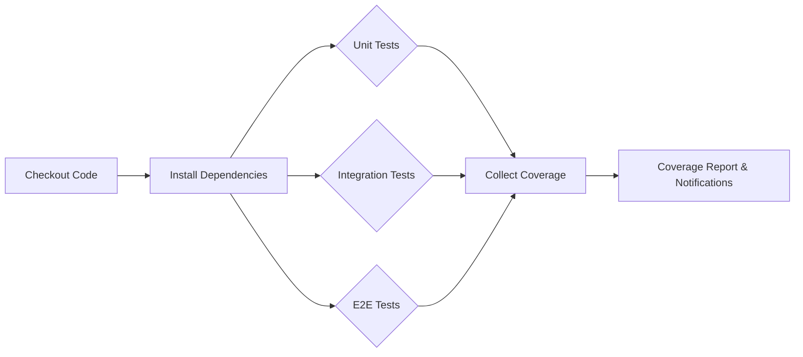
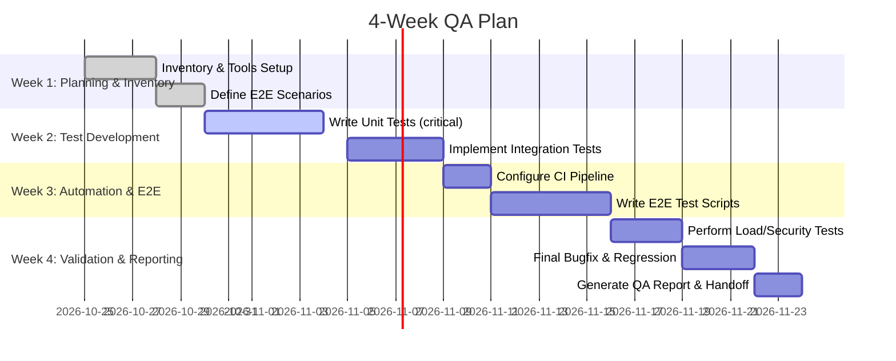

# QA Strategy and Plan for Quveta (15-Module Event App)

**Executive Summary:** This QA plan defines a rigorous, traceable approach for validating Quveta’s full stack. We begin by **inventorying** implemented modules (01–15) via source artifacts (code directories, API routes, migrations, CI scripts).  Core **end-to-end (E2E) user journeys** are documented step-by-step, covering key flows (e.g. event creation → planning → budgeting → final report) with expected results and rollback points.  A **test matrix** maps unit, integration, and E2E tests against modules and acceptance criteria, prioritising critical paths (login, core planning workflows).  Test data strategy includes deterministic fixtures, mock AI/provider calls, and idempotency keys.  Automation covers CI pipelines (parallel test jobs, reporting) and safeguards for flaky tests.  **Performance/security/accessibility** checks are specified (e.g. load testing benchmarks, OWASP Top10 scans, WCAG compliance).  A **release checklist** ensures migration tests, smoke tests, and rollback plans.  **Monitoring/observability** metrics (KPIs, error rates, SLO alerts) and log-based diagnostics (per SRE practices) are defined.  Finally, we outline a **test execution timeline** (4-week plan) and deliverables (test suites, CI configs, reports). This plan aligns with best practices: prioritise high-impact journeys, keep tests independent, and ground all QA in Quveta’s actual data and flows.

## 1. Inventory of Modules and Artifacts

**Identify implemented modules:** Scan the code repository for evidence of each module. For example, verify folders or files under `/modules` or `/features` named *dashboard, event-setup, ai-planning, budget, budget-simulator, tasks, vendors, event-day, guest, seating, invitations, insights, notifications, reports, settings* (Modules 01–15).  Check `package.json` or CI scripts for included module names or scripts.  Within each module directory, note key files (controllers, services, schemas, migrations, tests).

**API routes and endpoints:** Inspect server routes (Express/Koa route files or API definitions) to list endpoints per module (e.g. `/api/events`, `/api/budget`, `/api/vendors`). Verify route registration in main app. Ensure that each “owner module” exposes its resources (per prompt’s ownership rules). Also check GraphQL schema if used.

**Database schema and migrations:** Review ORM models or SQL migration files. For example, look for tables like `events`, `budgets`, `tasks`, `vendors`, `quotations`, `guests`, `invitations`, `seating_plans`, `notifications`, etc. Confirm fields match prompt (e.g. guest RSVP fields, quotation status). Ensure foreign keys reflect module ownership (event_id, vendor_id, etc).  

**CI/CD workflows:** Examine CI configuration (e.g. `.github/workflows/*.yml`, `Jenkinsfile`, etc). Identify jobs for linting, building, testing. Note commands for running tests (e.g. `npm test`, `pytest`). Check for test coverage reporting and deployment steps.

**Existing tests:** Inspect test directories (e.g. `/tests/unit`, `/tests/integration`, `/tests/e2e`). Determine coverage per module. Identify missing tests (e.g. if no tests exist for a module’s routes or services). Use tools like coverage reports or `grep` for “describe(” to count test files. 

**Artifacts to inspect:**  
- **Code:** All module directories and source files.  
- **Routes:** API/router files.  
- **Schemas/Migrations:** DB migrations or ORM entity definitions.  
- **Tests:** Existing test files (unit, integration, E2E).  
- **CI config:** Workflow YAMLs, build logs.  
- **Package files:** `package.json`, Dockerfiles, environment configs (for build/test commands).  
- **Documentation:** Any design docs or API specs that clarify expected behavior.

## 2. Core End-to-End User Journeys

Define realistic multi-step scenarios for each major workflow. For each, list preconditions, user actions, expected outcomes, and rollback or error-check points. For example:

- **Event Setup to Planning:** *Pre:* Authenticated user with no event. *Flow:* Create new event with date/location → Run AI planning → Accept/modify plan → Save plan. *Checks:* Dashboard shows new event, event details match input, AI plan items appear in tasks. *Errors:* AI failure should show message without blocking event creation.  (Rollback: user can delete incomplete event or retry AI).

- **Budgeting Workflow:** *Pre:* Event created. *Flow:* Add budget line item(s) → Trigger adaptive scenario (increase headcount) → Review scenario suggestions → Approve scenario → Check budget updates. *Checks:* Budget totals update correctly, no double-counted expenses, scenario preserved in audit log. *Recovery:* On conflict (e.g. currency mismatch) error prompts and user can adjust inputs.

- **Task & Timeline:** *Pre:* Budget approved. *Flow:* Create tasks with dependencies → Mark a task in-progress → Complete it → Verify dependent tasks unblock. *Checks:* Timeline and dashboard reflect statuses, notifications for overdue tasks. 

- **Vendor & Quotation:** *Pre:* Event requirements exist. *Flow:* Add vendor and request quotation → Receive quotation (manual entry) → Compare quotations → Accept one → Link to budget. *Checks:* Vendor record saved, quotation details stored, budget line updated from quotation, prior estimate replaced. *Rollback:* Changing an accepted quotation creates revision, older version preserved.

- **Guest & RSVP:** *Pre:* Event and guest list prepared. *Flow:* Import guest CSV (with families) → Send invitations (or prepare drafts) → Record RSVPs (simulate mix of responses) → Update attendance. *Checks:* Guest counts (confirmed/tentative/declined) match entries, household handling correct, dietary notes accounted. *Recovery:* Duplicate guests flagged, can resolve conflicts manually.

- **Seating Planner:** *Pre:* Confirmed guest list, venue setup defined. *Flow:* Define tables with capacities → Assign guests (manual or AI-assisted) → Detect overcapacity or accessibility issues → Approve layout. *Checks:* No table exceeds capacity, accessibility constraints satisfied (flag otherwise). *Rollback:* Change in RSVPs triggers flag on affected assignments.

- **Invitations & Communications:** *Pre:* Event and guests exist. *Flow:* Create invitation draft with placeholders → Personalize to sample guest → Send via email integration (or simulate) → Track bounce or delivery → Schedule reminder to non-responders. *Checks:* Messages include correct event details, RSVP links valid, delivery status logged. *Recovery:* On provider failure, user can retry or export messages manually.

- **Event-Day & Reports:** *Pre:* All planning done. *Flow:* Generate run sheet → Mark activities in progress and record delays → Report an incident (e.g. vendor delay) → Adjust schedule (with approval). *Checks:* Run sheet shows actual vs planned times, incident log created, schedule revision requires confirmation. *Rollback:* If AI suggestion applied incorrectly, user can revert to last approved schedule.

- **AI Insights & Notifications:** *Pre:* Ongoing event plan. *Flow:* Ask AI “which tasks are urgent?” → Validate answer cites actual overdue tasks. *Checks:* AI answers grounded in real data, not hallucinated. Trigger notifications (e.g. RSVP deadline soon) → Dismiss or resolve them. *Recovery:* If AI/API down, system shows fallback that core data remains accessible.

Each scenario should be codified in Gherkin-like steps or test cases, with clear expected results and evidence sources.

## 3. Test Matrix and Coverage

| Module / Test Type        | Unit Tests (fast, isolated) | Integration Tests (services + DB/API) | E2E Tests (full user flows) | Priority (H/M/L) |
|---------------------------|-----------------------------|---------------------------------------|-----------------------------|-----------------|
| **01. Dashboard**         | Load and calculate summary metrics (DB mocks) | Query summaries vs real DB state | E.g. after plan update, dashboard shows new values | H               |
| **02. Event Setup**       | Validation of input, default event props | API create/edit event workflows  | Create event, verify all modules update | H |
| **03. AI Planning**       | Validate recommendation logic, error handling (mock AI) | API calls stubbed AI response | Submit planning request, review output, ensure revisions saved | M |
| **04. Budget Mgmt**       | Calculation functions (currency, totals) | DB interactions, line-item creation | Modify budget, simulate scenario, confirm totals match | H |
| **05. Budget Simulator**  | Scenario math, approval logic | Integration with budget data | Run scenario, approve change, verify budget update | M |
| **06. Tasks/Timeline**    | Task dependency logic (unit-check) | Blocked/unblocked status via API | Create tasks, mark done, auto-unblock, check timeline order | H |
| **07. Vendor/Quotation**  | Price calc utility, status transitions | Link with budget line items, CRUD APIs | Enter quotations, compare, accept, link to budget | M |
| **08. Run Sheet**        | Schedule conflict detection | Import tasks to run-sheet, status updates | Full-day coordination: start/complete tasks, delay, incident | H |
| **09. Guest/RSVP**       | Counting algorithms (attendance) | RSVP record updates via API | Import guests, simulate RSVPs, check attendance summary | H |
| **10. Seating Planner**   | Capacity and constraint checks | Assignments with DB lookup | Assign guests, generate AI plan, detect overcapacity | M |
| **11. Invitations**       | Template rendering (placeholder logic) | Campaign send (mock SMTP) | Draft + send invites, track RSVP links | M |
| **12. AI Insights**       | Answer parsing logic (validate refs) | NA (mostly stubbed AI) | Ask insight questions, apply proposed action after confirmation | M |
| **13. Notifications**     | Trigger logic (unit tests for events) | Reminders scheduler, rule engine | Condition: overdue tasks → in-app notif appears | M |
| **14. Reports/Exports**   | Data formatting (PDF/CSV generation) | Multi-module data assembly | Generate PDFs/CSV, verify content accuracy | L |
| **15. Settings/Security** | Preference read/write | Authz on resources | Test login, access control (e.g. user A can’t see user B’s event) | H |

- **Priority:** High (H) for core flows (events, budget, tasks), Medium (M) for supportive features, Low (L) for documentation exports.
- Each test should measure pass/fail. Track metrics: % coverage, test durations, CI success rate.
- *Unit tests* run on every build; *integration tests* (API + DB) run on merges; *E2E tests* run nightly or on key branches.

*Pass/Fail metrics to collect:* Test coverage % (target e.g. ≥80%), number of failing tests, flakiness rate, mean time to fix failures.

## 4. Test Data Strategy

- **Fixtures and seed data:** Use dedicated test fixtures for events, users, budgets, etc. For example, set up known events in a test DB. Use libraries (e.g. FactoryBot, pytest fixtures) to generate repeatable data. Keep random data to a minimum to maintain determinism.
- **Mocking external services:** Replace live AI or email/SMS services with mocks or stubs. For instance, use an HTTP mock (e.g. MSW, nock) to simulate AI provider responses during tests. Tag real integrations behind flags so CI can switch to a sandbox mode.
- **Sensitive data:** Use synthetic PII or anonymize. Store secrets (API keys) in CI as encrypted env vars (not in code). Avoid real contact data in tests. 
- **Idempotency keys:** For APIs that use idempotency (e.g. creating bookings), include deterministic keys in tests to prevent duplicate creation on retries.
- **Database state:** Reset DB between tests or use transactions. For integration tests, use a separate test database and clear relevant tables.
- **Edge cases:** Include test data for currency differences (e.g. USD vs EUR), incomplete quotations (null tax), and outdated invites.

## 5. Automation & CI Integration

- **Test runners:** Use existing frameworks (e.g. Jest/Mocha for unit, Supertest/RestAssured for API integration, Cypress/Playwright for E2E). If none mandated, default to popular tools (Jest + Testing Library, Cypress).
- **CI commands:** Example (in GitHub Actions or Jenkinsfile):
  ```yaml
  steps:
    - checkout
    - run: npm ci
    - run: npm test:unit   # run all unit tests
    - run: npm test:integration  # API+DB tests
    - run: npm run lint
    - run: npm run build # if needed
    - name: Cypress E2E
      run: npm run test:e2e # possibly on merge to main or nightly
  ```
- **Parallelization:** Split test suites across multiple CI agents or use Jest’s `--runInBand` vs parallel workers. For large test suites, use `pytest-xdist` or Jest’s `--maxWorkers`.
- **Flaky tests:** Tag or quarantine any non-deterministic tests (e.g. network timeouts). Implement retry logic (e.g. `jest.retryTimes()`). Monitor flakiness and fix root causes.
- **Environment variables:** Manage in CI (database URLs, feature flags). Use a `.env.test` file or CI secrets store.
- **Test reporting:** Output in JUnit or similar format for CI dashboards. Include coverage reports (e.g. Cobertura) for assessing progress.
- **Mock vs Live provider:** By default, CI mocks AI or email services. In a special pipeline (e.g. `--env RUN_LIVE_TESTS=true`), run a subset of tests with real providers (mark these as slow or nightly).
- **CI flow:** Embed a mermaid flowchart of the test pipeline. For example:



## 6. Performance, Security, Accessibility & Privacy Checks

- **Performance:** Define load-testing scenarios (e.g. simulate 1000 concurrent users creating events or generating reports). Use tools like k6 or JMeter. Key metrics: response time percentiles, throughput. Set thresholds (e.g. 95% of requests <200ms under load). Check memory/CPU usage. Also run stress tests to find breaking points.
- **Security:** Follow OWASP guidelines. Tests include:
  - **Static analysis:** SAST or ESLint security plugins. 
  - **Dependency scanning:** e.g. `npm audit`, OWASP Dependency-Check.
  - **Dynamic scans:** Automated pentest tools (OWASP ZAP in CI) to catch SQLi, XSS, auth bypass. 
  - **Penetration tests:** Manual or automated pen-tests on auth and data flows.
- **Privacy/Data Protection:** Ensure PII fields are encrypted at rest (if applicable) and sanitized in outputs. Test that API excludes sensitive fields (e.g. by asserting responses lack internal notes). Verify GDPR requirements like data export/delete workflows if implemented.
- **Accessibility:** Use automated linters (axe-core, Pa11y) on critical screens. For example, check that all forms have labels, images have alt text, color contrast meets WCAG. (W3C encourages early accessibility evaluation.) Include one or two manual checks with screen readers on key pages.
- **Regression:** Include non-regression tests (smoke tests) for critical features. After any code change, run a smoke suite verifying login, basic navigation, data retrieval.

## 7. Regression & Release Checklist

- **Pre-merge gating:** Pull requests must pass all unit and integration tests. Critical code paths covered by CI.
- **Migration verification:** After DB schema changes, run migration scripts against a copy of production-like DB. Add tests for any new migrations.
- **Smoke tests:** Before release, deploy to staging and run minimal sanity tests (e.g. authenticate, create entity, verify major workflow).
- **Rollback plan:** For each migration or deployment, have a rollback SQL script. Test rollback on staging. For code, maintain last stable version with backups of DB.
- **Feature flags:** For risky features (AI, notifications), use toggles so they can be disabled post-release if needed.
- **Release notes:** Document changes and known issues in QA report. Ensure all blocked items are resolved or flagged.

## 8. Observability & Monitoring

- **Metrics & Alerts:** Instrument key events (login count, RSVP rate, API errors) as counters/gauges. Use Prometheus/Grafana. Define SLOs (e.g. 99.9% uptime, error rate <0.1%). Set alerts on anomalies: e.g. 5xx spikes, CPU >80%. Per SRE guidance, use metrics for real-time alerts and logs for root-cause analysis.
- **Log aggregation:** Centralize logs (ELK or Cloud watch). Include structured logs with context (userID, eventID). Monitor for exceptions or slow queries.
- **Incident playbooks:** For common failures (payment declines, email bounces), document steps to triage. For example, on high error rate alert: check deploy logs, revert last change if recent.
- **User-facing monitoring:** Track UI errors (e.g. via Sentry). If E2E fails in production, alert on public monitors (Selenium/Montoringless).
- **Post-release health checks:** Monitor tasks like nightly database backups, external API connectivity. Ensure backup success/failure alerts.

## 9. Test Execution Plan & Timeline

We propose a **4-week QA schedule**, iterating in sprints:



Milestones: test completion of each module, CI integration, and final report. Resources: assume at least one QA engineer and developer collaboration.

## 10. Deliverables

- **Test Scripts/Code:** Checked into version control. Organized by unit, integration, E2E. 
- **CI Config:** Sample workflow files with test steps (no secrets). 
- **Test Data:** Fixture files, factory definitions, mock server scripts. 
- **Test Reports:** CI output in JUnit/Cobertura, plus manual QA report summarizing coverage and defects. 
- **Bug Triage Process:** Template for logging issues (repro steps, severity, module). Document workflow (e.g. GitHub issues with labels).
- **Final QA Report:** This comprehensive document plus summary of executed tests and results.
- **Flow Diagrams:** (e.g. CI pipeline flowchart above). 
- **Policies:** Written policies for flaky tests, release criteria, and access controls as implemented.

All output should be versioned and peer-reviewed. Key coverage targets: aim >90% for business logic (modules 01–09), >70% for UI/E2E flows.  

**Sources:** We align with industry best practices: mapping tests to real user flows and modules, automating tests in CI/CD, and validating accessibility early. This ensures Quveta’s QA is thorough, automated, and maintainable.