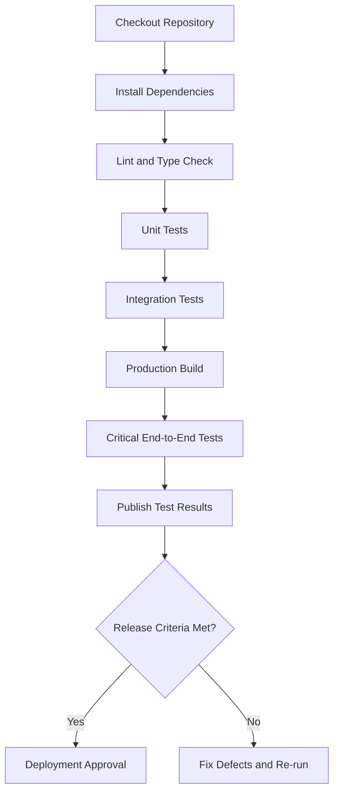

# Quveta — QA Strategy and Test Plan

**Project:** Quveta — AI-Powered Event Planner  
**Scope:** Modules 01–15  
**Document type:** Quality Assurance Strategy, Test Plan, and Release Checklist  
**Status:** Proposed plan — execution evidence pending

---

## 1. Executive Summary

This document defines a systematic approach to validating Quveta as a complete, integrated event-planning web application.

Quveta's core functionality spans event setup, AI-generated planning, budget management, adaptive budget simulation, task and timeline management, vendor quotations, event-day coordination, guest management, seating, invitations, AI insights, notifications, reports, and security settings.

Quality assurance must verify that these features work individually and together, use real persisted data, protect private information, and preserve user control over important changes.

The QA process will:

- Inventory the actual implementation before testing.
- Identify missing features and incomplete integrations.
- Define unit, integration, end-to-end, security, and accessibility tests.
- Validate the adaptive budget simulator as Quveta's main differentiator.
- Test realistic user journeys from event creation to report generation.
- Verify deployment configuration and production readiness.
- Record evidence, defects, and remaining risks honestly.

**Important:** No test should be marked as passed unless it has actually been executed and its result recorded. Planned checks, hypothetical thresholds, and expected outcomes must not be represented as verified results.

## 2. QA Objectives

The primary objectives are:

1. Verify functional correctness across implemented modules.
2. Confirm that data persists and remains consistent across the application.
3. Validate budget calculations and approved scenario changes.
4. Prevent unauthorized access to events, guests, quotations, and reports.
5. Ensure AI-generated recommendations are validated and do not bypass user approval.
6. Verify error handling when AI providers or external services fail.
7. Check responsive behavior and accessibility.
8. Confirm that exports reflect authoritative application data.
9. Validate deployment configuration and essential production workflows.
10. Produce a traceable QA report with actual results and known limitations.

## 3. Module Inventory

Before writing new tests, inspect the actual repository, database schema, API routes, configuration, and existing tests.

Do not assume the planned modules are fully implemented.

| Module | Area | Primary QA focus |
|---|---|---|
| 01 | Dashboard | Accurate summaries, real persisted data, empty states |
| 02 | Event Setup | Validation, persistence, edits, date and timezone handling |
| 03 | AI Planning | Structured output, validation, provider failure, proposal approval |
| 04 | Budget Management | Arithmetic, currency handling, financial status consistency |
| 05 | Adaptive Budget Simulator | Scenario accuracy, trade-offs, approval and rollback safety |
| 06 | Tasks and Timeline | Dependencies, deadlines, scheduling, blocked tasks |
| 07 | Vendors and Quotations | Quotation accuracy, status transitions, budget integration |
| 08 | Event-Day Run Sheet | Approved schedules, delays, incidents, revisions |
| 09 | Guest Management | RSVP counts, guest records, privacy, import/export |
| 10 | Seating Planner | Table capacity, duplicate assignments, seating conflicts |
| 11 | Invitations and Communications | Drafting, approval, provider status, RSVP links |
| 12 | AI Insights | Grounded answers, authorized context, safe action proposals |
| 13 | Notifications and Automation | Trigger accuracy, deduplication, retry behavior |
| 14 | Reports and Exports | Data accuracy, format correctness, access control |
| 15 | Settings and Security | Authentication, authorization, preferences, integration integrity |

For every module, record:

- Implemented features.
- Source files and services.
- Database tables and migrations.
- API routes.
- Existing automated tests.
- Known defects.
- Dependencies on other modules.
- Missing functionality.

Use the existing project architecture and testing framework rather than introducing replacements without justification.

## 4. Core End-to-End Test Scenarios

### 4.1 Event Creation and AI Planning

**Preconditions:** A valid test user can access the application.

**Steps:**
1. Create an event with a name, type, date, guest count, currency, and budget.
2. Save the event.
3. Confirm that the event appears on the dashboard.
4. Request an AI-generated plan.
5. Inspect the proposal and its assumptions.
6. Approve or modify selected recommendations.
7. Reopen the event and verify persistence.

**Expected results:**
- Event details match the submitted values.
- Dashboard information reflects saved records.
- AI output is validated before being accepted.
- Approved and proposed content remain distinguishable.
- AI failure does not delete or invalidate the event.

### 4.2 Budget Management

**Steps:**
1. Add several budget line items.
2. Include estimated, quoted, committed, and paid items where supported.
3. Check category totals and overall expenditure.
4. Change the budget target.
5. Review the remaining budget or overrun.
6. Reload the page and verify the values.

**Expected results:**
- Financial totals match the authoritative budget service.
- Statuses are not double-counted.
- Different currencies are not added together without verified conversion.
- Changing the target does not silently delete or reduce existing items.
- Missing values are not treated as confirmed zero-cost items unless the business rules explicitly require it.

### 4.3 Adaptive Budget Simulator — Critical Path

This is a high-priority test because adaptive planning is Quveta's main differentiator.

**Steps:**
1. Create an event with a known budget, guest count, and line items.
2. Record the current budget and plan state.
3. Reduce the budget or increase the guest count.
4. Request an alternative scenario.
5. Review the proposed category changes and trade-offs.
6. Reject one recommendation.
7. Accept a different recommendation.
8. Recalculate the combined scenario.
9. Approve the scenario.
10. Verify the updated budget and related views.
11. Attempt to apply a stale scenario after the underlying budget has changed.

**Expected results:**
- Scenario calculations use authoritative budget data.
- Fixed and variable costs are treated according to their recorded cost models.
- Estimates are labeled and vendor facts are not fabricated.
- Recommendations explain meaningful trade-offs.
- Rejected recommendations are not applied.
- No approved data changes before confirmation.
- Approval updates the appropriate records consistently.
- Stale scenarios are detected or revalidated.
- The original plan or its history remains available where versioning is supported.

### 4.4 Tasks and Timeline

**Steps:**
1. Create tasks with different priorities and deadlines.
2. Add task dependencies.
3. Attempt to create a circular dependency.
4. Complete a prerequisite task.
5. Simulate a delay to an important task.
6. Review the impact analysis.
7. Approve or reject a proposed schedule revision.

**Expected results:**
- Invalid dependency cycles are rejected.
- Task statuses persist.
- Timeline calculations use the correct timezone.
- Impacted tasks are identified accurately.
- Proposed changes do not silently overwrite the approved schedule.

### 4.5 Vendor and Quotation Management

**Steps:**
1. Create vendor records.
2. Record multiple quotations.
3. Include incomplete quotation details where applicable.
4. Compare the quotations.
5. Select a quotation or update its status.
6. Link it to the appropriate budget item.
7. Review the budget report.

**Expected results:**
- Quotation details remain faithful to the entered records.
- Missing prices and terms are not invented.
- Booking status reflects actual saved information.
- Linked quotations and budget entries are not double-counted.
- Relevant changes appear in reports.

### 4.6 Guest Management and Seating

**Steps:**
1. Add guests or import a valid test CSV.
2. Include household or group records if supported.
3. Record accepted, tentative, and declined responses.
4. Create tables with defined capacities.
5. Assign guests to tables.
6. Attempt duplicate assignments or overcapacity.
7. Change an RSVP and inspect the seating plan.

**Expected results:**
- Attendance counts follow Module 09's rules.
- Invitation delivery is not treated as an RSVP.
- Table capacities are enforced.
- Conflicts are flagged after relevant changes.
- Guest contact, dietary, and accessibility information is protected.

### 4.7 Invitations and Notifications

**Steps:**
1. Create an invitation draft.
2. Preview personalized content.
3. Approve it.
4. Exercise the actual provider integration if configured, or use an explicitly identified test double.
5. Trigger a reminder condition.
6. Retry a simulated failure.
7. Inspect communication and notification histories.

**Expected results:**
- Drafting, approval, sending, and delivery statuses remain distinct.
- A simulated provider does not masquerade as a real send.
- Retries do not create unintended duplicate side effects.
- Notifications correspond to real events and follow user preferences.
- Failures are visible and recoverable.

### 4.8 Event-Day Run Sheet

**Steps:**
1. Generate the run sheet from saved event data and approved tasks.
2. Record an operational incident.
3. Introduce a delay.
4. Review affected activities.
5. Approve a revised schedule if appropriate.
6. Generate a new run sheet.

**Expected results:**
- The original and revised schedules remain distinguishable.
- Recorded incidents and actual times are preserved.
- Unapproved schedule changes do not become official.
- The run sheet uses real task and vendor records.

### 4.9 AI Insights

**Steps:**
1. Ask which tasks are overdue.
2. Compare the answer with actual task records.
3. Ask for budget risks.
4. Verify referenced financial figures.
5. Request an action that would modify the plan.
6. Confirm that explicit approval is required when appropriate.
7. Simulate AI provider failure.

**Expected results:**
- Answers are grounded in current, authorized records.
- Calculations come from authoritative services.
- Proposed actions are validated and allowlisted.
- The AI cannot access another user's event data.
- Core saved information remains available during provider failure.

### 4.10 Reports and Exports

**Steps:**
1. Generate an event overview.
2. Generate a budget report.
3. Export a task checklist.
4. Export a guest list using authorized test data.
5. Generate a seating report and event-day run sheet.
6. Inspect CSV escaping and spreadsheet formula-injection protection.
7. Attempt to access a report belonging to another user.

**Expected results:**
- Reports match the source records.
- Currency and financial statuses are represented correctly.
- Missing information is identified honestly.
- Sensitive fields are excluded unless needed and authorized.
- Unsupported formats are not advertised as working.
- Unauthorized downloads are rejected.

## 5. Test Types and Coverage Matrix

### Unit tests

Test isolated business logic, including:

- Budget calculations and currency precision.
- Scenario comparison and approval rules.
- Event and preference validation.
- Task dependency validation.
- Date and timezone calculations.
- RSVP and attendance counts.
- Seating capacity checks.
- Notification trigger logic.
- Report formatting and CSV escaping.
- Authorization policy helpers where suitable.

### Integration tests

Test module boundaries and interactions, including:

- API and database persistence.
- Event creation and dashboard aggregation.
- Budget and quotation integration.
- Scenario approval and budget updates.
- Task and run-sheet consistency.
- RSVP changes and seating conflicts.
- Notifications and background jobs.
- Reports and source-module calculations.
- Authentication and private storage access.

### End-to-end tests

Automate the most important user journeys using the existing browser-testing framework, if available.

Prioritize:
1. Sign-in and event creation.
2. AI plan generation and approval.
3. Budget editing and adaptive simulation.
4. Task scheduling and delay handling.
5. Vendor quotation and budget integration.
6. Guest, RSVP, and seating workflows.
7. Run-sheet generation.
8. Reports and downloads.
9. Unauthorized access prevention.
10. Recovery from AI or provider failure.

### Suggested priority levels

- **P0 — Release blocker:** Security vulnerabilities, data loss, incorrect financial calculations, unauthorized access, or broken core user journeys.
- **P1 — High:** Major workflow failures, invalid state transitions, or significant data inconsistencies.
- **P2 — Medium:** Important usability or secondary feature defects with workarounds.
- **P3 — Low:** Minor visual issues or non-critical enhancements.

These priorities are proposed guidelines. Assign final severity based on the actual impact and risk of each defect.

## 6. Test Data and External Services

Use dedicated synthetic test data.

Include:
- Events with different dates and guest counts.
- Budgets with known, manually verifiable totals.
- Multiple currencies.
- Incomplete vendor quotations.
- Different RSVP statuses.
- Seating arrangements with capacity limits.
- Overdue and blocked tasks.
- Missing optional fields.
- AI responses that are valid, malformed, incomplete, or unavailable.

Mock AI, email, and messaging providers in ordinary automated tests where practical.

Test actual external integrations separately using authorized sandbox accounts or controlled environments.

Never use real guest contact details or production personal data in automated tests.

Use a separate test database. Reset test state safely between test cases, and ensure test operations cannot modify production data.

## 7. Build and Test Automation

Inspect the repository to discover the actual package manager, framework, and available scripts.

Run the appropriate existing commands for:

- Dependency installation or validation.
- Linting.
- Static type checking.
- Unit tests.
- Integration tests.
- End-to-end tests.
- Production build.
- Database migration validation.
- Security and dependency scanning, where available.

Do not assume commands such as `npm test` or a particular test framework exist until the project has been inspected.

If automation is missing, add only the smallest useful configuration compatible with the existing stack.

A proposed CI flow is:

The diagram describes the intended workflow, not a claim that this pipeline already exists.

## 8. Security and Privacy Validation

Test the following areas:

- Authentication enforcement.
- Resource-level authorization.
- Cross-user and cross-event isolation.
- Session expiration and sign-out.
- Server-side input validation.
- Safe database queries.
- Output encoding and unsafe HTML handling.
- Rate limiting on expensive operations.
- CORS and CSRF protections appropriate to the architecture.
- Private file and export access.
- Sensitive-data exposure through API responses and logs.
- Secret management and environment configuration.
- Dependency vulnerabilities.
- AI prompt-injection resistance and authorization boundaries.

For database-backed systems, inspect row-level security policies where supported.

Verify that private guest data, vendor contacts, financial information, and AI context are not unnecessarily exposed.

Run automated security tools only where appropriate, and record their actual output. Automated scanning alone is not proof of complete security.

## 9. Performance and Reliability

Identify the operations most likely to become expensive:

- Dashboard aggregation.
- AI plan generation.
- Adaptive budget simulation.
- Large guest-list operations.
- Report and PDF generation.
- Background notifications.
- Multi-module data retrieval.

Measure actual performance before setting release thresholds.

Evaluate:
- Response-time percentiles.
- Error rates.
- Memory and CPU use where observable.
- Database query performance.
- Large-export behavior.
- Timeout handling.
- Retry and duplicate-operation safety.

Suggested performance targets should be set only after considering the deployment environment, expected usage, and product requirements. Do not claim a load test passed unless it was run with documented parameters and results.

## 10. Accessibility and Responsive UI

Check the principal workflows on desktop, tablet, and mobile-sized viewports.

Validate:
- Keyboard navigation.
- Visible focus indicators.
- Form labels and validation messages.
- Dialog behavior.
- Accessible names for buttons and controls.
- Screen-reader announcements for errors and status changes.
- Contrast and status indicators.
- Tables and charts.
- Responsive layouts and navigation.
- Loading, empty, and error states.

Use automated accessibility checks where available, supplemented by manual keyboard and screen-reader checks for important journeys.

Aim for WCAG 2.2 AA-oriented behavior, but do not claim formal conformance without an appropriate evaluation.

## 11. Regression and Release Checklist

Before release, verify:

- [ ] Existing features still work after QA fixes.
- [ ] Critical unit tests pass.
- [ ] Relevant integration tests pass.
- [ ] Critical end-to-end journeys pass.
- [ ] Production build completes successfully.
- [ ] Database migrations have been validated in a safe environment.
- [ ] Authentication and authorization tests pass.
- [ ] Budget totals match their source calculations.
- [ ] Scenario approval preserves user control.
- [ ] Guest and vendor data remain private.
- [ ] Reports and exports contain accurate data.
- [ ] AI and provider failures are handled safely.
- [ ] Responsive and accessibility checks are recorded.
- [ ] Required environment variables are documented.
- [ ] No secrets are committed to the repository.
- [ ] Deployment configuration has been reviewed.
- [ ] Smoke tests are defined for the deployed environment.
- [ ] Known limitations and release risks are documented.
- [ ] A recovery or rollback approach exists for relevant changes.

A checked box should mean the corresponding verification was actually performed.

## 12. Deployment Validation

Inspect the actual deployment platform and configuration before making changes.

Verify:
- Frontend and backend build commands.
- Required environment variables.
- Database connection and migration strategy.
- Production API URLs and CORS settings.
- Authentication callback and redirect URLs.
- AI provider configuration and server-side secret handling.
- Private storage and export permissions.
- Background job execution, if applicable.
- HTTPS and production cookie settings, where relevant.
- Health checks and error logging.
- Recovery procedures for failed deployments.

After deployment, execute a small smoke-test suite against the actual deployed environment.

Do not invent a live URL or claim that deployment succeeded without evidence.

Do not expose production credentials or secrets in logs, documentation, screenshots, or the QA report.

## 13. Monitoring and Operational Readiness

If monitoring is configured, verify that it captures useful, privacy-conscious information.

Potential signals include:
- Application errors.
- API failure rates.
- AI provider errors and timeouts.
- Background job failures.
- Export failures.
- Database connectivity.
- Authentication failures.
- Resource usage.

Avoid logging session tokens, secrets, full guest profiles, or unnecessary personal information.

Document how to investigate a failed operation and how to recover from common issues.

Monitoring tools and service-level objectives are recommendations until they have been selected and implemented.

## 14. Competition Demo Readiness

Quveta's demo should demonstrate a complete, realistic workflow rather than a collection of disconnected screens.

Recommended demonstration:

1. Create an event with a defined date, guest count, and budget.
2. Generate a personalized planning proposal.
3. Review the initial budget and tasks.
4. Change the budget or guest count.
5. Demonstrate the adaptive simulator's proposed trade-offs.
6. Reject one recommendation and accept another.
7. Approve the scenario and verify the saved results.
8. Show how an important delay affects dependent tasks.
9. Review a vendor quotation without inventing availability.
10. Generate a useful event-day run sheet or report.
11. Show the relevant data persists after navigation or refresh.

Before recording:
- Use synthetic demo data.
- Verify the workflow on the actual build.
- Prepare a recovery path if the AI provider fails.
- Avoid exposing credentials or private information.
- Clearly distinguish simulated integrations from real integrations.
- Do not claim unimplemented capabilities.

The strongest demo should make Quveta's differentiator clear: **it adapts an existing event plan to changing constraints while keeping the organizer in control.**

## 15. Proposed Execution Schedule

The following is an optional four-stage plan. It is not a statement of completed work or a fixed delivery commitment.

### Stage 1 — Inventory and critical-path review
- Inspect implemented modules.
- Identify the current test tools and commands.
- Map key user journeys.
- Record missing features and release blockers.

### Stage 2 — Functional and integration testing
- Validate budget calculations.
- Test adaptive scenarios and approval.
- Verify task dependencies and schedule changes.
- Validate guest, seating, vendor, and report integration.

### Stage 3 — Security, accessibility, and regression
- Test authorization and data isolation.
- Check error handling and external-service failures.
- Run responsive and accessibility checks.
- Fix and retest defects.

### Stage 4 — Deployment and evidence-based reporting
- Validate production configuration.
- Run deployment smoke tests.
- Review remaining risks.
- Prepare the final QA report and demo checklist.

Adjust the schedule to the repository's actual state and available time.

## 16. Defect Tracking Template

For each issue, record:

- **ID:**
- **Title:**
- **Module:**
- **Severity:** P0 / P1 / P2 / P3
- **Environment:**
- **Preconditions:**
- **Steps to reproduce:**
- **Expected result:**
- **Actual result:**
- **Evidence:** Logs, screenshots, test output, or relevant file references
- **Impact:**
- **Root cause:** If established
- **Fix:**
- **Regression test:**
- **Verification status:**

Do not mark a defect as fixed until the relevant behavior has been retested.

## 17. Final QA Report Template

Complete this section after the tests have actually run.

### Environment
- Repository revision:
- Runtime and framework versions:
- Test environment:
- Database and migration status:
- Deployment environment:

### Test execution results

| Check | Status | Evidence |
|---|---|---|
| Repository and module inventory | Pending | |
| Lint | Pending | |
| Type check | Pending | |
| Unit tests | Pending | |
| Integration tests | Pending | |
| End-to-end tests | Pending | |
| Adaptive budget simulator | Pending | |
| Security and authorization | Pending | |
| Accessibility and responsive UI | Pending | |
| Export validation | Pending | |
| Production build | Pending | |
| Deployment smoke tests | Pending | |

Use `Passed`, `Failed`, `Blocked`, `Not run`, or `Not applicable` as appropriate. Replace `Pending` only when there is evidence supporting the result.

### Defect summary
- Release blockers:
- High-priority defects:
- Medium-priority defects:
- Low-priority defects:
- Fixes verified:

### Remaining risks
- Incomplete functionality:
- Untested integrations:
- Security concerns:
- Performance concerns:
- Deployment limitations:

### Release recommendation
Choose one after reviewing the evidence:

- **Ready for release:** Required checks passed and no unacceptable release blockers remain.
- **Ready with documented limitations:** Remaining issues are understood and explicitly accepted.
- **Not ready:** Important failures or unresolved risks prevent safe release.

Do not select a status before reviewing the actual results.

## 18. Final Instructions for Antigravity

Use this document as the QA execution plan.

1. Inspect the real repository before changing code.
2. Identify implemented behavior rather than assuming all 15 modules are complete.
3. Reuse the existing stack, architecture, and test framework.
4. Run the available checks and record their actual results.
5. Prioritize security, data integrity, and the adaptive budget simulator.
6. Fix verified defects with focused changes.
7. Add regression tests for corrected defects.
8. Rerun affected checks after changes.
9. Never fabricate test output, coverage percentages, deployment URLs, or successful integrations.
10. Distinguish completed verification from planned work.
11. Report exact files changed and commands executed.
12. Document remaining limitations and release risks.

**Definition of success:** Quveta's important user journeys work with real persisted data, financial calculations remain correct, AI proposals respect user approval, private information stays protected, and the final QA report is backed by verifiable evidence.